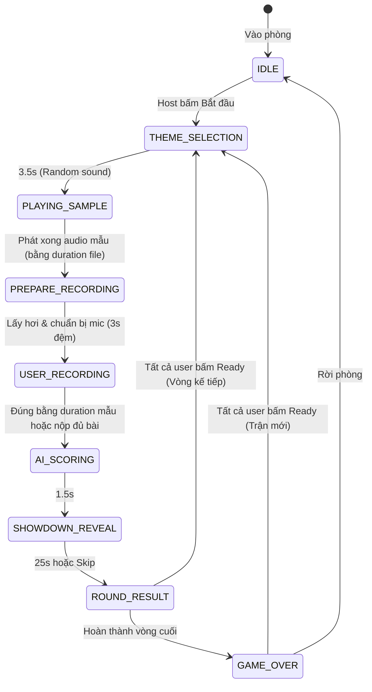

# 📘 Tài Liệu Kỹ Thuật & Đặc Tả Socket Server (MicMixFun & Mimic Party)

Tài liệu đặc tả toàn bộ kiến trúc vận hành, danh mục hằng số (constants), quy định kích thước/thời lượng âm thanh, REST API và giao thức Socket.IO hai chiều phục vụ ứng dụng Android và Web.

---

## 1. ⚙️ Danh Mục Hằng Số Kỹ Thuật (System Constants)

### 1.1. Thời Gian & Vòng Đấu (Timings & Durations)

| Hằng số (Constant) | Giá trị | Đơn vị | Mô tả |
| :--- | :--- | :--- | :--- |
| `THEME_SELECTION_DURATION` | **3.5** | Giây | Thời gian chạy hiệu ứng quay Roulette chọn chủ đề âm thanh |
| `PLAYING_SAMPLE_DURATION` | **5.0** | Giây | Thời gian phát âm thanh mẫu ra loa (client khóa mic để nghe) |
| `USER_RECORDING_DURATION` | **5.0** | Giây | Thời gian mở micro để người chơi nhại lại âm thanh |
| `AI_SCORING_DURATION` | **1.5** | Giây | Thời gian server AI phân tích phổ âm thanh và tính điểm |
| `SHOWDOWN_REVEAL_DURATION`| **12.0**| Giây | Thời gian nghe lại bản thu của nhau & thả reaction emoji |
| `ROUND_RESULT_DURATION` | **5.0** | Giây | Thời gian hiển thị bảng tổng sắp vòng trước khi sang vòng mới |
| `DEFAULT_TOTAL_ROUNDS` | **3** | Vòng | Số vòng đấu mặc định trong 1 trận (có thể chọn 3, 5, 7) |
| `TICK_INTERVAL` | **1.0** | Giây | Tần suất server phát sự kiện `game_state_tick` đồng bộ đồng hồ |
| `ROOM_CLEANUP_DELAY` | **60.0**| Giây | Thời gian chờ dọn dẹp bộ nhớ phòng sau khi thành viên cuối rời phòng |

### 1.2. Giới Hạn Tệp Âm Thanh & Buffer (Audio Limits & Specs)

| Hằng số (Constant) | Giá trị | Đơn vị | Mô tả |
| :--- | :--- | :--- | :--- |
| `MAX_HTTP_BUFFER_SIZE` | **10** (`1e7`) | MB | Giới hạn dung lượng tối đa cho 1 payload binary/Base64 qua Socket |
| `MIN_AUDIO_PAYLOAD_SIZE`| **500** | Bytes | Ngưỡng dữ liệu tối thiểu để loại bỏ bản thu rỗng/mất tiếng |
| `SAMPLE_RATE` | **44100 / 48000**| Hz | Tần số lấy mẫu âm thanh khuyến nghị cho Android và Web |
| `AUDIO_CHANNELS` | **1 (Mono)** | Kênh | Định dạng 1 kênh để tối ưu băng thông đường truyền socket |
| `PREFERRED_MIME_TYPE` | `audio/webm` / `audio/aac` | MIME | Định dạng nén tối ưu độ trễ thấp |
| `TARGET_CLIP_DURATION` | **1.5 - 4.5** | Giây | Độ dài lý tưởng của các file âm thanh soundboard mẫu |

### 1.3. Cấu Hình Phòng & Phiên (Room & Session Limits)

| Hằng số (Constant) | Giá trị | Mô tả |
| :--- | :--- | :--- |
| `MAX_MEMBERS_PER_ROOM` | **12** người | Số người chơi tối đa trong 1 phòng đấu để đảm bảo hiệu năng |
| `MAX_CHAT_HISTORY_SIZE` | **50** tin nhắn | Số tin nhắn tối đa lưu trữ tạm thời trong RAM mỗi phòng |
| `MAX_USERNAME_LENGTH` | **20** ký tự | Độ dài tối đa của tên hiển thị |
| `ROOM_ID_LENGTH` | **6 - 8** ký tự | Độ dài mã phòng ngẫu nhiên (chữ hoa và số) |

---

## 2. 🔄 Hệ Thống Máy Trạng Thái Gameplay (State Machine)

Server vận hành theo mô hình State Machine tập trung (Single Source of Truth). Client chỉ cần map theo enum `GAME_STATES`:



### Chi tiết các State Enum:
1. **`IDLE`**: Đang ở sảnh chờ, người chơi tự do chat, test mic, đợi Host bấm bắt đầu.
2. **`THEME_SELECTION`**: Server random chọn Sound Pack (Động vật, Meme, Xe cộ, Hài hước...) và chọn 1 sound trong pack đó. Client chạy hiệu ứng quay Roulette (3.5s).
3. **`PLAYING_SAMPLE`**: Server broadcast URL file audio mẫu. Client tự động phát ra loa theo đúng thời lượng thực tế của file âm thanh.
4. **`PREPARE_RECORDING`**: Trạng thái đệm 3 giây giữa lúc nghe mẫu và lúc bật mic. Giúp người dùng có thời gian lấy hơi, định thần và hướng micro vào miệng (3s đếm ngược 3..2..1).
5. **`USER_RECORDING`**: Tới lượt người dùng nhại lại. Thời lượng thu âm **ĐÚNG BẰNG THỜI GIAN FILE MẪU**, tự động gửi audio nộp lên server khi hết giờ.
6. **`AI_SCORING`**: Server xử lý phân tích cao độ, nhịp điệu và năng lượng âm thanh. Client hiển thị hiệu ứng AI scanning (1.5s).
7. **`SHOWDOWN_REVEAL`**: Công bố bảng điểm chi tiết (25s), cho phép mọi người bấm nghe lại bản thu của nhau và thả emoji reaction thời gian thực.
8. **`ROUND_RESULT`**: Bảng xếp hạng điểm tích lũy sau vòng đấu. Dừng chờ TẤT CẢ người chơi xác nhận Sẵn sàng thì mới qua vòng tiếp theo.
9. **`GAME_OVER`**: Tổng kết trao Cúp Vua Nhại Giọng cho người có tổng điểm cao nhất qua tất cả các vòng. Dừng chờ TẤT CẢ xác nhận để khởi động trận mới.

---

## 3. 🌐 Danh Sách REST APIs

Server cung cấp các HTTP endpoint tại `http://localhost:3000`:

| Method | Endpoint | Mô tả | Định dạng phản hồi (Sample Response) |
| :--- | :--- | :--- | :--- |
| `GET` | `/api/health` | Kiểm tra tình trạng server | `{"status":"online","timestamp":1712345678,"totalActiveRooms":2,"totalConnectedSockets":5}` |
| `GET` | `/api/game-states` | Lấy danh mục Enum State và nhãn | `{"states":{"IDLE":"IDLE",...},"labels":{"IDLE":"Đang chờ tại sảnh",...}}` |
| `GET` | `/api/mimic-packs` | Danh sách 4 Sound Packs và sound clips | `{"packs":[{"id":"animals","name":"🐾 Thế Giới Động Vật",...}]}` |
| `GET` | `/api/sounds` | Danh mục 270+ file âm thanh soundboard | `{"count":274,"sounds":[{"id":"cat-meow","url":"/downloaded_sounds/cat-meow.mp3"}]}` |
| `GET` | `/api/rooms` | Danh sách các phòng đang mở | `{"rooms":[{"roomId":"MIMIC99","roomName":"Phòng VIP","memberCount":4}]}` |

---

## 4. ⚡ Đặc Tả Giao Thức Socket.IO (Socket Specifications)

### 4.1. Sự Kiện Client Gửi Lên Server (Client -> Server)

#### a. `join_room` (Tham gia phòng)
```json
// Payload
{
  "roomId": "MIMIC99",
  "userName": "Alex",
  "avatar": "🦊"
}

// Callback Response
{
  "success": true,
  "room": { "id": "MIMIC99", "members": [...], "messages": [...] },
  "user": { "socketId": "...", "userName": "Alex", "avatar": "🦊" },
  "gameState": {
    "state": "IDLE",
    "round": 0,
    "totalRounds": 3,
    "timeRemaining": 0
  }
}
```

#### b. `game_start` (Host bắt đầu trận đấu)
```json
{
  "roomId": "MIMIC99"
}
```

#### c. `game_submit_audio` (Nộp bản thu âm nhại lại)
```json
{
  "roomId": "MIMIC99",
  "audioData": "data:audio/webm;base64,GkXfo59ChoEBQveBA...",
  "mimeType": "audio/webm"
}
```

#### d. `game_emoji_reaction` (Thả reaction emoji bay trên màn hình)
```json
{
  "roomId": "MIMIC99",
  "emoji": "😂"
}
```

#### e. `get_game_state` (Đồng bộ tức thời State khi reconnect)
```json
// Gửi: { "roomId": "MIMIC99" }
// Nhận snapshot đầy đủ của phòng:
{
  "state": "USER_RECORDING",
  "round": 2,
  "totalRounds": 3,
  "timeRemaining": 3,
  "targetSound": { "id": "cat-meow", "name": "Mèo kêu nũng nịu" }
}
```

---

### 4.2. Sự Kiện Server Bắn Xuống Client (Server -> Client)

#### a. `game_state_changed` (Bắn mỗi khi chuyển đổi State)
Đây là sự kiện quan trọng nhất để Client cập nhật UI:
```json
{
  "state": "PLAYING_SAMPLE",
  "stateLabel": "Đang phát âm thanh mẫu",
  "round": 1,
  "totalRounds": 3,
  "duration": 5.0,
  "timeRemaining": 5.0,
  "timestamp": 1712345678900,
  "payload": {
    "pack": {
      "id": "animals",
      "name": "🐾 Thế Giới Động Vật",
      "emoji": "🐾"
    },
    "targetSound": {
      "id": "animals_lion-roar",
      "name": "Sư tử gầm vang",
      "emoji": "🦁",
      "hint": "Gầm gừ từ đáy lồng ngực với âm lượng cực lớn!",
      "audioUrl": "/downloaded_sounds/animals_lion-roar.mp3",
      "duration": 4
    }
  }
}
```

#### b. `game_state_tick` (Bắn định kỳ mỗi 1 giây để đồng bộ đồng hồ)
```json
{
  "state": "PLAYING_SAMPLE",
  "timeRemaining": 3,
  "totalDuration": 5,
  "progressPercent": 40
}
```

#### c. `game_reaction_broadcast` (Truyền emoji bay)
```json
"😂"
```

---

## 5. 🤖 Thuật Toán Chấm Điểm AI Voice Scoring

AI Voice Detector chấm điểm bản thu của người chơi dựa trên trọng số 3 thành phần:

$$\text{Total Score} = (\text{Pitch} \times 0.40) + (\text{Rhythm} \times 0.35) + (\text{Energy} \times 0.25)$$

1. **Cao độ (Pitch Accuracy - 40%)**: So sánh tần số cơ bản (F0) và độ vuốt giọng.
2. **Nhịp điệu & Độ nảy (Rhythm & Attacks - 35%)**: So sánh thời lượng và các điểm nhấn âm lượng.
3. **Năng lượng thanh quản (Vocal Energy - 25%)**: Cường độ âm thanh (RMS amplitude) để nhận diện độ nhiệt tình.

### Tiêu chuẩn xếp hạng:
* **Hạng S (>= 90 điểm)**: Thánh nhại âm! Giống y bản gốc.
* **Hạng A (75 - 89 điểm)**: Rất mượt mà, bám sát giai điệu.
* **Hạng B (55 - 74 điểm)**: Khá giải trí, nghe có nét riêng.
* **Hạng C (35 - 54 điểm)**: Lệch tông đáng kể.
* **Hạng F (< 35 điểm hoặc rỗng)**: Quên bật mic hoặc âm thanh không xác định.

---

## 6. 📱 Kiến Trúc Tích Hợp Client (Android Kotlin Pattern)

Client Android sử dụng mô hình MVI (Model-View-Intent) với `StateFlow`:

```kotlin
// 1. Enum GameState
enum class MimicGameState {
    IDLE,
    THEME_SELECTION,
    PLAYING_SAMPLE,
    USER_RECORDING,
    AI_SCORING,
    SHOWDOWN_REVEAL,
    ROUND_RESULT,
    GAME_OVER
}

// 2. Data Class UiState
data class MimicGameUiState(
    val state: MimicGameState = MimicGameState.IDLE,
    val round: Int = 1,
    val totalRounds: Int = 3,
    val timeRemaining: Int = 0,
    val progressPercent: Int = 0,
    val targetSound: TargetSound? = null,
    val attempts: List<PlayerAttempt> = emptyList(),
    val leaderboard: List<LeaderboardItem> = emptyList()
)

// 3. Socket Listener trong ViewModel
socket.on("game_state_changed") { args ->
    val data = args[0] as JSONObject
    val nextState = MimicGameState.valueOf(data.getString("state"))
    val round = data.getInt("round")
    val payload = data.optJSONObject("payload")

    _uiState.update { current ->
        current.copy(
            state = nextState,
            round = round,
            timeRemaining = data.optInt("timeRemaining")
        )
    }

    // Trigger Side-effects
    when (nextState) {
        MimicGameState.PLAYING_SAMPLE -> {
            val url = payload?.getJSONObject("targetSound")?.getString("audioUrl")
            audioPlayer.play(url)
        }
        MimicGameState.USER_RECORDING -> {
            audioRecorder.startRecording()
        }
        MimicGameState.AI_SCORING -> {
            val audioBase64 = audioRecorder.stopAndGetBase64()
            socket.emit("game_submit_audio", JSONObject().apply {
                put("roomId", currentRoomId)
                put("audioData", audioBase64)
            })
        }
        else -> {}
    }
}
```

---

## 7. 👑 Phân Quyền Chủ Phòng (Host) & Người Chơi (Player)

Hệ thống phân chia rõ ràng 2 vai trò người dùng trong phòng để đảm bảo tính kỷ luật và trải nghiệm mượt mà:

### 7.1. Bảng so sánh quyền hạn:

| Tính năng | Chủ phòng (Host) 👑 | Người chơi (Player) 🎧 | Ghi chú |
| :--- | :---: | :---: | :--- |
| **Quyền tạo phòng / vào đầu tiên** | Có (tự động thành Host) | Không (người vào sau) | `hostId` được gán vào socket đầu tiên |
| **Cấu hình trận đấu (`game_update_config`)** | ✅ Toàn quyền (Số vòng: 3/5/7, Thời gian nhại) | ❌ Bị chặn | Server báo lỗi nếu Player cố gọi |
| **Khởi động game (`game_start`)** | ✅ Có quyền bắt đầu | ❌ Bị chặn | Emit `game_error` nếu không phải Host |
| **Bật/Tắt Sẵn sàng (`player_ready_toggle`)** | Luôn mặc định `isReady = true` | ✅ Tự do bật / tắt | Thông báo cho cả phòng |
| **Mời ra khỏi phòng (`kick_player`)** | ✅ Có quyền Kick bất kỳ ai | ❌ Không có quyền | Target nhận `kicked_from_room` |
| **Chuyển giao quyền (Host Migration)** | Tự động chuyển khi Host rời phòng | Được thăng cấp lên Host | Socket kế tiếp trong `members` |

---

### 7.2. Các Socket Events phục vụ phân quyền:

#### A. Host khởi động game (`game_start`)
* **Client emit**:
  ```json
  { "roomId": "ROOM_PIN" }
  ```
* **Phản hồi khi vi phạm**:
  Nếu người gửi không phải là Chủ phòng, server sẽ emit sự kiện lỗi về riêng socket đó:
  ```json
  // Event: "game_error"
  { "message": "Chỉ có Chủ phòng (Host) mới có quyền bắt đầu trận đấu!" }
  ```

#### B. Host cập nhật cấu hình phòng (`game_update_config`)
* **Host emit**:
  ```javascript
  socket.emit('game_update_config', {
    roomId: 'MIMIC99',
    totalRounds: 5,        // 3, 5, 7 hoặc 10
    recordDuration: 7      // 3 đến 15 giây
  });
  ```
* **Server Broadcast cho cả phòng**:
  ```json
  // Event: "game_config_changed"
  {
    "totalRounds": 5,
    "recordDuration": 7,
    "updatedBy": "socket_id_host",
    "systemMessage": "⚙️ Chủ phòng đã cập nhật: 5 vòng, thời gian nhại 7s!"
  }
  ```

#### C. Player chuyển trạng thái Sẵn sàng (`player_ready_toggle`)
* **Player emit**:
  ```javascript
  socket.emit('player_ready_toggle', {
    roomId: 'MIMIC99',
    isReady: true // hoặc false
  });
  ```
* **Server Broadcast cho cả phòng**:
  ```json
  // Event: "player_ready_changed"
  {
    "socketId": "sock_123",
    "userName": "Alex",
    "isReady": true,
    "members": [ ... ],
    "systemMessage": "Alex đã SẴN SÀNG ✅"
  }
  ```

#### D. Host Kick người chơi (`kick_player`)
* **Host emit**:
  ```javascript
  socket.emit('kick_player', {
    roomId: 'MIMIC99',
    targetSocketId: "sock_troll_456"
  });
  ```
* **Gửi riêng cho người bị kick**:
  ```json
  // Event: "kicked_from_room"
  {
    "message": "Bạn đã bị Chủ phòng mời ra khỏi phòng!"
  }
  ```

#### E. Cơ chế Chuyển Giao Quyền Chủ Phòng (Host Migration)
Khi Chủ phòng bấm rời phòng (`leave_room`) hoặc bị rớt mạng / mất kết nối (`disconnect`):
1. Server tự động tìm thành viên kế tiếp trong danh sách `room.members`.
2. Gán `room.hostId = nextHost.socketId`, chuyển `role: 'HOST'`, và `isReady: true`.
3. Cập nhật `gameSession.setHost(newHostId)`.
4. Broadcast sự kiện `host_changed` tới toàn bộ phòng:
  ```json
  // Event: "host_changed"
  {
    "newHostId": "sock_new_host_789",
    "newHostName": "Hoàng Long",
    "members": [ ... ],
    "systemMessage": "👑 Hoàng Long đã trở thành Chủ phòng mới!"
  }
  ```
Client tự động mở khóa giao diện Host (hiển thị nút Bắt đầu, bảng cấu hình và quyền Kick) mà không cần phải reload lại trang.

---

### 7.3. ⏳ Cơ Chế Chờ Kết Quả & Bắt Buộc Tất Cả Người Chơi Xác Nhận Sẵn Sàng

Để người chơi có đủ thời gian nghe lại âm thanh nhại của nhau và xem bảng điểm mà không bị hệ thống vội vã chuyển vòng:

1. **Thời gian Showdown Reveal (`SHOWDOWN_REVEAL`)**:
   - Tăng lên **25 giây** (thay vì 12 giây) để người chơi kịp nghe lại các bản thu, chấm điểm chi tiết và thả reaction emoji.
   - Hỗ trợ sự kiện **`skip_to_round_result`** / **`confirm_showdown_skip`**: Cho phép xem ngay bảng điểm nếu **TẤT CẢ** người chơi trong phòng cùng xác nhận đồng ý (broadcast tiến độ qua event `showdown_skip_updated`).

2. **Dừng chuyển vòng tự động trong Bảng Điểm (`ROUND_RESULT`)**:
   - `duration = 0`: Server **KHÔNG** tự ý chuyển sang vòng tiếp theo sau 5 giây như trước.
   - Trạng thái `isReady` của tất cả người chơi được reset về `false`.
   - **TẤT CẢ người chơi** (bao gồm cả Chủ phòng lẫn Người chơi thường) đều phải bấm xác nhận **"Sẵn Sàng"** thì vòng tiếp theo mới bắt đầu.

3. **Giao thức Socket.IO xác nhận Sẵn Sàng**:
   * **Client gửi xác nhận**:
     ```javascript
     socket.emit('confirm_next_round_ready', { roomId: 'MIMIC99' });
     ```
   * **Server cập nhật tiến độ (Broadcast)**:
     ```json
     // Event: "round_ready_updated"
     {
       "socketId": "sock_123",
       "userName": "Alice",
       "readyCount": 2,
       "totalCount": 3,
       "allReady": false,
       "players": [
         { "socketId": "sock_123", "userName": "Alice", "isReady": true },
         { "socketId": "sock_456", "userName": "Bob", "isReady": true },
         { "socketId": "sock_789", "userName": "Charlie", "isReady": false }
       ]
     }
     ```
   * **Khi 100% người chơi đã sẵn sàng**:
     Server phát sự kiện đếm ngược 3 giây thông báo:
     ```json
     // Event: "all_players_ready"
     {
       "message": "🎉 Tất cả người chơi đã SẴN SÀNG! Bắt đầu trong 3 giây...",
       "countdown": 3
     }
     ```
     Sau 3 giây, server tự động bắt đầu vòng đấu tiếp theo (`THEME_SELECTION`) hoặc trận đấu mới (`GAME_OVER` ➔ `THEME_SELECTION`).


---

### 7.4. ⏱️ Thời Gian Nhại Giọng Bằng Âm Thanh Mẫu & Khoảng Đệm Chuẩn Bị (PREPARE_RECORDING)

1. **Thời gian thu âm nhại lại bằng đúng âm thanh mẫu**:
   * Trước đây, thời gian thu âm bị fix cứng 5 giây khiến những file mẫu ngắn (1-2s) bị dư thừa quá nhiều thời gian chết, còn các file dài hơn lại bị cắt vội vã.
   * Server hiện tại sử dụng công cụ đọc metadata file âm thanh thực tế (`getSoundDuration(fileName)`):
     * `PLAYING_SAMPLE`: Phát đúng thời lượng thực tế của file âm thanh (`Math.max(2, Math.ceil(rawDuration))`).
     * `USER_RECORDING`: Thời gian nhại lại được đồng bộ **CHÍNH XÁC BẰNG THỜI GIAN ÂM THANH MẪU** (`customDuration = playDuration`).
     * Client nhận `duration` qua sự kiện `game_state_changed` và đếm ngược nhịp 1s qua `game_state_tick`.

2. **Khoảng đệm chuẩn bị lấy hơi (3s delay: `PREPARE_RECORDING`)**:
   * Để người chơi không bị bất ngờ và giật mình khi âm thanh mẫu vừa dứt thì micro đã bật ngay, server chèn trạng thái đệm **`PREPARE_RECORDING`** kéo dài **3 giây**:
     * Trạng thái chuyển: `PLAYING_SAMPLE` ➔ `PREPARE_RECORDING` (3s) ➔ `USER_RECORDING` (bằng duration mẫu).
     * Dừng và reset hoàn toàn audio mẫu nếu đang phát dở.
     * Client hiển thị màn hình đếm ngược 3..2..1, thông báo tên âm thanh và thời gian thu âm chuẩn bị diễn ra.
     * Payload sự kiện `PREPARE_RECORDING`:
       ```json
       {
         "state": "PREPARE_RECORDING",
         "duration": 3,
         "timeRemaining": 3,
         "payload": {
           "targetSound": { "id": "anime-wow", "name": "Anime Kawaii Wow", "emoji": "🌸" },
           "recordingDuration": 5,
           "message": "Lấy hơi! Chuẩn bị micro để nhại lại trong 3 giây..."
         }
       }
       ```


---

### 7.5. 📊 Biểu Đồ Sóng Âm Động, Sóng Kép Đè Lên Nhau (Dual Waveform) & Chấm Điểm Hồi Hộp (5s Suspense)

1. **Khắc phục triệt để lỗi âm thanh thừa phát lấn State (`sample_playback_done`)**:
   * Khi client phát trọn vẹn tệp âm thanh mẫu (`audio.onended`), client emit sự kiện `sample_playback_done`.
   * Server ngay lập tức kết thúc `PLAYING_SAMPLE` và chuyển sang `PREPARE_RECORDING` (đếm 3..2..1) mà không phụ thuộc vào timer fix cứng.
   * Client đồng thời gọi `stopSampleAudio()` để reset audio về vị trí 0, đảm bảo **không còn một mili-giây âm thanh thừa nào bị phát lấn** sang lượt nhại của người chơi.

2. **Biểu đồ sóng âm động trong lúc nghe mẫu (`PLAYING_SAMPLE`)**:
   * Sử dụng Web Audio API (`AudioContext.decodeAudioData`) giải mã chính xác 70 điểm biên độ sóng âm thực tế của tệp âm thanh.
   * Hiển thị canvas sóng âm màu **Electric Cyan (#00e5ff)** chuyển động nhịp nhàng theo năng lượng tần số âm thanh từ `AnalyserNode` và vạch kim playhead quét theo tiến trình phát.

3. **Biểu đồ sóng âm kép đè lên nhau trong lúc nhại lại (`USER_RECORDING`)**:
   * Canvas hiển thị đồng thời 2 lớp sóng âm đè lên nhau với màu sắc và opacity phân biệt rõ rệt:
     * **Lớp 1 (Sóng âm mẫu gốc)**: Màu **Cyan (#00e5ff)** với độ trong suốt **`Opacity = 40%`**, hiển thị toàn bộ biên độ chuẩn của tệp âm thanh.
     * **Lớp 2 (Giọng nhại của user)**: Màu **Hot Neon Pink (#f43f5e)** với độ đậm nét **`Opacity = 95%`** (kèm hiệu ứng phát sáng neon glow), vẽ trực tiếp theo thời gian thực đè lên sóng âm mẫu khi người chơi phát âm vào micro.
   * Hiển thị chỉ số trùng khớp thời gian thực: `Độ trùng khớp nhịp & cao độ: 85% 🔥`.

4. **Vòng chấm điểm hồi hộp kịch tính (5s Suspense: `AI_SCORING`)**:
   * Thời gian chấm điểm được nâng lên **5 giây** để tạo bầu không khí hồi hộp, gay cấn như gameshow truyền hình trước khi công bố bảng vàng.
   * Giao diện hiển thị radar quét sóng âm đa chiều, thanh tiến độ 0% ➔ 100%, đồng hồ đếm ngược 5s và các thông báo trạng thái kịch tính:
     * `0s - 1.2s`: 🔍 Đang bóc tách cao độ & tần số giọng hát...
     * `1.2s - 2.5s`: ⚡ Đang đối chiếu phổ tần số của từng người chơi...
     * `2.5s - 3.8s`: 🤖 Tính toán điểm số năng lượng & độ tương đồng...
     * `3.8s - 5.0s`: 🥁 HỒI HỘP! Chuẩn bị lật mở bảng điểm vàng...
   * Âm thanh nhịp tim đập hồi hộp (*heartbeat thump*) được tổng hợp trực tiếp bằng Web Audio API Oscillator.


---

## 8. 🚀 Lưu Ý Tối Ưu Hóa Cho Client Để Giảm Tải Server

Chi tiết đầy đủ xem tại **[CLIENT_OPTIMIZATION_GUIDE.md](./CLIENT_OPTIMIZATION_GUIDE.md)**. Tóm tắt các yêu cầu bắt buộc đối với đội phát triển Client (Android & Web):

1. **Nén Audio trước khi gửi (`game_submit_audio`)**:
   * Thu âm ở chế độ **Mono (1 kênh)**, Sample Rate **`24,000 Hz`**, Bitrate **`24 kbps`** (`audio/webm;codecs=opus` hoặc `AAC/MP4`).
   * Nếu người chơi im lặng (`activeRatio < 0.05`), gửi `audioData: null` thay vì upload file âm thanh trắng.
   * Mỗi vòng chỉ gọi `game_submit_audio` **đúng 1 lần**.
2. **Đính kèm chỉ số DSP tính sẵn tại Client (`metrics`)**:
   * Gửi kèm `metrics: { matchPct, activeRatio, energyScore, rhythmScore }` tính từ sóng âm thời gian thực để giảm tải CPU chấm điểm trên Server.
3. **Truyền cố định `userId` khi vào phòng (`join_room`)**:
   * Lưu `userId` (UUID) dưới máy client và gửi kèm khi `join_room` để Server tự động khôi phục điểm số (`totalScore`, `roundScore`) nếu rớt mạng tạm thời trong 120s.
4. **Sử dụng HTTP Stream cho các bản thu lớn (`/api/attempts/:roomId/:socketId`)**:
   * Ở `SHOWDOWN_REVEAL`, ưu tiên phát âm thanh qua `audioStreamUrl` (lazy load khi người dùng bấm nghe) và cache các file mẫu `/downloaded_sounds/*` tại bộ nhớ đệm của thiết bị.
5. **Throttle các sự kiện tần suất cao**:
   * Giới hạn `game_emoji_reaction` tối đa 1 lần / `300ms` mỗi client; không dùng polling `get_game_state`.


---

## 9. 🔐 Phương Thức Xác Thực Người Dùng (Guest Session Token / HMAC-SHA256)

Server sử dụng cơ chế **Stateless Signed Session Token (`HMAC-SHA256`)** để định danh người chơi mà không bắt buộc đăng ký tài khoản mật khẩu phức tạp, đồng thời **chống giả mạo `userId`** và bảo vệ điểm số khi kết nối lại.

### 9.1. Cấu trúc Token
* Định dạng: `<base64url(payloadJSON)>.<base64url(hmacSha256Signature)>`
* Payload bên trong:
  ```json
  {
    "uid": "u_8f9d2a1b4c3e5f60",
    "name": "Alex",
    "avatar": "🦊",
    "iat": 1728873600000,
    "exp": 1729478400000
  }
  ```
* Thời hạn mặc định (`AUTH_TOKEN_TTL_MS`): **7 ngày**.
* Kiểm tra chữ ký bằng `crypto.timingSafeEqual` chống tấn công Timing Attack.

### 9.2. Các cách lấy & sử dụng `authToken`

#### Cách 1: Tự động cấp phát ngay khi gọi `join_room` (Khuyên dùng)
* Lần đầu vào phòng, Client gửi `join_room` (chưa cần có `authToken`).
* Server tự sinh `userId` bảo mật, ký `authToken` và trả về trong callback / sự kiện `joined_room_success`:
  ```json
  {
    "success": true,
    "authToken": "eyJ1aWQiOiJ1XzhmOWQyYTFiNGMzZTVmNjAiLC...",
    "expiresAt": 1729478400000,
    "restoredSession": false,
    "user": {
      "socketId": "...",
      "userId": "u_8f9d2a1b4c3e5f60",
      "userName": "Alex",
      "isAuthenticated": true
    }
  }
  ```
* Client lưu `authToken` vào `localStorage` (Web) hoặc `SharedPreferences` (Android). Ở các lần kết nối sau, gửi kèm `authToken` trong `io({ auth: { token } })` hoặc trong `join_room({ roomId, userName, avatar, authToken })`.

#### Cách 2: Gọi REST API `POST /api/auth/guest` hoặc Socket Event `auth_guest`
* **REST API**:
  * `POST /api/auth/guest` với body `{ "userName": "Alex", "avatar": "🦊", "authToken": "<token_cũ_nếu_có>" }`
  * `GET /api/auth/verify` với header `Authorization: Bearer <authToken>` để kiểm tra token còn hạn hay không.
* **Socket Event**:
  * `socket.emit('auth_guest', { userName: 'Alex', avatar: '🦊', authToken }, (res) => { ... })`


---

## 10. 🔥 Tích Hợp Firebase Anonymous Authentication & Cơ Chế Clear Data Khi Đóng Phòng (`close_room`)

### 10.1. Luồng Xác Thực Kép: Firebase Anonymous Auth + HMAC Session Token

Khi ứng dụng Android / iOS / Web sử dụng **Firebase Anonymous Authentication**:

1. **Tại App (Android Kotlin)**:
   ```kotlin
   // Bước 1: Đăng nhập ẩn danh trên Firebase và lấy ID Token (JWT)
   FirebaseAuth.getInstance().signInAnonymously().addOnSuccessListener { result ->
       result.user?.getIdToken(false)?.addOnSuccessListener { tokenResult ->
           val firebaseIdToken = tokenResult.token

           // Bước 2: Truyền firebaseIdToken vào Socket Handshake hoặc join_room
           val opts = IO.Options().apply {
               auth = mapOf("firebaseIdToken" to firebaseIdToken)
           }
           val socket = IO.socket("http://localhost:3000", opts)
           socket.connect()

           // Bước 3: Hoặc gửi kèm trực tiếp trong sự kiện join_room
           socket.emit("join_room", JSONObject().apply {
               put("roomId", "MIMIC99")
               put("userName", "Alex")
               put("avatar", "🦊")
               put("firebaseIdToken", firebaseIdToken)
           })
       }
   }
   ```

2. **Xử lý tại Server (`verifyFirebaseIdToken`)**:
   * Server kiểm tra cấu trúc JWT 3 phần của Firebase ID Token (`header.payload.signature`), kiểm tra hạn dùng (`exp`), `iss` (`https://securetoken.google.com/<projectId>`), `sub`/`user_id` (`firebaseUid`) và xác thực chữ ký `RSA-SHA256` với chứng chỉ công khai X.509 của Google (`securetoken@system.gserviceaccount.com` được cache tự động theo `max-age`).
   * Sau khi xác thực thành công, Server ánh xạ định danh cố định `uid = "fb_" + firebaseUid`, đồng thời cấp kèm `authToken` (HMAC-SHA256) tốc độ cao cho các phiên kết nối lại.
   * Hỗ trợ đầy đủ qua:
     * **REST API**: `POST /api/auth/firebase` (Body: `{ "firebaseIdToken": "...", "userName": "Alex", "avatar": "🦊" }`)
     * **Socket Handshake**: `io({ auth: { firebaseIdToken } })`
     * **Socket Event**: `auth_firebase` hoặc `join_room({ roomId, userName, avatar, firebaseIdToken })`

---

### 10.2. 🧹 Cơ Chế Xóa Sạch Dữ Liệu Khi Đóng Phòng (`close_room` & `destroyRoomData`)

Để đảm bảo Server không bị rò rỉ RAM (Memory Leak) bởi các mảng tin nhắn chat, dữ liệu phiên chơi và các `Buffer` âm thanh sau khi kết thúc:

1. **Chủ phòng chủ động đóng phòng (`close_room`)**:
   * **Host emit**:
     ```json
     // Event: "close_room"
     { "roomId": "MIMIC99" }
     ```
   * **Server xử lý tức thời (`destroyRoomData`)**:
     1. Broadcast sự kiện **`room_closed`** tới toàn bộ thành viên trong phòng:
        ```json
        // Event: "room_closed"
        {
          "roomId": "MIMIC99",
          "reason": "HOST_CLOSED",
          "message": "👑 Chủ phòng Alex đã đóng phòng đấu!",
          "timestamp": 1728873900000
        }
        ```
     2. Tách toàn bộ socket ra khỏi kênh phòng (`sock.leave(roomId)`), xóa sạch `room.members` và `room.messages`.
     3. Gọi `gameSession.destroy()`: Hủy mọi bộ đếm `timer` / `nextStageTimer`, xóa sạch `audioStore` (giải phóng toàn bộ `Buffer` âm thanh trong RAM), xóa `players`, `disconnectedPlayers`, `usedSoundIds`, `showdownSkipVotes`.
     4. Xóa `rooms.delete(roomId)` và `gameSessions.delete(roomId)`.

2. **Tự động giải phóng Audio Buffer sau mỗi vòng (`clearRoundAudioData`)**:
   * Ngay khi kết thúc pha nghe lại (`SHOWDOWN_REVEAL` ➔ `ROUND_RESULT` hoặc `GAME_OVER`), Server tự động gọi `clearRoundAudioData()` để xóa toàn bộ `audioStore` và chuỗi Base64 của vòng vừa qua khỏi RAM, chỉ giữ lại điểm số trên bảng xếp hạng.

3. **Tự động dọn dẹp khi tất cả thành viên rời phòng (`leave_room` / `disconnect`)**:
   * Khi thành viên cuối cùng rời phòng (`room.members.size === 0`):
     * Xóa ngay lập tức `room.messages = []` và `game.clearRoundAudioData()` (0 byte âm thanh bị giữ lại).
     * Nếu phòng chưa diễn ra trận đấu hoặc không có dữ liệu điểm chờ reconnect (`disconnectedPlayers.size === 0`), Server gọi `destroyRoomData(roomId, 'ALL_MEMBERS_LEFT')` xóa sổ phòng **ngay lập tức (0ms)**.
     * Nếu có người chơi đang có điểm bị rớt mạng, giữ siêu dữ liệu điểm số nhẹ trong `30 giây`, hết 30s không ai vào lại sẽ tự động `destroyRoomData(roomId, 'EMPTY_ROOM_TIMEOUT')`.

---

## 11. 🌐 Bảng Mapping Localization Enum Codes (`src/config/messages.ts`)

Toàn bộ thông báo lỗi, thông báo hệ thống phòng, lời nhắc trạng thái Gameplay và lời bình AI trên Server đều trả về **mã Enum cố định** (`code` / `message` / `systemMessage` / `remark`) kèm đối tượng `messageParams` (nếu có biến động) để ứng dụng Client (Android / iOS / Web) chủ động hiển thị đa ngôn ngữ (Localization).

Client cũng có thể gọi trực tiếp **`GET /api/enums`** (hoặc **`GET /api/game-states`**) để lấy toàn bộ từ điển ánh xạ JSON thời gian thực.

### 11.1. Bảng Mã Lỗi (`ErrorCode`)

| Mã Enum (`code` / `message`) | Mô tả Tiếng Việt (VI) | Mô tả Tiếng Anh (EN) | `messageParams` | Ngữ cảnh xuất hiện |
| :--- | :--- | :--- | :--- | :--- |
| `INTERNAL_SERVER_ERROR` | Đã xảy ra lỗi hệ thống ngoài ý muốn. Vui lòng thử lại! | An unexpected internal server error occurred. | — | Lỗi ngoại lệ không xác định tại REST API hoặc Socket handler (HTTP 500). |
| `SOUNDS_DIRECTORY_READ_ERROR` | Không thể đọc danh mục âm thanh trên máy chủ. | Failed to read sound catalog on server. | — | Lỗi đọc file `sounds/catalog.json` tại `GET /api/sounds` (HTTP 500). |
| `AUTH_FIREBASE_TOKEN_INVALID` | Firebase ID Token không hợp lệ hoặc đã hết hạn! | Firebase ID Token is invalid or expired. | — | `POST /api/auth/firebase` khi JWT sai định dạng, hết hạn hoặc sai chữ ký RS256 (HTTP 401). |
| `AUTH_CHALLENGE_SIGNATURE_INVALID` | Chữ ký xác thực thiết bị (Challenge-Response) không hợp lệ hoặc bị giả mạo qua trung gian! | Device challenge-response signature is invalid or replayed. | — | `POST /api/auth/firebase` khi `nonce` hết hạn, bị dùng lại (replay) hoặc sai HMAC signature (HTTP 403). |
| `AUTH_TOKEN_INVALID_OR_EXPIRED` | Phiên đăng nhập không hợp lệ hoặc đã hết hạn! | Session token is invalid, expired, or fingerprint mismatched. | — | `GET /api/auth/verify` khi thiếu token, token hết hạn hoặc lệch Client Fingerprint (HTTP 401). |
| `AUTH_IP_CONNECTION_LIMIT_EXCEEDED` | Vượt quá số kết nối tối đa cho phép trên cùng 1 địa chỉ IP! | Maximum simultaneous connections per IP address exceeded. | — | Socket.IO Handshake Middleware khi 1 IP mở quá `MAX_CONNECTIONS_PER_IP` (15) kết nối. |
| `ROOM_ID_REQUIRED` | Vui lòng cung cấp mã phòng! | Room ID is required. | — | Socket event `join_room` khi `roomId` rỗng. |
| `ROOM_ID_ALREADY_EXISTS` | Mã phòng đã tồn tại. Hãy thử mã khác! | Room ID already exists. Please try another code. | — | Socket event `create_room` khi mã phòng bị trùng. |
| `ROOM_NOT_FOUND` | Phòng chơi không tồn tại hoặc đã giải tán! | Room does not exist or has been closed. | — | `GET /api/attempts/:roomId/:socketId` (404), `close_room` hoặc `game_start` khi không tìm thấy phòng. |
| `ROOM_NOT_JOINED` | Bạn chưa tham gia phòng nào! | You have not joined any room. | — | Gửi chat, phát soundboard, chia sẻ audio hoặc nộp bài khi socket chưa vào phòng. |
| `ROOM_FULL` | Phòng đã đầy (`{maxMembers}/{maxMembers}` người)! | Room is full (`{maxMembers}/{maxMembers}` members). | `maxMembers` | Socket event `join_room` khi số thành viên đạt ngưỡng `MAX_MEMBERS_PER_ROOM` (12). |
| `ROOM_HOST_ONLY_CLOSE` | Chỉ có Chủ phòng (Host) mới có quyền đóng phòng! | Only the room Host can close the room. | — | Socket event `close_room` được gọi bởi thành viên không phải Host. |
| `ROOM_HOST_ONLY_KICK` | Chỉ có Chủ phòng mới có quyền mời thành viên ra khỏi phòng! | Only the room Host can kick a member. | — | Socket event `kick_player` được gọi bởi thành viên không phải Host. |
| `ROOM_CANNOT_KICK_SELF` | Bạn không thể tự mời chính mình ra khỏi phòng! | You cannot kick yourself from the room. | — | Socket event `kick_player` khi `targetSocketId` trùng với `socket.id` của Host. |
| `ROOM_KICKED_BY_HOST` | Bạn đã bị Chủ phòng mời ra khỏi phòng! | You have been removed from the room by the Host. | — | Sự kiện `kicked_from_room` gửi tới người chơi bị Host kick. |
| `PLAYER_NOT_IN_ROOM` | Người chơi không còn trong phòng! | Player is no longer in the room. | — | Khi `kick_player`, `submitMimicAudio`, `confirmShowdownSkip` hoặc `confirmRoundReady` mà không tìm thấy người chơi. |
| `RATE_LIMIT_CHAT_EXCEEDED` | Bạn nhắn quá nhanh! Vui lòng đợi giây lát. | You are sending messages too fast. Please wait a moment. | — | Socket event `send_message` vượt quá 6 tin nhắn / 3 giây. |
| `RATE_LIMIT_SOUND_EXCEEDED` | Thao tác phát âm thanh quá nhanh! Vui lòng đợi giây lát. | You are triggering sounds too fast. Please slow down. | — | Socket event `trigger_sound` vượt quá 5 lần / 2 giây. |
| `ATTEMPT_AUDIO_NOT_FOUND` | Không tìm thấy bản thu âm hoặc bản thu đã được giải phóng sau vòng đấu. | Attempt audio recording not found or already cleared. | — | `GET /api/attempts/:roomId/:socketId` khi không có bản thu trong `audioStore` (HTTP 404). |
| `GAME_NOT_FOUND` | Trận đấu không tồn tại! | Game session does not exist. | — | Khi gọi `game_submit_audio`, `confirm_next_round_ready` hoặc `confirm_showdown_skip` cho phòng chưa có phiên game. |
| `GAME_HOST_ONLY_START` | Chỉ có Chủ phòng (Host) mới có quyền bắt đầu trận đấu! | Only the room Host can start the game. | — | Socket event `game_start` được gọi bởi người chơi không phải Host. |
| `GAME_PLAYERS_NOT_READY` | Chưa thể bắt đầu! Còn thành viên chưa sẵn sàng: `{unreadyPlayers}` | Cannot start! Some players are not ready: `{unreadyPlayers}` | `unreadyPlayers` | Socket event `game_start` với `requireAllReady=true` khi còn thành viên chưa bấm Sẵn sàng. |
| `GAME_HOST_ONLY_CONFIG` | Chỉ có Chủ phòng mới có quyền cấu hình trận đấu! | Only the room Host can update game configuration. | — | Socket event `game_update_config` được gọi bởi người chơi không phải Host. |
| `GAME_CONFIG_LOCKED_IN_PROGRESS` | Không thể đổi cấu hình khi trận đấu đang diễn ra! | Cannot change game configuration while a match is in progress. | — | Socket event `game_update_config` khi trạng thái game khác `IDLE` và `GAME_OVER`. |
| `GAME_NOT_IN_RECORDING_PHASE` | Hiện không trong thời gian thu âm! | Not currently in the voice recording phase. | — | Nộp bài thu âm (`submitMimicAudio`) khi game không ở trạng thái `USER_RECORDING` hoặc `AI_SCORING`. |
| `GAME_ALREADY_SUBMITTED_THIS_ROUND` | Bạn đã nộp bài trong vòng này rồi! | You have already submitted your recording for this round. | — | Chặn nộp bài trùng lặp nhiều lần trong cùng 1 vòng đấu. |
| `GAME_NOT_IN_SHOWDOWN_PHASE` | Chưa tới giai đoạn Showdown Reveal! | Not currently in the Showdown Reveal phase. | — | Gọi `confirmShowdownSkip` khi game không ở trạng thái `SHOWDOWN_REVEAL`. |
| `GAME_NOT_IN_READY_PHASE` | Chưa tới giai đoạn xác nhận sẵn sàng qua vòng! | Not currently in the Round Result or Game Over ready phase. | — | Gọi `confirmRoundReady` khi game không ở trạng thái `ROUND_RESULT` hoặc `GAME_OVER`. |

### 11.2. Bảng Mã Thông Báo Hệ Thống Phòng (`SystemMessageCode`)

| Mã Enum (`systemMessage` / `messageCode`) | Mô tả Tiếng Việt (VI) | Mô tả Tiếng Anh (EN) | `messageParams` | Sự kiện Socket |
| :--- | :--- | :--- | :--- | :--- |
| `SYS_HOST_JOINED_ROOM` | 👑 Chủ phòng `{userName}` đã tham gia phòng! | 👑 Host `{userName}` joined the room! | `userName`, `role` | `user_joined` |
| `SYS_PLAYER_JOINED_ROOM` | 🎧 `{userName}` đã tham gia phòng! | 🎧 `{userName}` joined the room! | `userName`, `role` | `user_joined` |
| `SYS_USER_LEFT_ROOM` | `{userName}` đã rời phòng. | `{userName}` left the room. | `userName` | `user_left` |
| `SYS_HOST_CHANGED` | 👑 `{newHostName}` đã trở thành Chủ phòng mới! | 👑 `{newHostName}` is now the new room Host! | `newHostName` | `host_changed` |
| `SYS_HOST_CLOSED_ROOM` | 👑 Chủ phòng `{hostName}` đã đóng phòng đấu! | 👑 Host `{hostName}` closed the room! | `hostName` | `room_closed` |
| `SYS_PLAYER_READY` | `{userName}` đã SẴN SÀNG ✅ | `{userName}` is READY ✅ | `userName`, `isReady` | `player_ready_changed` |
| `SYS_PLAYER_UNREADY` | `{userName}` đã hủy sẵn sàng ⏳ | `{userName}` is no longer ready ⏳ | `userName`, `isReady` | `player_ready_changed` |
| `SYS_SOUND_TRIGGERED` | đã phát âm thanh `"{soundName}"` | played sound `"{soundName}"` | `soundId`, `soundName` | `new_message` (`type: "sound_trigger"`) |
| `SYS_AUDIO_CLIP_SHARED` | đã chia sẻ một đoạn ghi âm giọng nói 🎙️ | shared a voice recording clip 🎙️ | — | `new_message` (`type: "audio_share"`) |
| `SYS_GAME_CONFIG_UPDATED` | ⚙️ Chủ phòng đã cập nhật: `{totalRounds}` vòng, thời gian nhại `{recordDuration}`s! | ⚙️ Host updated config: `{totalRounds}` rounds, `{recordDuration}`s recording time! | `totalRounds`, `recordDuration` | `game_config_changed` |

### 11.3. Bảng Mã Thông Báo Gameplay (`GameMessageCode`)

| Mã Enum (`payload.message` / `messageCode`) | Mô tả Tiếng Việt (VI) | Mô tả Tiếng Anh (EN) | `messageParams` | Trạng thái / Sự kiện |
| :--- | :--- | :--- | :--- | :--- |
| `GAME_MSG_PREPARE_RECORDING` | Lấy hơi! Chuẩn bị micro để nhại lại trong `{countdown}` giây... | Take a breath! Get your mic ready in `{countdown}` seconds... | `countdown` | `PREPARE_RECORDING` |
| `GAME_MSG_USER_RECORDING` | 🎙️ TỚI LƯỢT BẠN! HÃY NHẠI LẠI NGAY VÀO MICRO! | 🎙️ YOUR TURN! MIMIC THE SOUND INTO YOUR MIC NOW! | `duration` | `USER_RECORDING` |
| `GAME_MSG_AI_SCORING` | 🤖 AI Voice Detector đang phân tích & đối chiếu phổ âm thanh... | 🤖 AI Voice Detector is analyzing audio spectrum... | — | `AI_SCORING` |
| `GAME_MSG_ALL_SKIP_CONFIRMED` | 🚀 Tất cả đã đồng ý! Đang mở Bảng Điểm Vòng... | 🚀 All players agreed to skip! Opening Round Leaderboard... | — | `all_players_ready` (Showdown Skip) |
| `GAME_MSG_ALL_PLAYERS_READY_COUNTDOWN` | 🎉 Tất cả người chơi đã SẴN SÀNG! Bắt đầu trong `{countdown}` giây... | 🎉 All players READY! Starting in `{countdown}` seconds... | `countdown` | `all_players_ready` (Qua vòng mới) |
| `GAME_MSG_GAME_OVER_CHAMPION` | 🏆 Chúc mừng `{championName}` đã trở thành Vua Nhại Giọng! | 🏆 Congratulations to `{championName}` for becoming the Mimic Champion! | `championName`, `totalScore` | `GAME_OVER` |
| `GAME_MSG_GAME_OVER_FINISHED` | Trận đấu kết thúc! | Match finished! | — | `GAME_OVER` |

### 11.4. Bảng Mã Nhận Xét AI (`AiRemarkCode`) & Nhãn State (`StateLabelCode`)

| Mã Enum (`evaluation.remark`) | Hạng Điểm | Mô tả Tiếng Việt (VI) | Mô tả Tiếng Anh (EN) |
| :--- | :--- | :--- | :--- |
| `AI_REMARK_LEGENDARY_1` | **S (>= 90)** | 🔥 THÁNH NHẠI ÂM! Giống đến mức bản gốc phải xin chữ ký! | 🔥 MIMIC GOD! Even the original would ask for your autograph! |
| `AI_REMARK_LEGENDARY_2` | **S (>= 90)** | 🌟 10 điểm không có nhưng! Quá xuất thần! | 🌟 10 out of 10! Absolutely phenomenal! |
| `AI_REMARK_LEGENDARY_3` | **S (>= 90)** | 👑 Đỉnh cao thanh nhạc đường phố! Giống y đúc! | 👑 Peak vocal mastery! Identical to the sample! |
| `AI_REMARK_GOOD_1` | **A (75 - 89)** | 👏 Rất mượt mà! Khá giống bản gốc đấy! | 👏 Very smooth! Pretty close to the original! |
| `AI_REMARK_GOOD_2` | **A (75 - 89)** | ✨ Ấn tượng đấy, chỉ lệch một xíu cao độ thôi! | ✨ Impressive, just a tiny pitch difference! |
| `AI_REMARK_GOOD_3` | **A (75 - 89)** | 🎉 Khá lắm, nghe có nét rất riêng! | 🎉 Nice job, it has your own unique flair! |
| `AI_REMARK_FUNNY_1` | **B / C (35 - 74)** | 😂 Âm thanh này nghe giống tiếng bị nghẹt mũi hơn! | 😂 That sounded more like a stuffy nose! |
| `AI_REMARK_FUNNY_2` | **B / C (35 - 74)** | 🤔 Có gì đó sai sai... nhưng rất giải trí! | 🤔 Something went wrong... but very entertaining! |
| `AI_REMARK_FUNNY_3` | **B / C (35 - 74)** | 🤣 Nghe như phiên bản remix bị lỗi vậy! | 🤣 Sounds like a glitched remix version! |
| `AI_REMARK_FUNNY_4` | **B / C (35 - 74)** | 🚑 Cần gọi cấp cứu cho thanh quản của bạn không? | 🚑 Should we call an ambulance for your vocal cords? |
| `AI_REMARK_TERRIBLE_1` | **F (< 35)** | 💀 Tiếng gì đây trời?! AI xin phép từ chối nhận dạng! | 💀 What was that sound?! AI refuses to recognize it! |
| `AI_REMARK_TERRIBLE_2` | **F (< 35)** | 👻 Đang giả tiếng sinh vật ngoài hành tinh à? | 👻 Are you mimicking an alien creature? |
| `AI_REMARK_TERRIBLE_3` | **F (< 35)** | 🤐 Quên bật tiếng hay đang nhai micro vậy? | 🤐 Did you forget to unmute or are you chewing the mic? |
| `AI_REMARK_MISSED_RECORDING` | **F (0 - Missed)** | 😴 Không kịp thu âm nhại lại! | 😴 Missed the recording window! |
