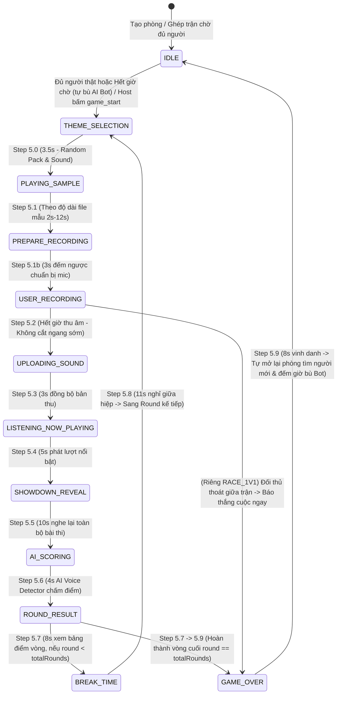

# 📘 Tài Liệu Tính Năng, REST API & Giao Thức Socket.IO (MicMixFun & Mimic Party)

Tài liệu chính thức dành cho đội phát triển **Client (Android / iOS / Web)** tích hợp vào hệ thống **MicMixFun & Mimic Party Backend** (TypeScript + Express 5 + Socket.IO + Cloudflare R2 CDN).

---

## 0. ✨ Tổng Quan Các Tính Năng Hiện Có

1. **Xác Thực & Bảo Mật Đa Lớp (`Auth & Anti-Relay Security`)**:
   - **Firebase Anonymous / ID Token (`RS256`)**: Xác thực chữ ký RSA-SHA256 trực tiếp với chứng chỉ X.509 của Google (`securetoken@system.gserviceaccount.com`).
   - **Guest Session Token (`HMAC-SHA256`)**: Tự động cấp và gia hạn token định danh có thời hạn 7 ngày mà không cần đăng ký mật khẩu.
   - **Client Fingerprint Binding**: Gắn chặt token với dấu vân tay thiết bị (`IP + DeviceId/User-Agent`), chặn việc đánh cắp token đem qua môi trường/server trung gian khác.
   - **One-Time Challenge Nonce (`GET /api/auth/challenge`)**: Cơ chế Challenge-Response hiệu lực 30 giây, dùng 1 lần duy nhất để chống Replay Attack.
   - **Rate Limiting & Giới hạn IP**: Giới hạn tối đa 15 kết nối đồng thời trên mỗi IP, chống spam Chat (6 tin / 3s), Soundboard (5 lần / 2s), Emoji (5 lần / 1s).

2. **Quản Lý Phòng & Khôi Phục Phiên (`Room & Session Reconnect`)**:
   - Tạo phòng (`create_room`), tham gia phòng (`join_room`), rời phòng (`leave_room`), đóng phòng xóa sạch RAM (`close_room`), đổi trạng thái sẵn sàng (`player_ready_toggle`), mời ra khỏi phòng (`kick_player`).
   - **Tự động chuyển quyền Chủ phòng (`Host Migration`)**: Khi Host rời phòng hoặc mất kết nối, quyền Host tự động chuyển sang người chơi thật kế tiếp.
   - **Khôi phục điểm số khi rớt mạng (`120s Reconnect Window`)**: Người chơi bị mất mạng vào lại phòng trong vòng 120 giây được khôi phục nguyên vẹn `totalScore`, `roundScore` và trạng thái bài nộp.

3. **Tìm Trận Nhanh & Ghép Phòng Tự Động (`Smart Matchmaking Queue`)**:
   - Sự kiện `find_match` / `quick_match`:
     1. Ưu tiên ghép ngay với người chơi thật đang chờ trong hàng đợi (`matchmakingQueue`) hoặc ghép vào phòng `IDLE` đang mở còn chỗ trống.
     2. Nếu chưa có người chơi rảnh, đưa vào hàng đợi chờ (mặc định `waitMs = 10000ms`), phát sự kiện `matchmaking_searching` và đếm ngược mỗi giây qua `matchmaking_tick`.
     3. Hỗ trợ hủy tìm trận bất kỳ lúc nào qua `cancel_match` / `cancel_quick_match` (`matchmaking_cancelled`).
     4. Khi hết thời gian chờ mà không có người chơi khác, tự động mở phòng mới, lấp đầy bằng **3 AI Bot** và khởi động ngay ván đấu (`timedOutToBots: true`).

4. **Đấu Trường Nhại Giọng `Mimic Party` (`State Machine`)**:
   - Hỗ trợ cấu hình số vòng (`3, 5, 7, 10` vòng) và thời lượng thu âm (`3 - 15s` hoặc tự động khớp theo độ dài file âm thanh mẫu).
   - Chu trình 9 trạng thái: `IDLE` ➔ `THEME_SELECTION` (3.5s) ➔ `PLAYING_SAMPLE` (theo độ dài file mẫu, hỗ trợ đồng bộ phát xong sớm qua `sample_playback_done`) ➔ `PREPARE_RECORDING` (3s lấy hơi) ➔ `USER_RECORDING` (thu âm & nộp bài, tự chuyển sớm nếu tất cả đã nộp) ➔ `AI_SCORING` (5s chấm điểm hồi hộp) ➔ `SHOWDOWN_REVEAL` (25s nghe lại + thả emoji + bỏ phiếu skip sớm `confirm_showdown_skip`) ➔ `ROUND_RESULT` (chờ 100% bấm sẵn sàng `confirm_next_round_ready`) ➔ `GAME_OVER`.

5. **Hệ Thống AI Bot Thông Minh 3 Cấp Độ (`EASY` / `NORMAL` / `HARD`)**:
   - Quản lý Bot thủ công (`add_bot`, `remove_bot`) hoặc tự động điền đủ 4 người chơi khi bắt đầu (`game_start` với `autoFillBots: true`).
   - Bot tự động lấy chính âm thanh mẫu (`targetSound`) của vòng đó, biến đổi cao độ (`pitch`), tốc độ (`speed`), trộn tạp âm nền (`clean_mic`, `room_ambience`, `mic_static_and_breath`), rè mic (`distortion`), rung giọng (`tremolo`) và ngắt quãng (`dropoutCount`) để tổng hợp ra file `audio/wav` thực tế, lưu vào `audioStore` và chấm điểm qua cùng thuật toán với người chơi thật.

6. **Media, Soundboard Đồng Bộ, Chat & Live Mic Stream**:
   - Chat văn bản trong phòng (`send_message`), kích hoạt Soundboard phát đồng loạt trên mọi thiết bị (`trigger_sound`, `stop_all_sounds`), chia sẻ đoạn thu âm (`share_audio_clip`) và truyền giọng nói trực tiếp thời gian thực (`mic_stream_start`, `mic_stream_chunk`, `mic_stream_stop`).

7. **Kho 251 Âm Thanh Cloudflare R2 CDN & Đa Ngôn Ngữ (`VI / EN`)**:
   - 9 chủ đề âm thanh (`animals`, `meme`, `voice1`, `anime`, `voices`, `robots`, `yankee`, `vehicles`, `funny`) lưu trữ trên Cloudflare R2 CDN.
   - Stream trực tiếp bản thu của người chơi/Bot qua HTTP (`GET /api/attempts/:roomId/:socketId`) giúp giảm tải băng thông Socket.IO.
   - Toàn bộ mã lỗi, thông báo hệ thống, lời nhắc game và nhận xét AI được chuẩn hóa dưới dạng Enum đa ngôn ngữ (`GET /api/enums`).

---

## 1. ⚙️ Danh Mục Hằng Số Kỹ Thuật (System Constants)

### 1.1. Thời Gian & Vòng Đấu (Timings & Durations)

| Hằng số (Constant) | Giá trị | Đơn vị | Mô tả |
| :--- | :--- | :--- | :--- |
| `THEME_SELECTION_DURATION` | **3.5** | Giây | Thời gian chạy hiệu ứng quay Roulette chọn chủ đề âm thanh |
| `PLAYING_SAMPLE_DURATION` | **2.0 - 12.0** | Giây | Tự động lấy theo thời lượng thực tế của file mẫu (hoặc kết thúc sớm khi nhận `sample_playback_done`) |
| `PREPARE_RECORDING_DURATION` | **3.0** | Giây | Thời gian đệm đếm ngược 3..2..1 để người chơi lấy hơi và bật micro |
| `USER_RECORDING_DURATION` | **Theo file mẫu (hoặc 3-15s)** | Giây | Thời gian mở micro nhại lại âm thanh (chuyển sớm sang chấm điểm nếu 100% người chơi đã nộp bài) |
| `AI_SCORING_DURATION` | **5.0** | Giây | Thời gian AI phân tích phổ âm thanh và tạo hiệu ứng chấm điểm hồi hộp |
| `SHOWDOWN_REVEAL_DURATION`| **25.0**| Giây | Thời gian nghe lại bản thu của nhau, thả emoji & bỏ phiếu skip sớm |
| `ROUND_RESULT_DURATION` | **0 (Chờ Ready)** | Giây | Dừng chờ tất cả người chơi bấm `confirm_next_round_ready` rồi đếm ngược 3s sang vòng mới |
| `DEFAULT_TOTAL_ROUNDS` | **3** | Vòng | Số vòng đấu mặc định trong 1 trận (Host có thể cấu hình `3, 5, 7, 10`) |
| `DEFAULT_MATCHMAKING_WAIT_MS` | **10000** | Ms (10s) | Thời gian chờ tìm người chơi thật trước khi tự tạo phòng với AI Bot |
| `ROOM_CLEANUP_DELAY_MS` | **30000**| Ms (30s) | Thời gian giữ siêu dữ liệu phòng trống chờ người chơi có điểm kết nối lại |
| `RECONNECT_RESTORE_WINDOW` | **120000** | Ms (120s) | Thời gian tối đa bảo lưu điểm số của người chơi bị rớt mạng |

### 1.2. Giới Hạn Tệp Âm Thanh & Buffer (Audio Limits & Specs)

| Hằng số (Constant) | Giá trị | Đơn vị | Mô tả |
| :--- | :--- | :--- | :--- |
| `MAX_HTTP_BUFFER_SIZE` | **1** (`1e6`) | MB | Giới hạn dung lượng tối đa cho 1 gói tin qua Socket.IO để bảo vệ RAM |
| `MIN_AUDIO_PAYLOAD_SIZE`| **500** | Chars | Ngưỡng chuỗi Base64 tối thiểu để loại bỏ bản thu rỗng/mất tiếng |
| `SAMPLE_RATE` | **24000 - 48000**| Hz | Tần số lấy mẫu âm thanh khuyến nghị cho Android, iOS và Web |
| `AUDIO_CHANNELS` | **1 (Mono)** | Kênh | Định dạng 1 kênh để tối ưu băng thông đường truyền |
| `PREFERRED_MIME_TYPE` | `audio/webm` / `audio/mp4` / `audio/wav` | MIME | Định dạng nén ưu tiên độ trễ thấp |
| `STREAM_URL_THRESHOLD` | **65536** | Bytes | Nếu chuỗi Base64 > 64KB, server tự thay `audioUrl` bằng đường dẫn HTTP stream `/api/attempts/:roomId/:socketId` |

### 1.3. Cấu Hình Phòng, Bot & Bảo Mật (Room, Bot & Security Limits)

| Hằng số (Constant) | Giá trị | Mô tả |
| :--- | :--- | :--- |
| `MAX_MEMBERS_PER_ROOM` | **12** người | Số thành viên tối đa (cả người thật và AI Bot) trong 1 phòng |
| `DEFAULT_MIN_PLAYERS_WITH_BOTS` | **4** người | Số người chơi tối thiểu mặc định khi bật `autoFillBots` (ví dụ: 1 người + 3 Bot) |
| `DEFAULT_MATCHMAKING_BOT_COUNT` | **3** Bot | Số lượng AI Bot mặc định thêm vào khi tìm trận nhanh không gặp người thật |
| `MAX_CHAT_HISTORY_SIZE` | **50** tin nhắn | Số tin nhắn tối đa lưu trữ tạm thời trong RAM mỗi phòng |
| `MAX_USERNAME_LENGTH` | **20** ký tự | Độ dài tối đa của tên hiển thị |
| `MAX_CONNECTIONS_PER_IP` | **15** kết nối | Số kết nối Socket.IO tối đa đồng thời trên cùng 1 địa chỉ IP |
| `CHALLENGE_TTL_MS` | **30000** ms (30s) | Thời hạn hiệu lực của mã One-Time Challenge Nonce |
| `AUTH_TOKEN_TTL_MS` | **7 ngày** | Thời hạn hiệu lực của Session Token (`HMAC-SHA256`) |

---

## 2. 🔄 Hệ Thống Máy Trạng Thái Gameplay (State Machine — 100% Server-Driven)

Server vận hành theo mô hình **State Machine tập trung (100% Server-Authoritative — Không có chủ động Next Round hay nhảy cóc Step từ Client)**. Mọi thứ tự chuyển pha và bộ đếm thời gian đều do Server quyết định tuyệt đối; Client chỉ cần lắng nghe `game_state_changed` và `game_state_tick`:



---

## 3. 🌐 Đặc Tả Chi Tiết REST APIs

Base URL:
* **Local Development**: `http://localhost:3000`
* **Production (Railway)**: `https://micmixfun.up.railway.app`
* **Audio CDN (Cloudflare R2)**: `https://pub-2ec3726948d14e47babdc7ea12268a78.r2.dev`

### 3.1. Bảng Tổng Hợp Các Endpoint

| Method | Endpoint | Mô tả |
| :--- | :--- | :--- |
| `GET` | `/` | Kiểm tra nhanh trạng thái hoạt động của dịch vụ |
| `GET` | `/api/health` | Health Check kèm thống kê số phòng và số kết nối Socket đang hoạt động |
| `GET` | `/api/auth/challenge` | Phát hành mã `nonce` dùng 1 lần (hiệu lực 30s) chống Replay Attack |
| `POST` | `/api/auth/firebase` | Xác thực Firebase ID Token (`RS256`) và đổi lấy `authToken` gắn Fingerprint |
| `POST` | `/api/auth/guest` | Cấp mới hoặc gia hạn Guest Session Token (`HMAC-SHA256`) |
| `GET` | `/api/auth/verify` | Kiểm tra tính hợp lệ và Fingerprint của `authToken` hoặc `firebaseIdToken` |
| `GET` | `/api/rooms` | Lấy danh sách các phòng đang mở trên Server |
| `GET` | `/api/mimic-packs` | Lấy danh sách 9 chủ đề âm thanh (`SOUND_PACKS`) dùng trong Mimic Party |
| `GET` | `/api/sounds` | Lấy danh sách toàn bộ 251 file âm thanh từ `sounds/catalog.json` (hỗ trợ lọc `?pack=`) |
| `GET` | `/api/game-states` | Lấy danh mục `GAME_STATES`, `STATE_LABELS` và toàn bộ từ điển `ENUM_DICTIONARY` |
| `GET` | `/api/enums` | Lấy toàn bộ bảng mã Localization Enum (`VI` / `EN`) cho Client |
| `GET` | `/api/attempts/:roomId/:socketId` | Stream trực tiếp binary audio bản thu của người chơi hoặc AI Bot trong vòng hiện tại |
| `GET` | `/sounds/*`, `/downloaded_sounds/*`, `/audio/*` | Tự động Redirect (`302`) các đường dẫn âm thanh cũ sang Cloudflare R2 CDN |

---

### 3.2. Chi Tiết Request & Response Từng REST API

#### 1) `GET /api/health` — Kiểm tra tình trạng máy chủ
* **Response (`200 OK`)**:
  ```json
  {
    "status": "online",
    "timestamp": 1760494800000,
    "totalActiveRooms": 3,
    "totalConnectedSockets": 11
  }
  ```

#### 2) `GET /api/auth/challenge` — Lấy One-Time Challenge Nonce
* **Response (`200 OK`)**:
  ```json
  {
    "success": true,
    "nonce": "a4f891c2e7b03d561290ef84a1c3b5d7",
    "timestamp": 1760494800000,
    "expiresInMs": 30000
  }
  ```

#### 3) `POST /api/auth/firebase` — Xác thực Firebase ID Token
* **Headers**: `Content-Type: application/json` (hoặc truyền `Authorization: Bearer <firebaseIdToken>`)
* **Request Body**:
  ```json
  {
    "firebaseIdToken": "eyJhbGciOiJSUzI1NiIsImtpZCI6...",
    "userName": "Alex",
    "avatar": "🦊",
    "deviceId": "android-pixel-8-pro",
    "nonce": "a4f891c2e7b03d561290ef84a1c3b5d7",
    "timestamp": 1760494800000,
    "appSignature": "<HMAC_SHA256(nonce:timestamp:firebaseUid, APP_SIGNING_SECRET)>"
  }
  ```
  *(Lưu ý: `nonce`, `timestamp`, `appSignature` là tuỳ chọn nâng cao khi bật xác thực Challenge-Response).*
* **Response (`200 OK`)**:
  ```json
  {
    "success": true,
    "userId": "fb_9xYzAbCdEfGh123",
    "firebaseUid": "9xYzAbCdEfGh123",
    "provider": "firebase_anonymous",
    "authToken": "eyJ1aWQiOiJmYl85eFl6QWJDZEVmR2gxMjMi...<signature>",
    "expiresAt": 1761099600000,
    "user": {
      "userId": "fb_9xYzAbCdEfGh123",
      "firebaseUid": "9xYzAbCdEfGh123",
      "userName": "Alex",
      "avatar": "🦊"
    }
  }
  ```
* **Error Responses**:
  - `401 Unauthorized`: `{ "success": false, "code": "AUTH_FIREBASE_TOKEN_INVALID", "message": "AUTH_FIREBASE_TOKEN_INVALID" }`
  - `403 Forbidden`: `{ "success": false, "code": "AUTH_CHALLENGE_SIGNATURE_INVALID", "message": "AUTH_CHALLENGE_SIGNATURE_INVALID" }`

#### 4) `POST /api/auth/guest` — Cấp mới hoặc làm mới Guest Session Token
* **Request Body**:
  ```json
  {
    "userName": "Alex",
    "avatar": "🎧",
    "deviceId": "android-pixel-8-pro",
    "authToken": "<token_cũ_nếu_muốn_gia_hạn>",
    "firebaseIdToken": "<tuỳ_chọn_nếu_muốn_gắn_kèm_firebase>"
  }
  ```
* **Response (`200 OK`)**:
  ```json
  {
    "success": true,
    "userId": "u_8f9d2a1b4c3e5f60",
    "firebaseUid": null,
    "provider": "guest",
    "authToken": "eyJ1aWQiOiJ1XzhmOWQyYTFiNGMzZTVmNjAi...<signature>",
    "expiresAt": 1761099600000,
    "user": {
      "userId": "u_8f9d2a1b4c3e5f60",
      "firebaseUid": null,
      "userName": "Alex",
      "avatar": "🎧"
    }
  }
  ```

#### 5) `GET /api/auth/verify` — Kiểm tra Token hiện tại
* **Headers**:
  - `Authorization: Bearer <authToken_hoặc_firebaseIdToken>` (hoặc query `?token=...`)
  - `X-Device-Id: <deviceId>` (nếu lúc cấp token có truyền `deviceId`)
* **Response (`200 OK`)**:
  ```json
  {
    "success": true,
    "valid": true,
    "user": {
      "userId": "u_8f9d2a1b4c3e5f60",
      "firebaseUid": null,
      "provider": "guest",
      "userName": "Alex",
      "avatar": "🎧",
      "expiresAt": 1761099600000
    }
  }
  ```
* **Error Response (`401 Unauthorized`)**:
  ```json
  {
    "success": false,
    "valid": false,
    "code": "AUTH_TOKEN_INVALID_OR_EXPIRED",
    "message": "AUTH_TOKEN_INVALID_OR_EXPIRED"
  }
  ```

#### 6) `GET /api/rooms` — Danh sách phòng đang mở
* **Response (`200 OK`)**:
  ```json
  {
    "rooms": [
      {
        "roomId": "MIMIC99",
        "roomName": "Phòng Đại Chiến",
        "memberCount": 4,
        "maxMembers": 12,
        "gameState": "IDLE",
        "createdAt": 1760494700000
      }
    ]
  }
  ```

#### 7) `GET /api/mimic-packs` — Danh sách các gói chủ đề âm thanh
* **Response (`200 OK`)**:
  ```json
  {
    "packs": [
      {
        "id": "animals",
        "name": "PACK_NAME_ANIMALS",
        "emoji": "🐾",
        "description": "PACK_DESC_ANIMALS",
        "sounds": [
          {
            "id": "animals_cat-two",
            "name": "Cat Two",
            "emoji": "🐱",
            "fileName": "cat-two.mp3",
            "relativePath": "animals/cat-two.mp3",
            "hint": "Mimic the sound of Cat Two!"
          }
        ]
      }
    ]
  }
  ```

#### 8) `GET /api/sounds` — Danh mục 251 file âm thanh trên CDN
* **Query Params**: `?pack=animals` *(tuỳ chọn: lọc theo tên pack như `animals`, `meme`, `anime`, `voices`, `voice1`, `robots`, `yankee`, `vehicles`, `funny`, `everyday`, `melody`, `signals`, `space`, `common`)*
* **Response (`200 OK`)**:
  ```json
  {
    "count": 251,
    "packCounts": {
      "animals": 32,
      "meme": 28,
      "anime": 24
    },
    "sounds": [
      {
        "id": "cat-two",
        "pack": "animals",
        "fileName": "cat-two.mp3",
        "relativePath": "animals/cat-two.mp3",
        "name": "Cat Two",
        "url": "https://pub-2ec3726948d14e47babdc7ea12268a78.r2.dev/animals/cat-two.mp3"
      }
    ]
  }
  ```

#### 9) `GET /api/enums` & `GET /api/game-states` — Từ điển mã Enum Đa Ngôn Ngữ (`VI / EN`)
* **Response (`200 OK`)**:
  ```json
  {
    "states": {
      "IDLE": "IDLE",
      "THEME_SELECTION": "THEME_SELECTION",
      "PLAYING_SAMPLE": "PLAYING_SAMPLE",
      "PREPARE_RECORDING": "PREPARE_RECORDING",
      "USER_RECORDING": "USER_RECORDING",
      "AI_SCORING": "AI_SCORING",
      "SHOWDOWN_REVEAL": "SHOWDOWN_REVEAL",
      "ROUND_RESULT": "ROUND_RESULT",
      "GAME_OVER": "GAME_OVER"
    },
    "labels": {
      "IDLE": "STATE_LABEL_IDLE",
      "THEME_SELECTION": "STATE_LABEL_THEME_SELECTION"
    },
    "enums": {
      "errorCodes": { "ROOM_NOT_FOUND": "ROOM_NOT_FOUND" },
      "systemMessageCodes": { "SYS_HOST_JOINED_ROOM": "SYS_HOST_JOINED_ROOM" },
      "gameMessageCodes": { "GAME_MSG_USER_RECORDING": "GAME_MSG_USER_RECORDING" },
      "roomCloseReasonCodes": { "HOST_CLOSED": "HOST_CLOSED" },
      "stateLabelCodes": { "STATE_LABEL_IDLE": "STATE_LABEL_IDLE" },
      "aiRemarkCodes": { "AI_REMARK_LEGENDARY_1": "AI_REMARK_LEGENDARY_1" },
      "soundPackNameCodes": { "PACK_NAME_ANIMALS": "PACK_NAME_ANIMALS" },
      "soundPackDescCodes": { "PACK_DESC_ANIMALS": "PACK_DESC_ANIMALS" }
    },
    "descriptions": {
      "ROOM_NOT_FOUND": {
        "code": "ROOM_NOT_FOUND",
        "vi": "Phòng chơi không tồn tại hoặc đã giải tán!",
        "en": "Room does not exist or has been closed.",
        "context": "Khi vào phòng hoặc lấy dữ liệu phòng không còn tồn tại"
      }
    }
  }
  ```

#### 10) `GET /api/attempts/:roomId/:socketId` — Stream Audio bản thu của Người chơi / AI Bot
* **Mô tả**: Trả về trực tiếp binary buffer (`audio/webm`, `audio/mp4` hoặc `audio/wav` đối với AI Bot) của bài dự thi trong vòng hiện tại. Tự động xoá khỏi RAM sau khi qua giai đoạn `SHOWDOWN_REVEAL`.
* **Error Responses**:
  - `404 Not Found` (`ROOM_NOT_FOUND` hoặc `ATTEMPT_AUDIO_NOT_FOUND`).

---

## 4. ⚡ Đặc Tả Đầy Đủ Giao Thức Socket.IO (Socket Specifications)

### 4.0. Kết Nối Handshake (`io.connect`)
Khi khởi tạo kết nối Socket.IO, Client có thể truyền thông tin xác thực trong `auth`:
```javascript
const socket = io("https://micmixfun.up.railway.app", {
  transports: ["websocket"],
  auth: {
    token: "<authToken_HMAC>",           // Hoặc dùng trường authToken
    firebaseIdToken: "<firebase_jwt>",   // Tuỳ chọn nếu dùng Firebase Auth
    deviceId: "android-device-id-001",   // Dùng để đối chiếu Client Fingerprint
    nonce: "<challenge_nonce>",          // Tuỳ chọn Challenge-Response
    timestamp: 1760494800000,
    appSignature: "<hmac_signature>"
  }
});
```

---

### 4.1. Sự Kiện Client Gửi Lên Server (`Client ➔ Server`)

#### Nhóm A — Xác Thực & Quản Lý Phòng (`room.handler.ts`)

| Event Name | Payload Gửi Lên | Callback Response (`ack`) | Mô tả |
| :--- | :--- | :--- | :--- |
| `auth_guest` / `auth_firebase` | `{ userName, avatar, authToken?, firebaseIdToken? }` | `{ success: true, userId, firebaseUid, provider, authToken, expiresAt, user }` | Xác thực hoặc đổi tên/avatar trực tiếp trên kết nối Socket |
| `create_room` | `{ roomId?, roomName?, userName? }` | `{ success: true, roomId, roomName, hostId, mode: "CUSTOM_ROOM", room }` | Tạo phòng riêng (`CUSTOM_ROOM` — cách ly hoàn toàn, không bị người tìm trận ngẫu nhiên ghép vào) |
| `join_room` | `{ roomId, userName, avatar, userId?, authToken?, firebaseIdToken? }` | `{ success: true, authToken, expiresAt, restoredSession, room, user, gameState }` | Vào phòng theo mã Code (tự tạo phòng `CUSTOM_ROOM` nếu chưa có; tự khôi phục điểm nếu rớt mạng vào lại trong 120s) |
| `leave_room` | `{}` | `{ success: true }` | Rời khỏi phòng hiện tại |
| `close_room` | `{ roomId? }` | `{ success: true, roomId, cleared: true }` | **(Chỉ Host)** Đóng phòng ngay lập tức và giải phóng toàn bộ RAM |
| `player_ready_toggle` | `{ roomId?, isReady?: boolean }` | `{ success: true, isReady }` | Bật / tắt trạng thái sẵn sàng tại sảnh chờ |
| `kick_player` | `{ roomId?, targetSocketId }` | `{ success: true }` | **(Chỉ Host)** Mời người chơi hoặc xóa AI Bot khỏi phòng |
| `add_bot` | `{ roomId?, difficulty?: "EASY"\|"NORMAL"\|"HARD", botName?, avatar? }` | `{ success: true, bot, members }` | **(Chỉ Host)** Thêm 1 AI Bot vào phòng khi ở trạng thái `IDLE` / `GAME_OVER` |
| `remove_bot` | `{ roomId?, botSocketId? }` | `{ success: true, removedBot, members }` | **(Chỉ Host)** Xóa 1 AI Bot khỏi phòng (nếu không truyền `botSocketId` sẽ xóa Bot cuối) |

#### Nhóm B — Tìm Trận Nhanh / Smart Matchmaking (`room.handler.ts`) — Hỗ Trợ `QUICK_MATCH` (4P) & `RACE_1V1` (2P)

| Event Name | Payload Gửi Lên | Callback Response (`ack`) | Mô tả |
| :--- | :--- | :--- | :--- |
| `find_match` (hoặc `quick_match`) | `{ userName?, avatar?, mode?: "QUICK_MATCH"\|"RACE_1V1", botCount?: 3, botDifficulty?, autoStart?: true, waitMs?: 10000, waitForPlayers?: true }` | `{ success: true, searching, mode, targetPlayers, matchedWithHumans, timedOutToBots?, botsAdded, autoStarted, roomId, room, user, gameState }` | Tìm trận nhanh **4 Người (`QUICK_MATCH`)**: Ưu tiên Best-Fit (`3/4 ➔ 2/4 ➔ 1/4`) + FIFO. Chờ cơ bản `10s`; khi tìm được thêm người thật (`2/4` hoặc `3/4`) lúc đồng hồ `< 5s` thì tự **cộng giờ mềm `+5s`** (trần tối đa `16s`). Hết giờ tự bù `(4 - N)` AI Bot và bắt đầu ngay |
| `race_1v1` (hoặc `find_1v1_match`) | `{ userName?, avatar?, botDifficulty?, autoStart?: true, waitMs?: 8000, waitForPlayers?: true }` | `{ success: true, searching, mode: "RACE_1V1", targetPlayers: 2, matchedWithHumans, timedOutToBots?, botsAdded, autoStarted, roomId, room, user, gameState }` | Tìm trận **Đấu Tay Đôi `1vs1 Race` (`2 Người`)**: Khóa cứng `targetPlayers = 2`. Ghép được 1 đối thủ thật (`2/2`) là vào trận ngay lập tức; hết `8s` chờ tự bù đúng `1 AI Bot` |
| `cancel_match` (hoặc `cancel_quick_match`) | `{}` (hoặc không truyền data) | `{ success: true, cancelled: boolean, cancelledFromPreStartRoom: boolean, searching: false, state: "IDLE", systemMessage: "SYS_MATCHMAKING_CANCELLED" }` | **Unified Cancel Match**: Hủy tìm trận được ở cả 2 trạng thái: khi đang đứng lẻ `1/4` trong Queue **và** khi đã được gom tạm vào phòng `2/4`, `3/4` đang đếm ngược chờ đủ người (`IDLE`) |
| `get_matchmaking_state` | `{}` | `{ searching: boolean, state: "FINDING_MATCH"\|"IDLE", roomId?, mode, currentPlayers, targetPlayers, members, waitMs, remainingMs, timeRemaining, elapsedSeconds, totalDuration, progressPercent, startedAt, endsAt }` | Lấy trạng thái đồng hồ tìm trận và danh sách ghế Avatar (`members`) hiện tại từ Server |

#### Nhóm C — Gameplay Đấu Trường Nhại Giọng (`game.handler.ts`) — 100% Server-Driven (Không Có Chủ Động Next Round)

| Event Name | Payload Gửi Lên | Callback Response (`ack`) | Mô tả |
| :--- | :--- | :--- | :--- |
| `game_start` (hoặc `fill_bots_and_start`, `matchmaking_timeout`) | `{ roomId?, requireAllReady?: false, autoFillBots?: true, minPlayers?: 4, botCount?, botDifficulty? }` | `{ success: true, botsAdded, totalPlayers }` | **(Chỉ Host)** Bắt đầu trận đấu. Mặc định nếu phòng < `targetPlayers` sẽ tự động điền thêm AI Bot cho đủ số người |
| `game_update_config` | `{ roomId?, totalRounds?: 3\|5\|7\|10, recordDuration?: 3..15, useCustomRecordDuration?: boolean }` | `{ success: true, totalRounds, recordDuration }` | **(Chỉ Host)** Cập nhật số vòng đấu và thời gian thu âm khi ở sảnh chờ |
| `sample_playback_done` | `{ roomId? }` | — | Ghi nhận thiết bị đã phát xong file âm thanh mẫu (Server vẫn giữ đúng bộ đếm `PLAYING_SAMPLE` trước khi sang `PREPARE_RECORDING`) |
| `game_submit_audio` | `{ roomId?, audioData: "data:audio/webm;base64,...", mimeType?: "audio/webm", metrics?: { matchPct, rhythmScore, energyScore, activeRatio } }` | `{ success: true, evaluation: { totalScore, pitchScore, rhythmScore, energyScore, grade, remark } }` | Nộp bản thu âm nhại giọng của vòng hiện tại. **Không cắt ngang đồng hồ thu âm** — chờ hết giờ `USER_RECORDING` Server mới chuyển bước |
| `game_submit_bot_audio` | `{ roomId?, botSocketId, audioData: "data:audio/wav;base64,...", mimeType?: "audio/wav" }` | `{ success: true, botSocketId, uploadedBy, assignedGeneratorSocketId }` | *(Tuỳ chọn — Chế độ 1B)* Client được phân công (`assignedGeneratorSocketId`) nộp file audio đã render hộ cho AI Bot để đồng bộ qua `/api/attempts/:roomId/:botSocketId` |
| `game_emoji_reaction` | `{ roomId?, emoji: "😂" }` | — | Thả biểu tượng cảm xúc bay trên màn hình (tối đa 5 lần / giây) |
| `confirm_showdown_skip` (hoặc `skip_to_round_result`) | `{ roomId? }` | `{ success: true, isVoted, skipCount, totalCount, allSkipConfirmed }` | Ghi nhận trạng thái UI (không cắt ngang đồng hồ `SHOWDOWN_REVEAL` — Server điều phối 100% thời gian từng Step) |
| `confirm_next_round_ready` | `{ roomId? }` | `{ success: true, readyCount, totalCount, allReady }` | Ghi nhận trạng thái sẵn sàng của người chơi (trong trận, Server tự động chuyển vòng khi hết thời gian `ROUND_RESULT` + `BREAK_TIME`, **không có chủ động Next Round sớm**) |
| `get_game_state` | `{ roomId? }` | `GameStateSnapshot \| null` | Lấy toàn bộ trạng thái hiện tại của bàn chơi khi vừa kết nối lại |

#### Nhóm D — Chat, Soundboard, Chia Sẻ Audio & Live Mic (`media.handler.ts`)

| Event Name | Payload Gửi Lên | Callback Response (`ack`) | Mô tả |
| :--- | :--- | :--- | :--- |
| `send_message` | `{ message: "Hello!", type?: "text", audioMeta?: null }` | `{ success: true, messageId }` | Gửi tin nhắn chat vào phòng (lưu tối đa 50 tin gần nhất) |
| `trigger_sound` | `{ soundId, soundName?, soundUrl, volume?: 1.0, pitch?: 1.0 }` | `{ success: true }` | Phát hiệu ứng âm thanh Soundboard đồng bộ cho toàn bộ thành viên trong phòng |
| `stop_all_sounds` | `{}` | — | Dừng tất cả âm thanh Soundboard đang phát trong phòng |
| `share_audio_clip` | `{ audioData, audioName?, duration?, mimeType?: "audio/webm" }` | `{ success: true, audioId }` | Chia sẻ một đoạn ghi âm ngắn vào phòng và lưu vào lịch sử chat |
| `mic_stream_start` | `{ sampleRate?: 48000, channels?: 1 }` | — | Bắt đầu truyền giọng nói trực tiếp (Live Mic Stream) |
| `mic_stream_chunk` | `<ArrayBuffer \| Base64Chunk>` | — | Gửi từng mảnh dữ liệu âm thanh micro thời gian thực |
| `mic_stream_stop` | `{}` | — | Kết thúc truyền giọng nói trực tiếp |

---

### 4.2. Sự Kiện Server Bắn Xuống Client (`Server ➔ Client`)

#### 1) Sự kiện Phòng & Smart Matchmaking
* **`joined_room_success`**: Gửi riêng cho socket vừa vào phòng thành công (cấu trúc giống hệt callback của `join_room`).
* **`user_joined`**: Broadcast khi có người chơi hoặc Bot mới vào phòng:
  ```json
  {
    "user": { "socketId": "...", "userId": "...", "userName": "Alex", "avatar": "🦊", "role": "PLAYER", "isReady": false },
    "members": [ ... ],
    "systemMessage": "SYS_PLAYER_JOINED_ROOM",
    "messageCode": "SYS_PLAYER_JOINED_ROOM",
    "messageParams": { "userName": "Alex", "role": "PLAYER" }
  }
  ```
* **`user_left`**: Broadcast khi có thành viên rời phòng (`{ socketId, userName, members, systemMessage: "SYS_USER_LEFT_ROOM", messageParams }`).
* **`host_changed`**: Broadcast khi Chủ phòng cũ rời đi và quyền Host được chuyển giao (`{ newHostId, newHostName, members, systemMessage: "SYS_HOST_CHANGED" }`).
* **`player_ready_changed`**: Broadcast khi người chơi bật/tắt sẵn sàng tại sảnh (`{ socketId, userName, isReady, members, systemMessage }`).
* **`kicked_from_room`**: Gửi riêng cho người bị Host kick (`{ code: "ROOM_KICKED_BY_HOST", message: "ROOM_KICKED_BY_HOST" }`).
* **`room_closed`**: Broadcast khi phòng bị đóng (`{ roomId, reason: "HOST_CLOSED", message: "SYS_HOST_CLOSED_ROOM", messageParams, timestamp }`).
* **`bot_added` / `bot_removed` / `bots_auto_filled`**: Broadcast khi thêm/xóa Bot thủ công hoặc tự động điền Bot lúc bắt đầu game.
* **`matchmaking_searching`**: Gửi ngay khi bắt đầu vào hàng đợi chờ tìm người chơi thật, khi gom vào phòng chờ `2/4`, `3/4`, hoặc khi mở lại phòng tìm người mới sau trận (Server quản lý 100% timer tìm trận và trả về danh sách `members` để UI vẽ 4 ô ghế Avatar sáng dần `1/4 ➔ 2/4 ➔ 3/4`):
  ```json
  {
    "searching": true,
    "state": "FINDING_MATCH",
    "roomId": "A1B2C3",
    "mode": "QUICK_MATCH",
    "currentPlayers": 2,
    "targetPlayers": 4,
    "members": [
      { "socketId": "...", "userName": "Player1", "avatar": "🎧", "role": "HOST", "isBot": false },
      { "socketId": "...", "userName": "Player2", "avatar": "🦊", "role": "PLAYER", "isBot": false }
    ],
    "waitMs": 10000,
    "remainingMs": 10000,
    "timeRemaining": 10,
    "elapsedSeconds": 0,
    "totalWaitSeconds": 10,
    "totalDuration": 10,
    "progressPercent": 0,
    "extended": false,
    "extendedBonusSeconds": 0,
    "startedAt": 1760494800000,
    "endsAt": 1760494810000,
    "timestamp": 1760494800000,
    "systemMessage": "SYS_MATCHMAKING_SEARCHING",
    "messageCode": "SYS_MATCHMAKING_SEARCHING",
    "messageParams": { "waitSeconds": 10, "waitMs": 10000 }
  }
  ```
* **`matchmaking_tick`**: Server bắn định kỳ mỗi `1 giây` (bắt đầu từ `t = 0s` đến khi hết giờ, kèm `currentPlayers`, `members`, `extended`, `extendedBonusSeconds`) để Client chỉ việc bind trực tiếp lên UI đồng hồ tìm trận và các ô Avatar mà **không cần tự chạy timer phía Client**:
  ```json
  {
    "searching": true,
    "state": "FINDING_MATCH",
    "roomId": "A1B2C3",
    "mode": "QUICK_MATCH",
    "currentPlayers": 3,
    "targetPlayers": 4,
    "members": [ ... ],
    "waitMs": 13000,
    "remainingMs": 6000,
    "timeRemaining": 6,
    "elapsedSeconds": 7,
    "totalWaitSeconds": 13,
    "totalDuration": 13,
    "progressPercent": 54,
    "extended": true,
    "extendedBonusSeconds": 5,
    "startedAt": 1760494800000,
    "endsAt": 1760494813000,
    "timestamp": 1760494807000
  }
  ```
* **`matchmaking_player_joined`**: Broadcast ngay khi có người chơi thật mới ghép vào phòng chờ (`2/4` hoặc `3/4`) làm kích hoạt cộng giờ mềm (`+5s` khi còn `< 5s`, trần `16s`) để Client hiển thị hiệu ứng sáng ô Avatar mới và cộng thêm giây chờ (`{ roomId, mode, currentPlayers, targetPlayers, members, extended: true, extendedBonusSeconds: 5, timeRemaining, remainingMs, totalWaitSeconds }`).
* **`get_matchmaking_state` (`Client ➔ Server` ack)**: Cho phép Client lấy lại trạng thái timer tìm trận và `members` hiện tại từ Server bất cứ lúc nào nếu chuyển màn hình.
* **`match_found`**: Gửi ngay khi ghép được người chơi thật hoặc khi hết thời gian chờ trên Server và tự động tạo phòng với AI Bot + bắt đầu Gameplay.
* **`matchmaking_cancelled`**: Gửi khi người chơi hủy tìm trận (`{ success: true, cancelled: true, cancelledFromPreStartRoom: boolean, searching: false, state: "IDLE", timeRemaining: 0, remainingMs: 0, systemMessage: "SYS_MATCHMAKING_CANCELLED" }`).

#### 2) Sự kiện Gameplay Mimic Party (Server-Authoritative 100%: State, Step, Round, Timer & Xử Lý Rời Trận Giữa Chừng)

> **Nguyên tắc thiết kế bắt buộc cho Client:**
> 1. **100% Server-Driven Timeline (Không có chủ động Next Round / Không nhảy cóc Step)**:
>    - Khi bắt đầu Gameplay (`game_start` hoặc `match_found`), **Server quyết định tuyệt đối mọi thứ tự và thời gian của từng Step (`5.0` ➔ `5.9`), số Round (`round`/`totalRounds`) và thời gian nghỉ giữa các vòng (`BREAK_TIME`)**.
>    - Chỉ khi chạy **hết thời gian thu âm (`USER_RECORDING`)** ➔ qua đầy đủ các bước đồng bộ, nghe lại & chấm điểm (`UPLOADING_SOUND` ➔ `LISTENING_NOW_PLAYING` ➔ `SHOWDOWN_REVEAL` ➔ `AI_SCORING` ➔ `ROUND_RESULT`) ➔ chạy **hết thời gian nghỉ (`BREAK_TIME`)** thì Server mới chuyển sang Round tiếp theo.
> 2. **Quy tắc khi có người rời trận giữa chừng & Tự động tìm người mới sau trận**:
>    - **`QUICK_MATCH` (`4 Người`)**: Nếu 1 người rời giữa chừng, trận đấu **vẫn tiếp tục chạy bình thường tới hết toàn bộ các Round (`3/3`)** (trừ khi không còn người thật nào). Sau khi kết thúc trận (`GAME_OVER` `8s`), Server **tự động mở lại phòng đó để tìm người chơi thật mới** với bộ đếm giờ tìm trận (`matchmaking_searching` + `matchmaking_tick`), nếu quá thời gian chờ thì tự động bù AI Bot cho đủ 4 người và bắt đầu ván mới.
>    - **`RACE_1V1` (`2 Người`)**: Nếu đối thủ rời phòng giữa chừng, Server **kết thúc trận đấu ngay lập tức và báo kết quả `GAME_OVER` (`reason: "OPPONENT_LEFT_FORFEIT"`, `forfeitedBySocketId`, `forfeitedByUserName`)** vinh danh người ở lại thắng cuộc! Sau `GAME_OVER` (`8s`), phòng tự động mở lại bộ đếm giờ tìm đối thủ `1v1` mới (quá giờ thì bù `1 AI Bot`).

##### Bảng Lịch Trình Các Step Trong 1 Round Do Server Điều Phối (`GAME_STEP_DURATIONS`)

| Thứ tự (`stepIndex`) | Mã Step (`phaseStep`) | `state` (`GameStateType`) | Thời lượng Server (`duration`) | `nextState` tự động khi hết giờ | Mô tả hiển thị trên Client |
| :---: | :---: | :--- | :---: | :--- | :--- |
| `1` | `5.0` | `THEME_SELECTION` | **`3.5s`** (`4s` tick) | `PLAYING_SAMPLE` | Quay/chọn chủ đề Sound Pack của vòng đấu |
| `2` | `5.1` | `PLAYING_SAMPLE` | **Theo độ dài file mẫu** (`2s – 12s`) | `PREPARE_RECORDING` | Phát âm thanh mẫu gốc (`targetSound.audioUrl`) |
| `3` | `5.1b` | `PREPARE_RECORDING` | **`3s`** | `USER_RECORDING` | Đếm ngược `3..2..1` chuẩn bị lấy hơi & bật mic |
| `4` | `5.2` | `USER_RECORDING` | **Theo độ dài file mẫu** (hoặc custom `3s – 15s`) | `UPLOADING_SOUND` | Người chơi thu âm nhại lại (**chờ hết giờ Server mới chuyển bước**) |
| `5` | `5.3` | `UPLOADING_SOUND` | **`3s`** | `LISTENING_NOW_PLAYING` | Đồng bộ & tải bản thu âm của tất cả người chơi |
| `6` | `5.4` | `LISTENING_NOW_PLAYING` | **`5s`** | `SHOWDOWN_REVEAL` | Nghe nhanh lượt phát nổi bật (`spotlightPlayer` tự động xoay theo tick) |
| `7` | `5.5` | `SHOWDOWN_REVEAL` | **`10s`** | `AI_SCORING` | Nghe lại toàn bộ bài thi (**chờ hết giờ Server mới sang chấm điểm**) |
| `8` | `5.6` | `AI_SCORING` | **`4s`** | `ROUND_RESULT` | AI Voice Detector phân tích & chấm điểm |
| `9` | `5.7` | `ROUND_RESULT` | **`8s`** | `BREAK_TIME` (hoặc `GAME_OVER` nếu vòng cuối) | Hiển thị bảng xếp hạng vòng hiện tại |
| `10` | `5.8` | `BREAK_TIME` | **`11s`** | `THEME_SELECTION` (vòng kế tiếp) | Nghỉ giải lao giữa 2 vòng đấu (**chờ hết giờ nghỉ Server mới qua vòng kế tiếp**) |
| `—` | `5.9` | `GAME_OVER` | **`8s`** (tự mở lại tìm trận cho `QUICK_MATCH` / `RACE_1V1`) | `IDLE` / `FINDING_MATCH` | Vinh danh nhà vô địch chung cuộc |

* **`game_state_changed`**: Sự kiện trung tâm điều khiển UI mỗi khi Server chuyển sang Step mới:
  ```json
  {
    "roomId": "MIMIC99",
    "state": "PLAYING_SAMPLE",
    "stateLabel": "STATE_LABEL_PLAYING_SAMPLE",
    "phaseStep": "5.1",
    "stepIndex": 2,
    "totalStepsInRound": 10,
    "nextState": "PREPARE_RECORDING",
    "round": 1,
    "totalRounds": 3,
    "isLastRound": false,
    "nextRound": 2,
    "duration": 4,
    "totalDuration": 4,
    "timeRemaining": 4,
    "elapsedSeconds": 0,
    "remainingMs": 4000,
    "progressPercent": 0,
    "stateStartedAt": 1760494800000,
    "stateEndsAt": 1760494804000,
    "stepDurations": {
      "themeSelection": 3.5,
      "playingSample": 4,
      "prepareRecording": 3,
      "userRecording": 4,
      "uploadingSound": 3,
      "listeningNowPlaying": 5,
      "showdownReveal": 10,
      "aiScoring": 4,
      "roundResult": 8,
      "breakTime": 11,
      "readyCountdown": 3
    },
    "timestamp": 1760494800000,
    "payload": {
      "phaseStep": "5.1",
      "pack": { "id": "animals", "name": "PACK_NAME_ANIMALS", "emoji": "🐾" },
      "targetSound": {
        "id": "animals_cat-two",
        "name": "Cat Two",
        "emoji": "🐱",
        "hint": "Mimic the sound of Cat Two!",
        "audioUrl": "https://pub-2ec3726948d14e47babdc7ea12268a78.r2.dev/animals/cat-two.mp3",
        "rawDuration": 3.2,
        "exactDuration": 3.2,
        "duration": 4
      }
    }
  }
  ```
  - **Cấu trúc `payload` trong pha `SHOWDOWN_REVEAL` (Step `5.5`)**:
    ```json
    {
      "phaseStep": "5.5",
      "duration": 10,
      "pack": { ... },
      "targetSound": { ... },
      "roundWinner": { "socketId": "...", "userName": "Alex", "roundScore": 92, ... },
      "skipCount": 2,
      "totalCount": 4,
      "votedSockets": ["bot_1", "bot_2"],
      "attempts": [
        {
          "socketId": "sock_human_1",
          "userName": "Alex",
          "avatar": "🦊",
          "isBot": false,
          "botDifficulty": null,
          "roundScore": 92,
          "totalScore": 180,
          "audioUrl": "/api/attempts/MIMIC99/sock_human_1?r=2&t=1760494850000",
          "audioStreamUrl": "/api/attempts/MIMIC99/sock_human_1?r=2",
          "evaluation": {
            "totalScore": 92,
            "pitchScore": 94,
            "rhythmScore": 90,
            "energyScore": 91,
            "grade": "S",
            "remark": "AI_REMARK_LEGENDARY_1"
          }
        },
        {
          "socketId": "bot_abc123",
          "userName": "Bot Mecha",
          "avatar": "🤖",
          "isBot": true,
          "botDifficulty": "NORMAL",
          "roundScore": 78,
          "totalScore": 154,
          "audioUrl": "https://pub-2ec3726948d14e47babdc7ea12268a78.r2.dev/animals/cat-two.mp3?bot=1&d=NORMAL&p=1.06&s=1.05&delay=95&seed=284",
          "audioStreamUrl": "https://pub-2ec3726948d14e47babdc7ea12268a78.r2.dev/animals/cat-two.mp3",
          "botSoundId": "cat-two",
          "botSoundFileName": "cat-two.mp3",
          "botPitch": 1.06,
          "botSpeed": 1.05,
          "botAudioEffects": {
            "difficulty": "NORMAL",
            "baseSoundUrl": "https://pub-2ec3726948d14e47babdc7ea12268a78.r2.dev/animals/cat-two.mp3",
            "pitch": 1.06,
            "pitchSemitones": 1.01,
            "speed": 1.05,
            "pitchScoopCents": -24,
            "vibratoRateHz": 1.82,
            "noiseLevel": 0.041,
            "noiseType": "room_ambience",
            "inhaleBreathMs": 56,
            "inhaleBreathGain": 0.018,
            "distortion": 0.054,
            "tremoloDepth": 0.046,
            "dropoutCount": 0,
            "startDelayMs": 95,
            "bandpassHz": [220, 4200],
            "vocalPresenceHz": 1400,
            "vocalPresenceGainDb": 2.8
          },
          "evaluation": {
            "totalScore": 78,
            "pitchScore": 79,
            "rhythmScore": 76,
            "energyScore": 80,
            "grade": "A",
            "remark": "AI_REMARK_GOOD_2"
          }
        }
      ]
    }
    ```
* **`game_state_tick`**: Server bắn định kỳ mỗi `1 giây` trong suốt mọi Step (kể cả `BREAK_TIME`) để Client hiển thị đếm ngược, thanh tiến trình và người chơi đang phát (`spotlightPlayer` trong `LISTENING_NOW_PLAYING` / `SHOWDOWN_REVEAL`):
  ```json
  {
    "roomId": "MIMIC99",
    "state": "BREAK_TIME",
    "stateLabel": "STATE_LABEL_BREAK_TIME",
    "phaseStep": "5.8",
    "stepIndex": 10,
    "totalStepsInRound": 10,
    "nextState": "THEME_SELECTION",
    "round": 1,
    "totalRounds": 3,
    "isLastRound": false,
    "nextRound": 2,
    "timeRemaining": 9,
    "elapsedSeconds": 2,
    "totalDuration": 11,
    "remainingMs": 9000,
    "progressPercent": 18,
    "stateStartedAt": 1760494900000,
    "stateEndsAt": 1760494911000,
    "timestamp": 1760494902000
  }
  ```
* **`game_config_changed`**: Broadcast khi Host đổi cấu hình vòng/thời gian thu âm.
* **`showdown_skip_updated`**: Broadcast khi có người bấm đồng ý/hủy bỏ qua sớm `SHOWDOWN_REVEAL` (`{ socketId, userName, isVoted, skipCount, totalCount, allSkipConfirmed, votedSockets }`).
* **`round_ready_updated`**: Broadcast tiến độ bấm sẵn sàng qua vòng mới tại `ROUND_RESULT` / `BREAK_TIME` / `GAME_OVER` (`{ socketId, userName, readyCount, totalCount, allReady, players }`).
* **`all_players_ready`**: Broadcast khi 100% người chơi đã đồng ý skip hoặc sẵn sàng qua vòng mới (`{ roomId, state, countdown: 3, timeRemaining: 3, totalDuration: 3, messageCode }`).
* **`game_reaction_broadcast`**: Truyền chuỗi emoji bay trên màn hình (`"😂"`).
* **`game_error`**: Báo lỗi thao tác game (`{ code: "GAME_HOST_ONLY_START", message: "GAME_HOST_ONLY_START" }`).

#### 3) Sự kiện Media, Chat & Live Mic
* **`new_message`**: Tin nhắn mới trong phòng (`{ id, senderId, senderName, avatar, message, type: "text"|"sound_trigger"|"audio_share", audioMeta, timestamp }`).
* **`sync_play_sound`**: Yêu cầu các máy trong phòng phát đồng bộ 1 hiệu ứng Soundboard (`{ soundId, soundName, soundUrl, volume, pitch, senderId, senderName, avatar, timestamp }`).
* **`sync_stop_sounds`**: Dừng toàn bộ âm thanh Soundboard đang phát (`{ senderId, senderName }`).
* **`new_audio_shared`**: Khi có thành viên chia sẻ voice clip vào phòng (`{ id, audioData, audioName, mimeType, duration, senderId, senderName, avatar, timestamp }`).
* **`user_mic_stream_started` / `user_mic_stream_chunk` / `user_mic_stream_stopped`**: Sự kiện nhận luồng giọng nói trực tiếp từ thành viên khác trong phòng.

## 5. 🤖 Thuật Toán Chấm Điểm AI Voice Scoring

AI Voice Detector chấm điểm bản thu của người chơi dựa trên trọng số 3 thành phần:

$$\text{Total Score} = (\text{Pitch} \times 0.40) + (\text{Rhythm} \times 0.35) + (\text{Energy} \times 0.25)$$

1. **Cao độ (Pitch Accuracy - 40%)**: So sánh tần số cơ bản (F0) và độ vuốt giọng.
2. **Nhịp điệu & Độ nảy (Rhythm & Attacks - 35%)**: So sánh thời lượng và các điểm nhấn âm lượng.
3. **Năng lượng thanh quản (Vocal Energy - 25%)**: Cường độ âm thanh (RMS amplitude) để nhận diện độ nhiệt tình.

### Tiêu chuẩn xếp hạng:
* **Hạng S (>= 90 điểm)**: Thánh nhại âm! Giống y bản gốc.
* **Hạng A (75 - 89 điểm)**: Rất mượt mà, bám sát giai điệu.
* **Hạng B (55 - 74 điểm)**: Khá giải trí, nghe có nét riêng.
* **Hạng C (35 - 54 điểm)**: Lệch tông đáng kể.
* **Hạng F (< 35 điểm hoặc rỗng)**: Quên bật mic hoặc âm thanh không xác định.

---

## 6. 📱 Kiến Trúc Tích Hợp Client (Android Kotlin Pattern)

Client Android sử dụng mô hình MVI (Model-View-Intent) với `StateFlow`:

```kotlin
// 1. Enum GameState
enum class MimicGameState {
    IDLE,
    THEME_SELECTION,
    PLAYING_SAMPLE,
    USER_RECORDING,
    AI_SCORING,
    SHOWDOWN_REVEAL,
    ROUND_RESULT,
    GAME_OVER
}

// 2. Data Class UiState
data class MimicGameUiState(
    val state: MimicGameState = MimicGameState.IDLE,
    val round: Int = 1,
    val totalRounds: Int = 3,
    val timeRemaining: Int = 0,
    val progressPercent: Int = 0,
    val targetSound: TargetSound? = null,
    val attempts: List<PlayerAttempt> = emptyList(),
    val leaderboard: List<LeaderboardItem> = emptyList()
)

// 3. Socket Listener trong ViewModel
socket.on("game_state_changed") { args ->
    val data = args[0] as JSONObject
    val nextState = MimicGameState.valueOf(data.getString("state"))
    val round = data.getInt("round")
    val payload = data.optJSONObject("payload")

    _uiState.update { current ->
        current.copy(
            state = nextState,
            round = round,
            timeRemaining = data.optInt("timeRemaining")
        )
    }

    // Trigger Side-effects
    when (nextState) {
        MimicGameState.PLAYING_SAMPLE -> {
            val url = payload?.getJSONObject("targetSound")?.getString("audioUrl")
            audioPlayer.play(url)
        }
        MimicGameState.USER_RECORDING -> {
            audioRecorder.startRecording()
        }
        MimicGameState.AI_SCORING -> {
            val audioBase64 = audioRecorder.stopAndGetBase64()
            socket.emit("game_submit_audio", JSONObject().apply {
                put("roomId", currentRoomId)
                put("audioData", audioBase64)
            })
        }
        else -> {}
    }
}
```

---

## 7. 👑 Phân Quyền Chủ Phòng (Host) & Người Chơi (Player)

Hệ thống phân chia rõ ràng 2 vai trò người dùng trong phòng để đảm bảo tính kỷ luật và trải nghiệm mượt mà:

### 7.1. Bảng so sánh quyền hạn:

| Tính năng | Chủ phòng (Host) 👑 | Người chơi (Player) 🎧 | Ghi chú |
| :--- | :---: | :---: | :--- |
| **Quyền tạo phòng / vào đầu tiên** | Có (tự động thành Host) | Không (người vào sau) | `hostId` được gán vào socket đầu tiên |
| **Cấu hình trận đấu (`game_update_config`)** | ✅ Toàn quyền (Số vòng: 3/5/7, Thời gian nhại) | ❌ Bị chặn | Server báo lỗi nếu Player cố gọi |
| **Khởi động game (`game_start`)** | ✅ Có quyền bắt đầu | ❌ Bị chặn | Emit `game_error` nếu không phải Host |
| **Bật/Tắt Sẵn sàng (`player_ready_toggle`)** | Luôn mặc định `isReady = true` | ✅ Tự do bật / tắt | Thông báo cho cả phòng |
| **Mời ra khỏi phòng (`kick_player`)** | ✅ Có quyền Kick bất kỳ ai | ❌ Không có quyền | Target nhận `kicked_from_room` |
| **Chuyển giao quyền (Host Migration)** | Tự động chuyển khi Host rời phòng | Được thăng cấp lên Host | Socket kế tiếp trong `members` |

---

### 7.2. Các Socket Events phục vụ phân quyền:

#### A. Host khởi động game (`game_start`)
* **Client emit**:
  ```json
  { "roomId": "ROOM_PIN" }
  ```
* **Phản hồi khi vi phạm**:
  Nếu người gửi không phải là Chủ phòng, server sẽ emit sự kiện lỗi về riêng socket đó:
  ```json
  // Event: "game_error"
  { "message": "Chỉ có Chủ phòng (Host) mới có quyền bắt đầu trận đấu!" }
  ```

#### B. Host cập nhật cấu hình phòng (`game_update_config`)
* **Host emit**:
  ```javascript
  socket.emit('game_update_config', {
    roomId: 'MIMIC99',
    totalRounds: 5,        // 3, 5, 7 hoặc 10
    recordDuration: 7      // 3 đến 15 giây
  });
  ```
* **Server Broadcast cho cả phòng**:
  ```json
  // Event: "game_config_changed"
  {
    "totalRounds": 5,
    "recordDuration": 7,
    "updatedBy": "socket_id_host",
    "systemMessage": "⚙️ Chủ phòng đã cập nhật: 5 vòng, thời gian nhại 7s!"
  }
  ```

#### C. Player chuyển trạng thái Sẵn sàng (`player_ready_toggle`)
* **Player emit**:
  ```javascript
  socket.emit('player_ready_toggle', {
    roomId: 'MIMIC99',
    isReady: true // hoặc false
  });
  ```
* **Server Broadcast cho cả phòng**:
  ```json
  // Event: "player_ready_changed"
  {
    "socketId": "sock_123",
    "userName": "Alex",
    "isReady": true,
    "members": [ ... ],
    "systemMessage": "Alex đã SẴN SÀNG ✅"
  }
  ```

#### D. Host Kick người chơi (`kick_player`)
* **Host emit**:
  ```javascript
  socket.emit('kick_player', {
    roomId: 'MIMIC99',
    targetSocketId: "sock_troll_456"
  });
  ```
* **Gửi riêng cho người bị kick**:
  ```json
  // Event: "kicked_from_room"
  {
    "message": "Bạn đã bị Chủ phòng mời ra khỏi phòng!"
  }
  ```

#### E. Cơ chế Chuyển Giao Quyền Chủ Phòng (Host Migration)
Khi Chủ phòng bấm rời phòng (`leave_room`) hoặc bị rớt mạng / mất kết nối (`disconnect`):
1. Server tự động tìm thành viên kế tiếp trong danh sách `room.members`.
2. Gán `room.hostId = nextHost.socketId`, chuyển `role: 'HOST'`, và `isReady: true`.
3. Cập nhật `gameSession.setHost(newHostId)`.
4. Broadcast sự kiện `host_changed` tới toàn bộ phòng:
  ```json
  // Event: "host_changed"
  {
    "newHostId": "sock_new_host_789",
    "newHostName": "Hoàng Long",
    "members": [ ... ],
    "systemMessage": "👑 Hoàng Long đã trở thành Chủ phòng mới!"
  }
  ```
Client tự động mở khóa giao diện Host (hiển thị nút Bắt đầu, bảng cấu hình và quyền Kick) mà không cần phải reload lại trang.

---

### 7.3. ⏳ Cơ Chế Chuyển Vòng 100% Server-Driven (Không Chủ Động Next Round) & Xử Lý Rời Trận Giữa Chừng

Để đảm bảo mọi người chơi trong phòng luôn đồng bộ tuyệt đối và không bị treo phòng nếu có người thoát hoặc quên bấm nút:

1. **100% Server-Driven Step & Round Transitions (Không có chủ động Next Round)**:
   - Mọi bước trong vòng đấu đều chạy hết đúng thời lượng đếm ngược do Server điều phối:
     - `USER_RECORDING` (hết giờ thu âm mới kết thúc, không cắt ngang sớm) ➔ `UPLOADING_SOUND` (**3s**) ➔ `LISTENING_NOW_PLAYING` (**5s**) ➔ `SHOWDOWN_REVEAL` (**10s**) ➔ `AI_SCORING` (**4s**) ➔ `ROUND_RESULT` (**8s**) ➔ `BREAK_TIME` (**11s**) ➔ Tự động sang vòng kế tiếp (`THEME_SELECTION`).
   - Nếu là vòng cuối (`round === totalRounds`), sau `ROUND_RESULT` (**8s**) Server chuyển sang `GAME_OVER` (**8s**) để vinh danh nhà vô địch.
   - Các sự kiện `confirm_showdown_skip` và `confirm_next_round_ready` vẫn được ghi nhận để hiển thị trạng thái tích xanh trên UI (`showdown_skip_updated` / `round_ready_updated`), nhưng **không cắt ngang đồng hồ của Server** trong trận.

2. **Quy tắc khi có người rời trận giữa chừng (`Mid-Game Leave`) & Tự động tìm người mới sau trận**:
   - **Mode `QUICK_MATCH` (`4 Người`)**:
     - Khi 1 người thoát giữa trận, ván đấu **vẫn tiếp tục chạy bình thường tới hết tất cả các Round (`3/3`)** cho những người chơi còn lại.
     - Sau khi kết thúc `GAME_OVER` (**8s**), Server tự động xóa các AI Bot cũ, mở lại phòng chờ và bật bộ đếm tìm người chơi mới (`matchmaking_searching` + `matchmaking_tick` + tự hút người từ `matchmakingQueue`). Nếu hết thời gian chờ mà chưa đủ 4 người thật, Server tự động bù thêm AI Bot và bắt đầu ván mới.
   - **Mode `RACE_1V1` (`2 Người`)**:
     - Khi đối thủ thoát giữa trận, Server **kết thúc ván đấu ngay lập tức** và chuyển thẳng sang `GAME_OVER` kèm `reason: "OPPONENT_LEFT_FORFEIT"`, `forfeitedBySocketId`, `forfeitedByUserName` để trao chiến thắng ngay cho người ở lại.
     - Sau `GAME_OVER` (**8s**), phòng tự động mở lại tìm đối thủ 1v1 mới (quá giờ tự bù `1 AI Bot`).

---

### 7.4. ⏱️ Thời Gian Nhại Giọng Bằng Âm Thanh Mẫu & Khoảng Đệm Chuẩn Bị (PREPARE_RECORDING)

1. **Thời gian thu âm nhại lại bằng đúng âm thanh mẫu**:
   * Trước đây, thời gian thu âm bị fix cứng 5 giây khiến những file mẫu ngắn (1-2s) bị dư thừa quá nhiều thời gian chết, còn các file dài hơn lại bị cắt vội vã.
   * Server hiện tại sử dụng công cụ đọc metadata file âm thanh thực tế (`getSoundDuration(fileName)`):
     * `PLAYING_SAMPLE`: Phát đúng thời lượng thực tế của file âm thanh (`Math.max(2, Math.ceil(rawDuration))`).
     * `USER_RECORDING`: Thời gian nhại lại được đồng bộ **CHÍNH XÁC BẰNG THỜI GIAN ÂM THANH MẪU** (`customDuration = playDuration`).
     * Client nhận `duration` qua sự kiện `game_state_changed` và đếm ngược nhịp 1s qua `game_state_tick`.

2. **Khoảng đệm chuẩn bị lấy hơi (3s delay: `PREPARE_RECORDING`)**:
   * Để người chơi không bị bất ngờ và giật mình khi âm thanh mẫu vừa dứt thì micro đã bật ngay, server chèn trạng thái đệm **`PREPARE_RECORDING`** kéo dài **3 giây**:
     * Trạng thái chuyển: `PLAYING_SAMPLE` ➔ `PREPARE_RECORDING` (3s) ➔ `USER_RECORDING` (bằng duration mẫu).
     * Dừng và reset hoàn toàn audio mẫu nếu đang phát dở.
     * Client hiển thị màn hình đếm ngược 3..2..1, thông báo tên âm thanh và thời gian thu âm chuẩn bị diễn ra.
     * Payload sự kiện `PREPARE_RECORDING`:
       ```json
       {
         "state": "PREPARE_RECORDING",
         "duration": 3,
         "timeRemaining": 3,
         "payload": {
           "targetSound": { "id": "anime-wow", "name": "Anime Kawaii Wow", "emoji": "🌸" },
           "recordingDuration": 5,
           "message": "Lấy hơi! Chuẩn bị micro để nhại lại trong 3 giây..."
         }
       }
       ```


---

### 7.5. 📊 Biểu Đồ Sóng Âm Động, Sóng Kép Đè Lên Nhau (Dual Waveform) & Chấm Điểm Hồi Hộp (5s Suspense)

1. **Khắc phục triệt để lỗi âm thanh thừa phát lấn State (`sample_playback_done`)**:
   * Khi client phát trọn vẹn tệp âm thanh mẫu (`audio.onended`), client emit sự kiện `sample_playback_done`.
   * Server ngay lập tức kết thúc `PLAYING_SAMPLE` và chuyển sang `PREPARE_RECORDING` (đếm 3..2..1) mà không phụ thuộc vào timer fix cứng.
   * Client đồng thời gọi `stopSampleAudio()` để reset audio về vị trí 0, đảm bảo **không còn một mili-giây âm thanh thừa nào bị phát lấn** sang lượt nhại của người chơi.

2. **Biểu đồ sóng âm động trong lúc nghe mẫu (`PLAYING_SAMPLE`)**:
   * Sử dụng Web Audio API (`AudioContext.decodeAudioData`) giải mã chính xác 70 điểm biên độ sóng âm thực tế của tệp âm thanh.
   * Hiển thị canvas sóng âm màu **Electric Cyan (#00e5ff)** chuyển động nhịp nhàng theo năng lượng tần số âm thanh từ `AnalyserNode` và vạch kim playhead quét theo tiến trình phát.

3. **Biểu đồ sóng âm kép đè lên nhau trong lúc nhại lại (`USER_RECORDING`)**:
   * Canvas hiển thị đồng thời 2 lớp sóng âm đè lên nhau với màu sắc và opacity phân biệt rõ rệt:
     * **Lớp 1 (Sóng âm mẫu gốc)**: Màu **Cyan (#00e5ff)** với độ trong suốt **`Opacity = 40%`**, hiển thị toàn bộ biên độ chuẩn của tệp âm thanh.
     * **Lớp 2 (Giọng nhại của user)**: Màu **Hot Neon Pink (#f43f5e)** với độ đậm nét **`Opacity = 95%`** (kèm hiệu ứng phát sáng neon glow), vẽ trực tiếp theo thời gian thực đè lên sóng âm mẫu khi người chơi phát âm vào micro.
   * Hiển thị chỉ số trùng khớp thời gian thực: `Độ trùng khớp nhịp & cao độ: 85% 🔥`.

4. **Vòng chấm điểm hồi hộp kịch tính (5s Suspense: `AI_SCORING`)**:
   * Thời gian chấm điểm được nâng lên **5 giây** để tạo bầu không khí hồi hộp, gay cấn như gameshow truyền hình trước khi công bố bảng vàng.
   * Giao diện hiển thị radar quét sóng âm đa chiều, thanh tiến độ 0% ➔ 100%, đồng hồ đếm ngược 5s và các thông báo trạng thái kịch tính:
     * `0s - 1.2s`: 🔍 Đang bóc tách cao độ & tần số giọng hát...
     * `1.2s - 2.5s`: ⚡ Đang đối chiếu phổ tần số của từng người chơi...
     * `2.5s - 3.8s`: 🤖 Tính toán điểm số năng lượng & độ tương đồng...
     * `3.8s - 5.0s`: 🥁 HỒI HỘP! Chuẩn bị lật mở bảng điểm vàng...
   * Âm thanh nhịp tim đập hồi hộp (*heartbeat thump*) được tổng hợp trực tiếp bằng Web Audio API Oscillator.


---

## 8. 🚀 Lưu Ý Tối Ưu Hóa Cho Client Để Giảm Tải Server

Chi tiết đầy đủ xem tại **[CLIENT_OPTIMIZATION_GUIDE.md](./CLIENT_OPTIMIZATION_GUIDE.md)**. Tóm tắt các yêu cầu bắt buộc đối với đội phát triển Client (Android & Web):

1. **Nén Audio trước khi gửi (`game_submit_audio`)**:
   * Thu âm ở chế độ **Mono (1 kênh)**, Sample Rate **`24,000 Hz`**, Bitrate **`24 kbps`** (`audio/webm;codecs=opus` hoặc `AAC/MP4`).
   * Nếu người chơi im lặng (`activeRatio < 0.05`), gửi `audioData: null` thay vì upload file âm thanh trắng.
   * Mỗi vòng chỉ gọi `game_submit_audio` **đúng 1 lần**.
2. **Đính kèm chỉ số DSP tính sẵn tại Client (`metrics`)**:
   * Gửi kèm `metrics: { matchPct, activeRatio, energyScore, rhythmScore }` tính từ sóng âm thời gian thực để giảm tải CPU chấm điểm trên Server.
3. **Truyền cố định `userId` khi vào phòng (`join_room`)**:
   * Lưu `userId` (UUID) dưới máy client và gửi kèm khi `join_room` để Server tự động khôi phục điểm số (`totalScore`, `roundScore`) nếu rớt mạng tạm thời trong 120s.
4. **Sử dụng HTTP Stream cho các bản thu lớn (`/api/attempts/:roomId/:socketId`)**:
   * Ở `SHOWDOWN_REVEAL`, ưu tiên phát âm thanh qua `audioStreamUrl` (lazy load khi người dùng bấm nghe) và cache các file mẫu `/downloaded_sounds/*` tại bộ nhớ đệm của thiết bị.
5. **Throttle các sự kiện tần suất cao**:
   * Giới hạn `game_emoji_reaction` tối đa 1 lần / `300ms` mỗi client; không dùng polling `get_game_state`.


---

## 9. 🔐 Phương Thức Xác Thực Người Dùng (Guest Session Token / HMAC-SHA256)

Server sử dụng cơ chế **Stateless Signed Session Token (`HMAC-SHA256`)** để định danh người chơi mà không bắt buộc đăng ký tài khoản mật khẩu phức tạp, đồng thời **chống giả mạo `userId`** và bảo vệ điểm số khi kết nối lại.

### 9.1. Cấu trúc Token
* Định dạng: `<base64url(payloadJSON)>.<base64url(hmacSha256Signature)>`
* Payload bên trong:
  ```json
  {
    "uid": "u_8f9d2a1b4c3e5f60",
    "name": "Alex",
    "avatar": "🦊",
    "iat": 1728873600000,
    "exp": 1729478400000
  }
  ```
* Thời hạn mặc định (`AUTH_TOKEN_TTL_MS`): **7 ngày**.
* Kiểm tra chữ ký bằng `crypto.timingSafeEqual` chống tấn công Timing Attack.

### 9.2. Các cách lấy & sử dụng `authToken`

#### Cách 1: Tự động cấp phát ngay khi gọi `join_room` (Khuyên dùng)
* Lần đầu vào phòng, Client gửi `join_room` (chưa cần có `authToken`).
* Server tự sinh `userId` bảo mật, ký `authToken` và trả về trong callback / sự kiện `joined_room_success`:
  ```json
  {
    "success": true,
    "authToken": "eyJ1aWQiOiJ1XzhmOWQyYTFiNGMzZTVmNjAiLC...",
    "expiresAt": 1729478400000,
    "restoredSession": false,
    "user": {
      "socketId": "...",
      "userId": "u_8f9d2a1b4c3e5f60",
      "userName": "Alex",
      "isAuthenticated": true
    }
  }
  ```
* Client lưu `authToken` vào `localStorage` (Web) hoặc `SharedPreferences` (Android). Ở các lần kết nối sau, gửi kèm `authToken` trong `io({ auth: { token } })` hoặc trong `join_room({ roomId, userName, avatar, authToken })`.

#### Cách 2: Gọi REST API `POST /api/auth/guest` hoặc Socket Event `auth_guest`
* **REST API**:
  * `POST /api/auth/guest` với body `{ "userName": "Alex", "avatar": "🦊", "authToken": "<token_cũ_nếu_có>" }`
  * `GET /api/auth/verify` với header `Authorization: Bearer <authToken>` để kiểm tra token còn hạn hay không.
* **Socket Event**:
  * `socket.emit('auth_guest', { userName: 'Alex', avatar: '🦊', authToken }, (res) => { ... })`


---

## 10. 🔥 Tích Hợp Firebase Anonymous Authentication & Cơ Chế Clear Data Khi Đóng Phòng (`close_room`)

### 10.1. Luồng Xác Thực Kép: Firebase Anonymous Auth + HMAC Session Token

Khi ứng dụng Android / iOS / Web sử dụng **Firebase Anonymous Authentication**:

1. **Tại App (Android Kotlin)**:
   ```kotlin
   // Bước 1: Đăng nhập ẩn danh trên Firebase và lấy ID Token (JWT)
   FirebaseAuth.getInstance().signInAnonymously().addOnSuccessListener { result ->
       result.user?.getIdToken(false)?.addOnSuccessListener { tokenResult ->
           val firebaseIdToken = tokenResult.token

           // Bước 2: Truyền firebaseIdToken vào Socket Handshake hoặc join_room
           val opts = IO.Options().apply {
               auth = mapOf("firebaseIdToken" to firebaseIdToken)
           }
           val socket = IO.socket("http://localhost:3000", opts)
           socket.connect()

           // Bước 3: Hoặc gửi kèm trực tiếp trong sự kiện join_room
           socket.emit("join_room", JSONObject().apply {
               put("roomId", "MIMIC99")
               put("userName", "Alex")
               put("avatar", "🦊")
               put("firebaseIdToken", firebaseIdToken)
           })
       }
   }
   ```

2. **Xử lý tại Server (`verifyFirebaseIdToken`)**:
   * Server kiểm tra cấu trúc JWT 3 phần của Firebase ID Token (`header.payload.signature`), kiểm tra hạn dùng (`exp`), `iss` (`https://securetoken.google.com/<projectId>`), `sub`/`user_id` (`firebaseUid`) và xác thực chữ ký `RSA-SHA256` với chứng chỉ công khai X.509 của Google (`securetoken@system.gserviceaccount.com` được cache tự động theo `max-age`).
   * Sau khi xác thực thành công, Server ánh xạ định danh cố định `uid = "fb_" + firebaseUid`, đồng thời cấp kèm `authToken` (HMAC-SHA256) tốc độ cao cho các phiên kết nối lại.
   * Hỗ trợ đầy đủ qua:
     * **REST API**: `POST /api/auth/firebase` (Body: `{ "firebaseIdToken": "...", "userName": "Alex", "avatar": "🦊" }`)
     * **Socket Handshake**: `io({ auth: { firebaseIdToken } })`
     * **Socket Event**: `auth_firebase` hoặc `join_room({ roomId, userName, avatar, firebaseIdToken })`

---

### 10.2. 🧹 Cơ Chế Xóa Sạch Dữ Liệu Khi Đóng Phòng (`close_room` & `destroyRoomData`)

Để đảm bảo Server không bị rò rỉ RAM (Memory Leak) bởi các mảng tin nhắn chat, dữ liệu phiên chơi và các `Buffer` âm thanh sau khi kết thúc:

1. **Chủ phòng chủ động đóng phòng (`close_room`)**:
   * **Host emit**:
     ```json
     // Event: "close_room"
     { "roomId": "MIMIC99" }
     ```
   * **Server xử lý tức thời (`destroyRoomData`)**:
     1. Broadcast sự kiện **`room_closed`** tới toàn bộ thành viên trong phòng:
        ```json
        // Event: "room_closed"
        {
          "roomId": "MIMIC99",
          "reason": "HOST_CLOSED",
          "message": "👑 Chủ phòng Alex đã đóng phòng đấu!",
          "timestamp": 1728873900000
        }
        ```
     2. Tách toàn bộ socket ra khỏi kênh phòng (`sock.leave(roomId)`), xóa sạch `room.members` và `room.messages`.
     3. Gọi `gameSession.destroy()`: Hủy mọi bộ đếm `timer` / `nextStageTimer`, xóa sạch `audioStore` (giải phóng toàn bộ `Buffer` âm thanh trong RAM), xóa `players`, `disconnectedPlayers`, `usedSoundIds`, `showdownSkipVotes`.
     4. Xóa `rooms.delete(roomId)` và `gameSessions.delete(roomId)`.

2. **Tự động giải phóng Audio Buffer sau mỗi vòng (`clearRoundAudioData`)**:
   * Ngay khi kết thúc pha nghe lại (`SHOWDOWN_REVEAL` ➔ `ROUND_RESULT` hoặc `GAME_OVER`), Server tự động gọi `clearRoundAudioData()` để xóa toàn bộ `audioStore` và chuỗi Base64 của vòng vừa qua khỏi RAM, chỉ giữ lại điểm số trên bảng xếp hạng.

3. **Tự động dọn dẹp khi tất cả thành viên rời phòng (`leave_room` / `disconnect`)**:
   * Khi thành viên cuối cùng rời phòng (`room.members.size === 0`):
     * Xóa ngay lập tức `room.messages = []` và `game.clearRoundAudioData()` (0 byte âm thanh bị giữ lại).
     * Nếu phòng chưa diễn ra trận đấu hoặc không có dữ liệu điểm chờ reconnect (`disconnectedPlayers.size === 0`), Server gọi `destroyRoomData(roomId, 'ALL_MEMBERS_LEFT')` xóa sổ phòng **ngay lập tức (0ms)**.
     * Nếu có người chơi đang có điểm bị rớt mạng, giữ siêu dữ liệu điểm số nhẹ trong `30 giây`, hết 30s không ai vào lại sẽ tự động `destroyRoomData(roomId, 'EMPTY_ROOM_TIMEOUT')`.

---

## 11. 🌐 Bảng Mapping Localization Enum Codes (`src/config/messages.ts`)

Toàn bộ thông báo lỗi, thông báo hệ thống phòng, lời nhắc trạng thái Gameplay và lời bình AI trên Server đều trả về **mã Enum cố định** (`code` / `message` / `systemMessage` / `remark`) kèm đối tượng `messageParams` (nếu có biến động) để ứng dụng Client (Android / iOS / Web) chủ động hiển thị đa ngôn ngữ (Localization).

Client cũng có thể gọi trực tiếp **`GET /api/enums`** (hoặc **`GET /api/game-states`**) để lấy toàn bộ từ điển ánh xạ JSON thời gian thực.

### 11.1. Bảng Mã Lỗi (`ErrorCode`)

| Mã Enum (`code` / `message`) | Mô tả Tiếng Việt (VI) | Mô tả Tiếng Anh (EN) | `messageParams` | Ngữ cảnh xuất hiện |
| :--- | :--- | :--- | :--- | :--- |
| `INTERNAL_SERVER_ERROR` | Đã xảy ra lỗi hệ thống ngoài ý muốn. Vui lòng thử lại! | An unexpected internal server error occurred. | — | Lỗi ngoại lệ không xác định tại REST API hoặc Socket handler (HTTP 500). |
| `SOUNDS_DIRECTORY_READ_ERROR` | Không thể đọc danh mục âm thanh trên máy chủ. | Failed to read sound catalog on server. | — | Lỗi đọc file `sounds/catalog.json` tại `GET /api/sounds` (HTTP 500). |
| `AUTH_FIREBASE_TOKEN_INVALID` | Firebase ID Token không hợp lệ hoặc đã hết hạn! | Firebase ID Token is invalid or expired. | — | `POST /api/auth/firebase` khi JWT sai định dạng, hết hạn hoặc sai chữ ký RS256 (HTTP 401). |
| `AUTH_CHALLENGE_SIGNATURE_INVALID` | Chữ ký xác thực thiết bị (Challenge-Response) không hợp lệ hoặc bị giả mạo qua trung gian! | Device challenge-response signature is invalid or replayed. | — | `POST /api/auth/firebase` khi `nonce` hết hạn, bị dùng lại (replay) hoặc sai HMAC signature (HTTP 403). |
| `AUTH_TOKEN_INVALID_OR_EXPIRED` | Phiên đăng nhập không hợp lệ hoặc đã hết hạn! | Session token is invalid, expired, or fingerprint mismatched. | — | `GET /api/auth/verify` khi thiếu token, token hết hạn hoặc lệch Client Fingerprint (HTTP 401). |
| `AUTH_IP_CONNECTION_LIMIT_EXCEEDED` | Vượt quá số kết nối tối đa cho phép trên cùng 1 địa chỉ IP! | Maximum simultaneous connections per IP address exceeded. | — | Socket.IO Handshake Middleware khi 1 IP mở quá `MAX_CONNECTIONS_PER_IP` (15) kết nối. |
| `ROOM_ID_REQUIRED` | Vui lòng cung cấp mã phòng! | Room ID is required. | — | Socket event `join_room` khi `roomId` rỗng. |
| `ROOM_ID_ALREADY_EXISTS` | Mã phòng đã tồn tại. Hãy thử mã khác! | Room ID already exists. Please try another code. | — | Socket event `create_room` khi mã phòng bị trùng. |
| `ROOM_NOT_FOUND` | Phòng chơi không tồn tại hoặc đã giải tán! | Room does not exist or has been closed. | — | `GET /api/attempts/:roomId/:socketId` (404), `close_room` hoặc `game_start` khi không tìm thấy phòng. |
| `ROOM_NOT_JOINED` | Bạn chưa tham gia phòng nào! | You have not joined any room. | — | Gửi chat, phát soundboard, chia sẻ audio hoặc nộp bài khi socket chưa vào phòng. |
| `ROOM_FULL` | Phòng đã đầy (`{maxMembers}/{maxMembers}` người)! | Room is full (`{maxMembers}/{maxMembers}` members). | `maxMembers` | Socket event `join_room` khi số thành viên đạt ngưỡng `MAX_MEMBERS_PER_ROOM` (12). |
| `ROOM_HOST_ONLY_CLOSE` | Chỉ có Chủ phòng (Host) mới có quyền đóng phòng! | Only the room Host can close the room. | — | Socket event `close_room` được gọi bởi thành viên không phải Host. |
| `ROOM_HOST_ONLY_KICK` | Chỉ có Chủ phòng mới có quyền mời thành viên ra khỏi phòng! | Only the room Host can kick a member. | — | Socket event `kick_player` được gọi bởi thành viên không phải Host. |
| `ROOM_CANNOT_KICK_SELF` | Bạn không thể tự mời chính mình ra khỏi phòng! | You cannot kick yourself from the room. | — | Socket event `kick_player` khi `targetSocketId` trùng với `socket.id` của Host. |
| `ROOM_KICKED_BY_HOST` | Bạn đã bị Chủ phòng mời ra khỏi phòng! | You have been removed from the room by the Host. | — | Sự kiện `kicked_from_room` gửi tới người chơi bị Host kick. |
| `PLAYER_NOT_IN_ROOM` | Người chơi không còn trong phòng! | Player is no longer in the room. | — | Khi `kick_player`, `submitMimicAudio`, `confirmShowdownSkip` hoặc `confirmRoundReady` mà không tìm thấy người chơi. |
| `RATE_LIMIT_CHAT_EXCEEDED` | Bạn nhắn quá nhanh! Vui lòng đợi giây lát. | You are sending messages too fast. Please wait a moment. | — | Socket event `send_message` vượt quá 6 tin nhắn / 3 giây. |
| `RATE_LIMIT_SOUND_EXCEEDED` | Thao tác phát âm thanh quá nhanh! Vui lòng đợi giây lát. | You are triggering sounds too fast. Please slow down. | — | Socket event `trigger_sound` vượt quá 5 lần / 2 giây. |
| `ATTEMPT_AUDIO_NOT_FOUND` | Không tìm thấy bản thu âm hoặc bản thu đã được giải phóng sau vòng đấu. | Attempt audio recording not found or already cleared. | — | `GET /api/attempts/:roomId/:socketId` khi không có bản thu trong `audioStore` (HTTP 404). |
| `GAME_NOT_FOUND` | Trận đấu không tồn tại! | Game session does not exist. | — | Khi gọi `game_submit_audio`, `confirm_next_round_ready` hoặc `confirm_showdown_skip` cho phòng chưa có phiên game. |
| `GAME_HOST_ONLY_START` | Chỉ có Chủ phòng (Host) mới có quyền bắt đầu trận đấu! | Only the room Host can start the game. | — | Socket event `game_start` được gọi bởi người chơi không phải Host. |
| `GAME_PLAYERS_NOT_READY` | Chưa thể bắt đầu! Còn thành viên chưa sẵn sàng: `{unreadyPlayers}` | Cannot start! Some players are not ready: `{unreadyPlayers}` | `unreadyPlayers` | Socket event `game_start` với `requireAllReady=true` khi còn thành viên chưa bấm Sẵn sàng. |
| `GAME_HOST_ONLY_CONFIG` | Chỉ có Chủ phòng mới có quyền cấu hình trận đấu! | Only the room Host can update game configuration. | — | Socket event `game_update_config` được gọi bởi người chơi không phải Host. |
| `GAME_CONFIG_LOCKED_IN_PROGRESS` | Không thể đổi cấu hình khi trận đấu đang diễn ra! | Cannot change game configuration while a match is in progress. | — | Socket event `game_update_config` khi trạng thái game khác `IDLE` và `GAME_OVER`. |
| `GAME_NOT_IN_RECORDING_PHASE` | Hiện không trong thời gian thu âm! | Not currently in the voice recording phase. | — | Nộp bài thu âm (`submitMimicAudio`) khi game không ở trạng thái `USER_RECORDING` hoặc `AI_SCORING`. |
| `GAME_ALREADY_SUBMITTED_THIS_ROUND` | Bạn đã nộp bài trong vòng này rồi! | You have already submitted your recording for this round. | — | Chặn nộp bài trùng lặp nhiều lần trong cùng 1 vòng đấu. |
| `GAME_NOT_IN_SHOWDOWN_PHASE` | Chưa tới giai đoạn Showdown Reveal! | Not currently in the Showdown Reveal phase. | — | Gọi `confirmShowdownSkip` khi game không ở trạng thái `SHOWDOWN_REVEAL`. |
| `GAME_NOT_IN_READY_PHASE` | Chưa tới giai đoạn xác nhận sẵn sàng qua vòng! | Not currently in the Round Result or Game Over ready phase. | — | Gọi `confirmRoundReady` khi game không ở trạng thái `ROUND_RESULT` hoặc `GAME_OVER`. |
| `BOT_HOST_ONLY_MANAGE` | Chỉ có Chủ phòng mới có quyền thêm hoặc xóa Bot AI! | Only the room Host can add or remove AI Bots. | — | Gọi `add_bot` hoặc `remove_bot` bởi người chơi không phải Host. |
| `BOT_CANNOT_MANAGE_IN_PROGRESS` | Không thể thêm hoặc xóa Bot khi trận đấu đang diễn ra! | Cannot add or remove AI Bots while a match is in progress. | — | Gọi `add_bot` hoặc `remove_bot` khi trạng thái game khác `IDLE` và `GAME_OVER`. |
| `BOT_NOT_FOUND` | Không tìm thấy Bot AI trong phòng! | AI Bot not found in the room. | — | Gọi `remove_bot` khi phòng không có Bot nào hoặc `botSocketId` không tồn tại. |

### 11.2. Bảng Mã Thông Báo Hệ Thống Phòng (`SystemMessageCode`)

| Mã Enum (`systemMessage` / `messageCode`) | Mô tả Tiếng Việt (VI) | Mô tả Tiếng Anh (EN) | `messageParams` | Sự kiện Socket |
| :--- | :--- | :--- | :--- | :--- |
| `SYS_HOST_JOINED_ROOM` | 👑 Chủ phòng `{userName}` đã tham gia phòng! | 👑 Host `{userName}` joined the room! | `userName`, `role` | `user_joined` |
| `SYS_PLAYER_JOINED_ROOM` | 🎧 `{userName}` đã tham gia phòng! | 🎧 `{userName}` joined the room! | `userName`, `role` | `user_joined` |
| `SYS_USER_LEFT_ROOM` | `{userName}` đã rời phòng. | `{userName}` left the room. | `userName` | `user_left` |
| `SYS_HOST_CHANGED` | 👑 `{newHostName}` đã trở thành Chủ phòng mới! | 👑 `{newHostName}` is now the new room Host! | `newHostName` | `host_changed` |
| `SYS_HOST_CLOSED_ROOM` | 👑 Chủ phòng `{hostName}` đã đóng phòng đấu! | 👑 Host `{hostName}` closed the room! | `hostName` | `room_closed` |
| `SYS_PLAYER_READY` | `{userName}` đã SẴN SÀNG ✅ | `{userName}` is READY ✅ | `userName`, `isReady` | `player_ready_changed` |
| `SYS_PLAYER_UNREADY` | `{userName}` đã hủy sẵn sàng ⏳ | `{userName}` is no longer ready ⏳ | `userName`, `isReady` | `player_ready_changed` |
| `SYS_SOUND_TRIGGERED` | đã phát âm thanh `"{soundName}"` | played sound `"{soundName}"` | `soundId`, `soundName` | `new_message` (`type: "sound_trigger"`) |
| `SYS_AUDIO_CLIP_SHARED` | đã chia sẻ một đoạn ghi âm giọng nói 🎙️ | shared a voice recording clip 🎙️ | — | `new_message` (`type: "audio_share"`) |
| `SYS_GAME_CONFIG_UPDATED` | ⚙️ Chủ phòng đã cập nhật: `{totalRounds}` vòng, thời gian nhại `{recordDuration}`s! | ⚙️ Host updated config: `{totalRounds}` rounds, `{recordDuration}`s recording time! | `totalRounds`, `recordDuration` | `game_config_changed` |
| `SYS_BOT_JOINED_ROOM` | 🤖 Bot `{botName}` đã tham gia phòng đấu! | 🤖 Bot `{botName}` joined the room! | `botName`, `difficulty` | `bot_added` & `user_joined` |
| `SYS_BOT_REMOVED_FROM_ROOM` | 🤖 Bot `{botName}` đã rời khỏi phòng. | 🤖 Bot `{botName}` was removed from the room. | `botName` | `bot_removed` & `user_left` |
| `SYS_MATCHMAKING_BOTS_FILLED` | 🤖 Không tìm thấy người chơi khác — Hệ thống đã tự động thêm `{botsAdded}` Bot AI vào phòng để bắt đầu trận đấu! | 🤖 No other players found — Automatically added `{botsAdded}` AI Bots to start the match! | `botsAdded`, `totalPlayers` | `bots_auto_filled` |
| `SYS_MATCHMAKING_SEARCHING` | 🔍 Đang tìm người chơi khác đang rảnh (`{waitSeconds}`s)... | 🔍 Searching for other available players (`{waitSeconds}`s)... | `waitSeconds`, `waitMs` | `matchmaking_searching` |
| `SYS_MATCHMAKING_CANCELLED` | ❌ Đã hủy tìm trận. | ❌ Matchmaking cancelled. | — | `matchmaking_cancelled` |

### 11.3. Bảng Mã Thông Báo Gameplay (`GameMessageCode`)

| Mã Enum (`payload.message` / `messageCode`) | Mô tả Tiếng Việt (VI) | Mô tả Tiếng Anh (EN) | `messageParams` | Trạng thái / Sự kiện |
| :--- | :--- | :--- | :--- | :--- |
| `GAME_MSG_PREPARE_RECORDING` | Lấy hơi! Chuẩn bị micro để nhại lại trong `{countdown}` giây... | Take a breath! Get your mic ready in `{countdown}` seconds... | `countdown` | `PREPARE_RECORDING` |
| `GAME_MSG_USER_RECORDING` | 🎙️ TỚI LƯỢT BẠN! HÃY NHẠI LẠI NGAY VÀO MICRO! | 🎙️ YOUR TURN! MIMIC THE SOUND INTO YOUR MIC NOW! | `duration` | `USER_RECORDING` |
| `GAME_MSG_AI_SCORING` | 🤖 AI Voice Detector đang phân tích & đối chiếu phổ âm thanh... | 🤖 AI Voice Detector is analyzing audio spectrum... | — | `AI_SCORING` |
| `GAME_MSG_ALL_SKIP_CONFIRMED` | 🚀 Tất cả đã đồng ý! Đang mở Bảng Điểm Vòng... | 🚀 All players agreed to skip! Opening Round Leaderboard... | — | `all_players_ready` (Showdown Skip) |
| `GAME_MSG_ALL_PLAYERS_READY_COUNTDOWN` | 🎉 Tất cả người chơi đã SẴN SÀNG! Bắt đầu trong `{countdown}` giây... | 🎉 All players READY! Starting in `{countdown}` seconds... | `countdown` | `all_players_ready` (Qua vòng mới) |
| `GAME_MSG_GAME_OVER_CHAMPION` | 🏆 Chúc mừng `{championName}` đã trở thành Vua Nhại Giọng! | 🏆 Congratulations to `{championName}` for becoming the Mimic Champion! | `championName`, `totalScore` | `GAME_OVER` |
| `GAME_MSG_GAME_OVER_FINISHED` | Trận đấu kết thúc! | Match finished! | — | `GAME_OVER` |

### 11.4. Bảng Mã Nhận Xét AI (`AiRemarkCode`) & Nhãn State (`StateLabelCode`)

| Mã Enum (`evaluation.remark`) | Hạng Điểm | Mô tả Tiếng Việt (VI) | Mô tả Tiếng Anh (EN) |
| :--- | :--- | :--- | :--- |
| `AI_REMARK_LEGENDARY_1` | **S (>= 90)** | 🔥 THÁNH NHẠI ÂM! Giống đến mức bản gốc phải xin chữ ký! | 🔥 MIMIC GOD! Even the original would ask for your autograph! |
| `AI_REMARK_LEGENDARY_2` | **S (>= 90)** | 🌟 10 điểm không có nhưng! Quá xuất thần! | 🌟 10 out of 10! Absolutely phenomenal! |
| `AI_REMARK_LEGENDARY_3` | **S (>= 90)** | 👑 Đỉnh cao thanh nhạc đường phố! Giống y đúc! | 👑 Peak vocal mastery! Identical to the sample! |
| `AI_REMARK_GOOD_1` | **A (75 - 89)** | 👏 Rất mượt mà! Khá giống bản gốc đấy! | 👏 Very smooth! Pretty close to the original! |
| `AI_REMARK_GOOD_2` | **A (75 - 89)** | ✨ Ấn tượng đấy, chỉ lệch một xíu cao độ thôi! | ✨ Impressive, just a tiny pitch difference! |
| `AI_REMARK_GOOD_3` | **A (75 - 89)** | 🎉 Khá lắm, nghe có nét rất riêng! | 🎉 Nice job, it has your own unique flair! |
| `AI_REMARK_FUNNY_1` | **B / C (35 - 74)** | 😂 Âm thanh này nghe giống tiếng bị nghẹt mũi hơn! | 😂 That sounded more like a stuffy nose! |
| `AI_REMARK_FUNNY_2` | **B / C (35 - 74)** | 🤔 Có gì đó sai sai... nhưng rất giải trí! | 🤔 Something went wrong... but very entertaining! |
| `AI_REMARK_FUNNY_3` | **B / C (35 - 74)** | 🤣 Nghe như phiên bản remix bị lỗi vậy! | 🤣 Sounds like a glitched remix version! |
| `AI_REMARK_FUNNY_4` | **B / C (35 - 74)** | 🚑 Cần gọi cấp cứu cho thanh quản của bạn không? | 🚑 Should we call an ambulance for your vocal cords? |
| `AI_REMARK_TERRIBLE_1` | **F (< 35)** | 💀 Tiếng gì đây trời?! AI xin phép từ chối nhận dạng! | 💀 What was that sound?! AI refuses to recognize it! |
| `AI_REMARK_TERRIBLE_2` | **F (< 35)** | 👻 Đang giả tiếng sinh vật ngoài hành tinh à? | 👻 Are you mimicking an alien creature? |
| `AI_REMARK_TERRIBLE_3` | **F (< 35)** | 🤐 Quên bật tiếng hay đang nhai micro vậy? | 🤐 Did you forget to unmute or are you chewing the mic? |
| `AI_REMARK_MISSED_RECORDING` | **F (0 - Missed)** | 😴 Không kịp thu âm nhại lại! | 😴 Missed the recording window! |

---

## 12. 🤖 Hệ Thống AI Bot, 4 Chế Độ Chơi & Smart Matchmaking Engine

> **Tài liệu liên quan:**
> - Bản thiết kế trực quan 4 Chế Độ Chơi & Luồng Matchmaking: [`GAME_DESIGN_MODES.html`](./GAME_DESIGN_MODES.html)
> - Bảng tra cứu Enum đầy đủ: [`ENUM_LOCALIZATION_GUIDE.md`](./ENUM_LOCALIZATION_GUIDE.md)
> - Thiết kế tổng hợp âm thanh AI Bot: [`BOT_SOUND_GENERATION_PLAN.md`](./BOT_SOUND_GENERATION_PLAN.md)

### 12.1. Tổng quan 4 Chế Độ Chơi & Smart Matchmaking Engine (`quick_match` vs `race_1v1` vs `CUSTOM_ROOM`)

| Mode | Socket Event khởi tạo | `room.mode` | Số người (`targetPlayers`) | Thời gian chờ cơ bản | Quy tắc Cộng giờ & Bù AI Bot |
| :--- | :--- | :---: | :---: | :---: | :--- |
| **1. Quick Match (4P)** | `quick_match` / `find_match` | `QUICK_MATCH` | **4 Người** | `10s` (`waitMs: 10000`) | Khi có người thật mới vào phòng (`2/4` hoặc `3/4`) mà đồng hồ `< 5s` ➔ **Cộng giờ mềm `+5s`** (trần tối đa `16s`). Hết giờ tự bù `(4 - N)` Bot |
| **2. 1vs1 Race (2P)** | `race_1v1` / `find_1v1_match` | `RACE_1V1` | **2 Người** | `8s` (`waitMs: 8000`) | Đủ `2/2` người thật là bắt đầu ngay (`autoStarted: true`). Hết `8s` chờ tự bù đúng `1 AI Bot` |
| **3. Create Room** | `create_room` | `CUSTOM_ROOM` | Tối đa **8 Người** | Không tự đếm ngược | Cách ly hoàn toàn (`CUSTOM_ROOM`), người tìm trận ngẫu nhiên không bao giờ bị ghép nhầm vào |
| **4. Join Room** | `join_room` (`roomId`) | `CUSTOM_ROOM` | Tối đa **8 Người** | Không tự đếm ngược | Vào đúng phòng theo mã Code 6 ký tự; hỗ trợ Reconnect 120s khôi phục điểm |

#### 5 Cơ Chế Tối Ưu Smart Matchmaking Engine Trên Server:
1. **Best-Fit + FIFO Priority (`3/4 ➔ 2/4 ➔ 1/4`)**: Khi có người bấm tìm trận, Server luôn ưu tiên nhét vào phòng chờ đang có đông người thật nhất (`3/4` trước rồi tới `2/4`, phòng đợi lâu hơn ưu tiên trước) để đủ `4/4` vào trận ngay, thay vì tạo thêm phòng lẻ `2/4`.
2. **Queue Draining on Room Re-Open**: Ngay khi một phòng `QUICK_MATCH` hoặc `RACE_1V1` kết thúc trận (`GAME_OVER`) và mở lại tìm người mới, Server tự động hút ngay các user đang đứng chờ trong `matchmakingQueue` cùng mode vào các ghế trống.
3. **Custom Room Isolation (`mode: 'CUSTOM_ROOM'`)**: Phòng tạo qua `create_room` / `join_room` được gắn cứng `CUSTOM_ROOM`, tách biệt 100% khỏi hàng đợi Matchmaking.
4. **Live Avatar Slots (`currentPlayers`, `members`, `extendedBonusSeconds`)**: Mọi sự kiện `matchmaking_searching`, `matchmaking_tick`, `matchmaking_player_joined` và `get_matchmaking_state` đều trả về mảng `members` thực tế để UI vẽ 4 ô ghế Avatar sáng dần (`1/4 ➔ 2/4 ➔ 3/4 ➔ 4/4`).
5. **Unified Cancel Match (`cancel_match` / `cancel_quick_match`)**: Hỗ trợ hủy tìm trận ở cả 2 trạng thái: khi đang đứng lẻ `1/4` trong `matchmakingQueue` **và** khi đã được gom tạm vào phòng `2/4`, `3/4` đang đếm ngược chờ đủ người (`IDLE`).

```javascript
// 1. Tìm trận nhanh 4 Người (QUICK_MATCH)
socket.emit("quick_match", {
  userName: "CaoThuNhaiGiong",
  avatar: "🎧",
  waitMs: 10000 // Cơ bản 10s (Server tự +5s nếu tìm được người lúc < 5s, trần 16s)
}, (res) => {
  console.log(res.mode);              // "QUICK_MATCH"
  console.log(res.matchedWithHumans); // true nếu gặp người thật, false nếu hết giờ bù Bot
  console.log(res.room.members);      // Danh sách thành viên hiện tại
});

// 2. Tìm trận Đấu Tay Đôi 1vs1 Race (2 Người - RACE_1V1)
socket.emit("race_1v1", {
  userName: "DuelMaster",
  avatar: "⚡",
  waitMs: 8000 // Chờ tối đa 8s, gặp 1 người thật là autoStart ngay, hết 8s bù 1 Bot
}, (res) => {
  console.log(res.mode, res.targetPlayers, res.autoStarted); // "RACE_1V1", 2, true
});

// 3. Lắng nghe đồng hồ tìm trận & ghế Avatar trực tiếp từ Server
socket.on("matchmaking_tick", ({ currentPlayers, targetPlayers, members, timeRemaining, totalWaitSeconds, extended, extendedBonusSeconds }) => {
  console.log(`Đang tìm trận [${currentPlayers}/${targetPlayers}]... còn ${timeRemaining}/${totalWaitSeconds}s`, members);
});

socket.on("matchmaking_player_joined", ({ currentPlayers, targetPlayers, members, extended, extendedBonusSeconds, timeRemaining }) => {
  if (extended) {
    console.log(`Tìm thấy người chơi mới (${currentPlayers}/${targetPlayers})! Cộng thêm +${extendedBonusSeconds}s chờ (còn ${timeRemaining}s)`);
  }
});

// 4. Hủy tìm trận hợp nhất (hoạt động cả khi đang 1/4 ở Queue lẫn khi đang 2/4, 3/4 ở phòng chờ)
socket.emit("cancel_match", {}, (res) => {
  console.log(res.cancelled, res.cancelledFromPreStartRoom);
});
```

### 12.2. Bắt đầu trận tại phòng Custom (`game_start` / `fill_bots_and_start`)
Khi Chủ phòng ở phòng Custom (`CUSTOM_ROOM`) muốn bắt đầu trận đấu, gọi `game_start`:
- Mặc định `minPlayers = 4` (`autoFillBots = true`): Nếu phòng có ít hơn 4 người (ví dụ 1–3 người), Server tự động thêm AI Bot cho đủ 4 người chơi, phát sự kiện `bots_auto_filled` (`SYS_MATCHMAKING_BOTS_FILLED`) rồi bắt đầu vòng 1 ngay!
- Nếu bạn bè trong phòng muốn tự chơi với nhau mà **không thêm Bot**, truyền `autoFillBots: false`.

```javascript
socket.emit("game_start", {
  roomId: "K9P2",
  requireAllReady: false,
  autoFillBots: true, // Đặt false nếu phòng Custom chỉ muốn chơi giữa người thật với nhau
  minPlayers: 4       // Mặc định bù thêm Bot cho đủ 4 người chơi
}, (res) => {
  console.log(res); // { success: true, botsAdded: 3, totalPlayers: 4 }
});
```

### 12.3. Thêm / Xóa Bot thủ công tại sảnh (`add_bot` / `remove_bot`)
- **Thêm 1 Bot (`add_bot`):**
  ```javascript
  socket.emit("add_bot", {
    roomId: "K9P2",
    difficulty: "HARD", // "EASY" | "NORMAL" | "HARD"
    botName: "Bot Cyber",
    avatar: "👾"
  }, (res) => {
    console.log(res.bot); // { socketId: "bot_...", isBot: true, botDifficulty: "HARD", isReady: true }
  });
  ```
- **Xóa 1 Bot (`remove_bot` hoặc `kick_player`):**
  ```javascript
  socket.emit("remove_bot", {
    roomId: "K9P2",
    botSocketId: "bot_x8k2p" // Nếu bỏ trống sẽ xóa Bot vừa thêm gần nhất
  });
  ```

### 12.4. Cơ chế biến đổi âm thanh bài thi của AI Bot giống người thật theo 3 mức độ khó
Ngay khi bắt đầu vòng đấu, Server tự động tải và giải mã file `.mp3` gốc của `targetSound` từ Cloudflare R2 CDN sang PCM `20000 Hz` (`warmUpSoundPcm`), sau đó biến đổi trực tiếp trên sóng âm thật bằng thuật toán **WSOLA (Waveform Similarity Overlap-Add)** tách biệt độc lập giữa Cao độ (`pitch`) và Tốc độ (`speed`), kết hợp tiếng lấy hơi tự nhiên (`85ms` đầu câu) và chuỗi **3 bộ lọc Biquad bậc 2** mô phỏng micro điện thoại:
- **`EASY` (Yếu — Điểm khoảng 50–70đ)**: Lệch cao độ (`pitch` ±11%..18%) và tốc độ (`speed` ±10%..17%) trong ngưỡng giọng người thật, vào nhịp trễ (`startDelayMs` 180..340ms), có tiếng lấy hơi đầu câu, luyến giọng nhẹ và 1–2 nhịp ngập ngừng êm (`dropoutCount`).
- **`NORMAL` (Thông thường — Điểm khoảng 68–86đ)**: Lệch nhẹ cao độ (`pitch` ±4.5%..9%) và tốc độ (`speed` ±4%..8.5%), âm sắc micro smartphone tiêu chuẩn (`[220Hz, 4200Hz]`), trễ phản xạ tự nhiên 70..140ms.
- **`HARD` (Khó — Điểm khoảng 84–97đ)**: Bám rất sát âm thanh gốc (`pitch` ±1%..3.2%, `speed` ±1%..3%), thu âm micro trong trẻo (`[150Hz, 6000Hz]`), bắt nhịp nhanh (`startDelayMs` 15..40ms).
- Bản thu WAV (`audio/wav`) đã biến đổi của Bot được lưu trực tiếp vào `audioStore` của vòng đấu và stream qua `GET /api/attempts/:roomId/:socketId` trong pha `SHOWDOWN_REVEAL` giống hệt bài thu của người chơi thật.


