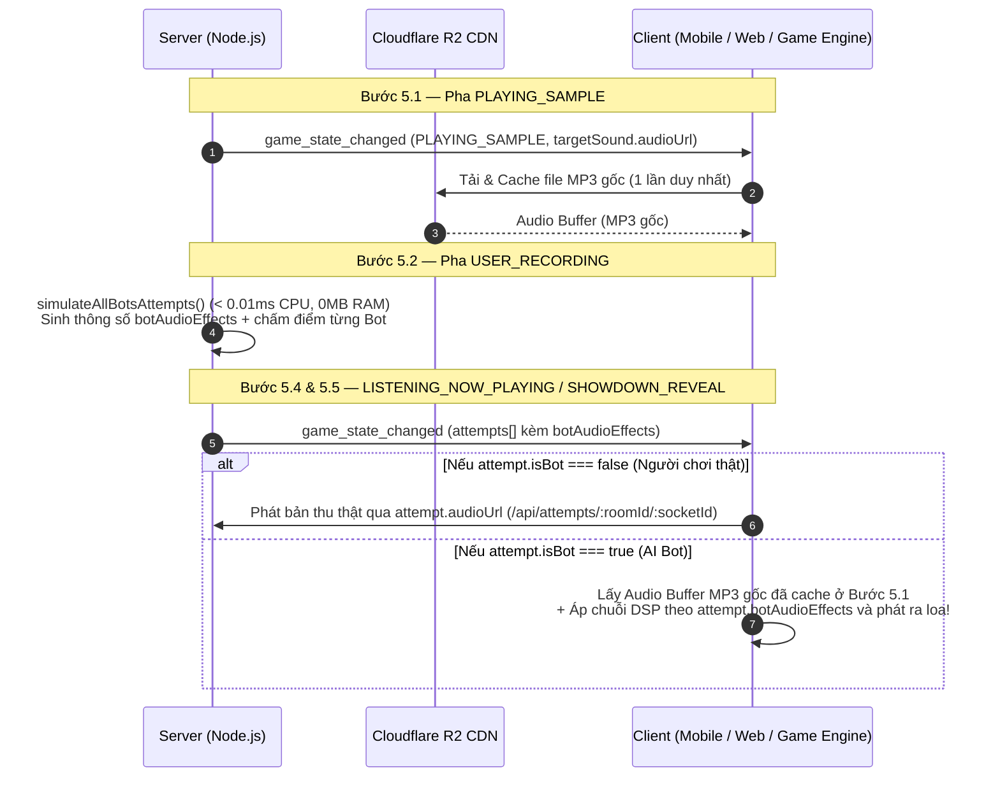

# 🤖 Kế Hoạch Triển Khai Âm Thanh AI Bot Phía Client (`BOT_SOUND_GENERATION_PLAN.md`)

> **Mục tiêu kiến trúc (Hướng 1 — Client-Side Bot DSP):**
> - **Server tốn 0% CPU, 0MB RAM, 0KB Bandwidth** cho âm thanh của Bot (chịu tải hàng nghìn phòng đồng thời không nghẽn Event Loop).
> - **Tận dụng 100% bộ nhớ đệm sẵn có ở Client:** Ở pha `PLAYING_SAMPLE` (Bước 5.1), thiết bị của người chơi đã tải sẵn file MP3 gốc (`targetSound.audioUrl` từ Cloudflare R2 CDN).
> - Khi sang pha phát lại (`LISTENING_NOW_PLAYING` / `SHOWDOWN_REVEAL`), nếu lượt phát là của AI Bot (`attempt.isBot === true`), Client lấy lại chính file `targetSound` đã cache trong máy và **áp chuỗi bộ lọc âm thanh thời gian thực theo thông số `attempt.botAudioEffects`** để tạo ra tiếng nhại tự nhiên như người thật thu qua micro điện thoại.

---

## 1. 🔄 Luồng Hoạt Động Giữa Server & Client



---

## 2. 📦 Cấu Trúc Payload `attempt` & `botAudioEffects` Từ Server

Trong sự kiện `game_state_changed` tại pha `LISTENING_NOW_PLAYING` (Step 5.4) và `SHOWDOWN_REVEAL` (Step 5.5), mỗi phần tử Bot trong mảng `payload.attempts` có cấu trúc như sau:

```json
{
  "socketId": "bot_room1_1",
  "userName": "Bot Mèo Méo",
  "avatar": "🐱",
  "isBot": true,
  "botDifficulty": "NORMAL",
  "roundScore": 78,
  "totalScore": 154,
  "audioUrl": "https://pub-xxx.r2.dev/animals/cat-two.mp3?bot=1&d=NORMAL&p=1.06&s=1.05&delay=95&seed=284",
  "audioStreamUrl": "https://pub-xxx.r2.dev/animals/cat-two.mp3",
  "botSoundId": "cat-two",
  "botSoundFileName": "cat-two.mp3",
  "botPitch": 1.06,
  "botSpeed": 1.05,
  "botAudioEffects": {
    "difficulty": "NORMAL",
    "baseSoundUrl": "https://pub-xxx.r2.dev/animals/cat-two.mp3",
    "pitch": 1.06,
    "pitchSemitones": 1.01,
    "speed": 1.05,
    "pitchScoopCents": -24,
    "vibratoRateHz": 1.82,
    "noiseLevel": 0.041,
    "noiseType": "room_ambience",
    "inhaleBreathMs": 56,
    "inhaleBreathGain": 0.018,
    "distortion": 0.054,
    "tremoloDepth": 0.046,
    "dropoutCount": 0,
    "startDelayMs": 95,
    "bandpassHz": [220, 4200],
    "vocalPresenceHz": 1400,
    "vocalPresenceGainDb": 2.8
  },
  "evaluation": {
    "totalScore": 78,
    "pitchScore": 79,
    "rhythmScore": 76,
    "energyScore": 80,
    "grade": "A",
    "remark": "AI_REMARK_GOOD_1"
  }
}
```

### Ý nghĩa từng trường trong `botAudioEffects` (Dành cho Client Dev)

| Tên trường | Kiểu | Đơn vị / Miền giá trị | Ý nghĩa & Cách áp dụng trên Client |
| :--- | :---: | :---: | :--- |
| `difficulty` | `string` | `'EASY' \| 'NORMAL' \| 'HARD'` | Cấp độ của Bot (`EASY`: Yếu, `NORMAL`: Thông thường, `HARD`: Khó). |
| `baseSoundUrl` | `string` | URL Cloudflare R2 | URL file MP3 mẫu gốc của vòng hiện tại (trùng với `targetSound.audioUrl` đã tải ở `PLAYING_SAMPLE`). |
| `pitch` | `number` | Hệ số nhân (`0.82 .. 1.18`) | Hệ số dịch cao độ **độc lập với tốc độ** (`1.0` = giữ nguyên cao độ gốc). |
| `pitchSemitones` | `number` | Bán âm (`-3.4 .. +2.9`) | Độ lệch cao độ tính bằng Semitones (`12 * log2(pitch)`). Rất tiện nếu Audio Engine dùng đơn vị bán âm hoặc cents (`pitchSemitones * 100`). |
| `speed` | `number` | Hệ số nhân (`0.83 .. 1.17`) | Hệ số tốc độ phát / nhịp độ (`1.0` = tốc độ gốc, `< 1.0` = chậm hơn, `> 1.0` = nhanh hơn). |
| `pitchScoopCents` | `number` | Cents (`-50 .. +50`) | **Hiệu ứng luyến giọng người thật đầu câu:** Trong `120ms` đầu tiên khi bắt đầu phát âm, detune bắt đầu lệch `pitchScoopCents` rồi trượt mượt (exponential ramp) về `0`. |
| `vibratoRateHz` | `number` | Hz (`1.4 .. 2.4 Hz`) | Dao động thanh quản tự nhiên rất chậm của con người (tránh tuyệt đối `> 4Hz` vì sẽ nghe giống robot/ma quái). |
| `startDelayMs` | `number` | Mili-giây (`15 .. 340 ms`) | **Độ trễ phản xạ của người chơi:** Khoảng chờ từ lúc bắt đầu phát tới khi tiếng nhại thực sự vang lên. |
| `inhaleBreathMs` | `number` | Mili-giây (`15 .. 90 ms`) | Độ dài tiếng **hít hơi nhẹ (inhale breath)** ngay trước khi hết `startDelayMs` (lọc Bandpass `450Hz – 1750Hz`). |
| `inhaleBreathGain` | `number` | Gain (`0.006 .. 0.036`) | Âm lượng của tiếng lấy hơi đầu câu. |
| `bandpassHz` | `[number, number]` | `[highpassHz, lowpassHz]` | **Đáp tuyến tần số Micro điện thoại:** Cắt tần số trầm dưới `bandpassHz[0]` (`150–280Hz`) và cắt tần số chói trên `bandpassHz[1]` (`3100–6000Hz`). |
| `vocalPresenceHz` | `number` | Hz (`1150 .. 1450 Hz`) | Tần số trung tâm của bộ lọc **Peaking EQ** mô phỏng cộng hưởng khoang miệng người thật. |
| `vocalPresenceGainDb` | `number` | dB (`+1.8 .. +3.4 dB`) | Độ nâng dải trung (Mid Presence) của Peaking EQ (`Q = 1.1`) giúp âm thanh giống thu qua mic điện thoại. |
| `distortion` | `number` | `0.010 .. 0.150` | Độ nén ấm tự động của điện thoại (**Soft-Knee Phone AGC / Warm Saturation** nhẹ `tanh(x * (1 + distortion))`). |
| `tremoloDepth` | `number` | `0.012 .. 0.120` | Độ biến thiên âm lượng theo hơi thở tự nhiên của người thật (~2Hz). |
| `dropoutCount` | `number` | `0 \| 1 \| 2` | Số nhịp **ngập ngừng / hụt hơi nhẹ** giữa câu (chỉ xuất hiện ở Bot `EASY` hoặc đôi khi `NORMAL`). Tại mỗi điểm ngập ngừng, hạ gain êm theo hàm Cosine xuống `35%` trong `110ms` rồi kéo lên lại (không cắt cụt đột ngột). |
| `noiseLevel` | `number` | `0.008 .. 0.120` | Mức **âm nền phòng trầm ấm (Room Tone)** đã lọc Low-pass `< 400Hz` với biên độ thực tế nhân `0.08` (tức `< 0.01`). |
| `noiseType` | `string` | `'clean_mic' \| 'room_ambience' \| 'mic_static_and_breath'` | Nhãn mô tả môi trường thu âm của Bot. |

---

## 3. 🎛️ Bảng Thông Số Chuẩn Theo 3 Mode (`EASY` / `NORMAL` / `HARD`)

| Tiêu chí | Mode YẾU (`EASY`) | Mode THÔNG THƯỜNG (`NORMAL`) | Mode KHÓ (`HARD`) |
| :--- | :--- | :--- | :--- |
| **Đặc trưng người chơi** | Người mới chơi: phản xạ vào nhịp trễ, lấy hơi rõ, chênh cao độ & nhịp độ rõ, có nhịp ngập ngừng giữa câu. | Người chơi phổ thông: thu âm bằng điện thoại trong phòng, lệch cao độ/nhịp độ nhẹ tự nhiên. | Cao thủ: phản xạ bắt nhịp cực nhanh, cao độ & tốc độ bám rất sát bản gốc, mic trong trẻo. |
| **Cao độ (`pitch`)** | `0.82x – 0.89x` hoặc `1.11x – 1.18x`<br>(`±1.9 .. ±3.3 semitones`) | `0.91x – 0.955x` hoặc `1.045x – 1.09x`<br>(`±0.8 .. ±1.6 semitones`) | `0.968x – 0.99x` hoặc `1.01x – 1.032x`<br>(`±0.17 .. ±0.55 semitones`) |
| **Tốc độ (`speed`)** | `0.83x – 0.90x` hoặc `1.10x – 1.17x` | `0.915x – 0.96x` hoặc `1.04x – 1.085x` | `0.97x – 0.99x` hoặc `1.01x – 1.03x` |
| **Độ trễ phản xạ (`startDelayMs`)** | `180ms – 340ms` | `70ms – 140ms` | `15ms – 40ms` |
| **Tiếng lấy hơi (`inhaleBreathMs`)** | `65ms – 90ms` (rõ nhẹ) | `45ms – 70ms` (tự nhiên) | `15ms – 35ms` (rất khẽ) |
| **Ngập ngừng (`dropoutCount`)** | `1 – 2` nhịp hụt hơi nhẹ | `0 – 1` nhịp | `0` (liền mạch 100%) |
| **Dải tần Mic (`bandpassHz`)** | `[280 Hz, 3100 Hz]` | `[220 Hz, 4200 Hz]` | `[150 Hz, 6000 Hz]` |
| **Peaking EQ (`vocalPresenceHz`)** | `1150 Hz` (`+3.4 dB`) | `1400 Hz` (`+2.8 dB`) | `1450 Hz` (`+1.8 dB`) |
| **Điểm số (`totalScore`)** | **50 – 72 điểm** (Hạng **C / B**) | **68 – 86 điểm** (Hạng **B / A**) | **84 – 97 điểm** (Hạng **A / S**) |

---

## 4. ⚠️ 4 Quy Tắc Vàng Để Âm Thanh Bot Giống Người Thật (Không Bị "Kinh Dị")

Khi đội Client implement bộ lọc, cần tuân thủ 4 quy tắc sau:
1. **LUÔN dùng Audio Buffer của `targetSound` (hoặc `botAudioEffects.baseSoundUrl`)**: Tuyệt đối không dùng bộ phát sóng Sine/Sawtooth tổng hợp thay cho tiếng mẫu gốc.
2. **Không trộn White Noise gắt hoặc tiếng nổ lách tách (Crackle)**: Nếu thêm âm nền phòng (`noiseLevel`), bắt buộc phải lọc Low-pass dưới `350Hz` và giới hạn biên độ thực tế `<= noiseLevel * 0.08` (chỉ tạo cảm giác không gian phòng ấm).
3. **Tách riêng `pitch` và `speed` (Time-Stretch Pitch Shift)** nếu Engine hỗ trợ (như Android `ExoPlayer PlaybackParameters(speed, pitch)`, Unity `AudioMixer Pitch Shifter`, iOS `AVAudioUnitTimePitch`). Nếu trên trình duyệt Web dùng `AudioBufferSourceNode`, hãy kết hợp `playbackRate = speed` và `detune` để bù cao độ độc lập.
4. **Hiệu ứng ngập ngừng (`dropoutCount`) phải giảm âm lượng êm (Cosine Fade 110ms xuống 35%)**: Không bao giờ cắt âm lượng về `0` đột ngột (vì cắt vuông góc sẽ tạo tiếng "tạch" và nghe như lỗi mạng).

---

## 5. 💻 Code Mẫu Triển Khai Cho Từng Nền Tảng Client

### 5.1. Web / React / TypeScript / WebView (Web Audio API)

```typescript
export interface BotAudioEffects {
  difficulty: 'EASY' | 'NORMAL' | 'HARD';
  baseSoundUrl: string;
  pitch: number;
  pitchSemitones: number;
  speed: number;
  pitchScoopCents: number;
  vibratoRateHz: number;
  noiseLevel: number;
  noiseType: string;
  inhaleBreathMs: number;
  inhaleBreathGain: number;
  distortion: number;
  tremoloDepth: number;
  dropoutCount: number;
  startDelayMs: number;
  bandpassHz: [number, number];
  vocalPresenceHz: number;
  vocalPresenceGainDb: number;
}

// Bộ nhớ đệm AudioBuffer ở phía Client (tái sử dụng từ pha PLAYING_SAMPLE)
const clientAudioBufferCache = new Map<string, AudioBuffer>();

export async function preloadSoundBuffer(ctx: AudioContext, url: string): Promise<AudioBuffer> {
  const cached = clientAudioBufferCache.get(url);
  if (cached) return cached;
  const res = await fetch(url);
  const arr = await res.arrayBuffer();
  const decoded = await ctx.decodeAudioData(arr);
  clientAudioBufferCache.set(url, decoded);
  return decoded;
}

/**
 * Phát bài dự thi của AI Bot trực tiếp từ file gốc đã cache + Chuỗi lọc Micro Người Thật
 */
export async function playBotAttemptWithHumanMicDsp(
  ctx: AudioContext,
  fx: BotAudioEffects
): Promise<{ stop: () => void }> {
  const sourceBuffer = await preloadSoundBuffer(ctx, fx.baseSoundUrl);
  const now = ctx.currentTime;
  const startAt = now + fx.startDelayMs / 1000;
  const playDuration = sourceBuffer.duration / fx.speed;

  // 1. Tạo Source Node từ file mẫu gốc
  const source = ctx.createBufferSource();
  source.buffer = sourceBuffer;
  source.playbackRate.setValueAtTime(fx.speed, startAt);

  // Bù detune để tách biệt cao độ (pitch) với tốc độ (speed) + hiệu ứng luyến giọng đầu câu (Pitch Scoop 120ms)
  const targetDetuneCents = 1200 * Math.log2(fx.pitch / fx.speed);
  source.detune.setValueAtTime(targetDetuneCents + fx.pitchScoopCents, startAt);
  source.detune.exponentialRampToValueAtTime(
    targetDetuneCents || 0.01,
    startAt + Math.min(0.12, playDuration * 0.25)
  );

  // 2. Chuỗi lọc Biquad mô phỏng Micro Smartphone & Khoang miệng (High-pass -> Vocal Presence -> Low-pass)
  const hpFilter = ctx.createBiquadFilter();
  hpFilter.type = 'highpass';
  hpFilter.frequency.value = fx.bandpassHz[0];
  hpFilter.Q.value = 0.707;

  const presenceEq = ctx.createBiquadFilter();
  presenceEq.type = 'peaking';
  presenceEq.frequency.value = fx.vocalPresenceHz;
  presenceEq.Q.value = 1.1;
  presenceEq.gain.value = fx.vocalPresenceGainDb;

  const lpFilter = ctx.createBiquadFilter();
  lpFilter.type = 'lowpass';
  lpFilter.frequency.value = fx.bandpassHz[1];
  lpFilter.Q.value = 0.707;

  // 3. Soft-Knee Phone AGC (WaveShaper ấm nhẹ, không gây vỡ tiếng)
  const shaper = ctx.createWaveShaper();
  const drive = 1 + fx.distortion * 1.15;
  const curve = new Float32Array(1024);
  for (let i = 0; i < 1024; i++) {
    const x = (i * 2) / 1024 - 1;
    curve[i] = Math.tanh(x * drive) / Math.tanh(drive);
  }
  shaper.curve = curve;

  // 4. Envelope Gain (Mô phỏng nhịp ngập ngừng êm ái nếu có dropoutCount)
  const envGain = ctx.createGain();
  envGain.gain.setValueAtTime(0.001, startAt);
  envGain.gain.linearRampToValueAtTime(0.95, startAt + 0.02);

  if (fx.dropoutCount > 0) {
    for (let d = 1; d <= fx.dropoutCount; d++) {
      const dipCenter = startAt + (playDuration * (d + 0.15)) / (fx.dropoutCount + 1.3);
      envGain.gain.setValueAtTime(0.95, Math.max(startAt, dipCenter - 0.055));
      envGain.gain.linearRampToValueAtTime(0.38, dipCenter);
      envGain.gain.linearRampToValueAtTime(0.95, Math.min(startAt + playDuration, dipCenter + 0.055));
    }
  }
  envGain.gain.setValueAtTime(0.95, Math.max(startAt, startAt + playDuration - 0.035));
  envGain.gain.linearRampToValueAtTime(0.0001, startAt + playDuration);

  // Kết nối chuỗi xử lý chính
  source
    .connect(hpFilter)
    .connect(presenceEq)
    .connect(lpFilter)
    .connect(shaper)
    .connect(envGain)
    .connect(ctx.destination);

  source.start(startAt);
  source.stop(startAt + playDuration + 0.05);

  return {
    stop: () => {
      try {
        source.stop();
      } catch {
        // ignore if already stopped
      }
    }
  };
}
```

---

### 5.2. Android Native (Kotlin — Media3 `ExoPlayer` + `DynamicsProcessing`)

Trên Android, `ExoPlayer` đã tích hợp sẵn thuật toán **Sonic WSOLA** ở tầng C++ giúp tách rời hoàn toàn `speed` và `pitch` chỉ bằng 1 dòng `PlaybackParameters(speed, pitch)`:

```kotlin
import android.media.audiofx.DynamicsProcessing
import android.os.Handler
import android.os.Looper
import androidx.media3.common.MediaItem
import androidx.media3.common.PlaybackParameters
import androidx.media3.exoplayer.ExoPlayer

fun playBotAttemptAndroid(
    player: ExoPlayer,
    fx: BotAudioEffects
) {
    // 1. Nạp lại chính URL sound gốc (ExoPlayer tự lấy từ MediaCache đã tải ở PLAYING_SAMPLE)
    val mediaItem = MediaItem.fromUri(fx.baseSoundUrl)
    player.setMediaItem(mediaItem)

    // 2. Tách độc lập Tốc độ (speed) và Cao độ (pitch) bằng Sonic DSP có sẵn của ExoPlayer
    player.playbackParameters = PlaybackParameters(
        fx.speed.toFloat(), // Tốc độ phát (Time-stretch)
        fx.pitch.toFloat()  // Cao độ độc lập (Pitch-shift)
    )
    player.prepare()

    // 3. Áp dụng EQ mô phỏng Micro điện thoại qua AudioSessionId
    val sessionId = player.audioSessionId
    if (sessionId != 0 && android.os.Build.VERSION.SDK_INT >= android.os.Build.VERSION_CODES.P) {
        val config = DynamicsProcessing.Config.Builder(
            DynamicsProcessing.VARIANT_FAVOR_FREQUENCY_RESOLUTION,
            1, true, 3, false, 0, false, 0, true
        ).build()
        val dp = DynamicsProcessing(0, sessionId, config)
        // Band 0: Cắt trầm dưới bandpassHz[0]
        dp.setPreEqBandAllChannelsTo(0, DynamicsProcessing.EqBand(true, fx.bandpassHz[0].toFloat(), -12f))
        // Band 1: Nâng giọng khoang miệng vocalPresenceHz
        dp.setPreEqBandAllChannelsTo(1, DynamicsProcessing.EqBand(true, fx.vocalPresenceHz.toFloat(), fx.vocalPresenceGainDb.toFloat()))
        // Band 2: Giảm tần số cao trên bandpassHz[1]
        dp.setPreEqBandAllChannelsTo(2, DynamicsProcessing.EqBand(true, fx.bandpassHz[1].toFloat(), -8f))
        dp.enabled = true
    }

    // 4. Mô phỏng độ trễ phản xạ người chơi (startDelayMs)
    Handler(Looper.getMainLooper()).postDelayed({
        player.play()
    }, fx.startDelayMs.toLong())
}
```

---

### 5.3. Unity / C# (`AudioSource` + `AudioMixer`)

1. Trong `AudioMixer`, tạo một Group tên `BotMicGroup` gồm chuỗi Effect:
   - **Highpass Simple**: Cutoff = `bandpassHz[0]`
   - **Parametric EQ**: Center = `vocalPresenceHz`, Octave Range = `1.0`, Frequency Gain = `1.25` (`+2.8dB`)
   - **Lowpass Simple**: Cutoff = `bandpassHz[1]`
   - **Pitch Shifter**: Dùng để giữ cao độ độc lập khi thay đổi `audioSource.pitch = fx.speed` (`Pitch Shifter = fx.pitch / fx.speed`).
2. Khi phát lượt của Bot:
   - Gán `audioSource.clip = cachedTargetSoundClip` (clip đã tải ở `PLAYING_SAMPLE`).
   - Gán `audioSource.pitch = fx.speed`.
   - Gán `audioMixer.SetFloat("BotPitchShift", fx.pitch / fx.speed)`.
   - Gọi `audioSource.PlayDelayed(fx.startDelayMs / 1000f)`.

---

## 6. 🛡️ Cơ Chế Giới Hạn Chống Quá Tải Client (`Quota 1:1` + `Pre-Recording Staggered Queue` + `Hybrid Fallback`)

Để đảm bảo không bao giờ xảy ra tình trạng 1 máy điện thoại phải render & upload quá nhiều Bot cùng lúc (ví dụ phòng `1 người thật + 3 Bot` hoặc `2 người thật + 3 Bot`), Server áp dụng **4 lớp giới hạn bảo vệ Client**:

### 1. Giới hạn cứng `MAX_BOTS_PER_CLIENT_PER_ROUND = 1` (Quota 1:1)
- **Mỗi máy Client người thật chỉ phải render & upload tối đa ĐÚNG 1 BOT mỗi vòng** (`generationMode = "CLIENT_UPLOAD"`, `requiresClientUpload = true`).
- Nếu số lượng Bot trong phòng **nhiều hơn số người chơi thật** (ví dụ: `1 người thật + 3 Bot` ở Quick Match, hoặc `2 người thật + 3 Bot`), các Bot vượt quá hạn mức `1:1` sẽ tự động chuyển sang chế độ **`generationMode = "LIVE_PLAYBACK_DSP"`** (`assignedGeneratorSocketId = null`, `requiresClientUpload = false`):
  - Client **KHÔNG CẦN** render hay upload file WAV cho các Bot `LIVE_PLAYBACK_DSP`.
  - Khi tới màn `5.5 SHOWDOWN_REVEAL`, nếu người chơi bấm nghe con Bot đó, Audio Player (`ExoPlayer` / `AVAudioEngine`) chỉ việc áp trực tiếp `pitch` + `speed` + `EQ` lên file `targetSound` đã cache trong máy (tốn **0ms render**, **0KB upload**).

| Cấu hình phòng | Phân bổ trên Server (`MAX_BOTS_PER_CLIENT_PER_ROUND = 1`) |
| :--- | :--- |
| **1 Người thật (`U1`) + 3 Bot (`B1, B2, B3`)** | **Hiệp 1:** `U1` chỉ gen **1 Bot (`B1`)** (`CLIENT_UPLOAD`); còn **`B2, B3`** tự chạy **`LIVE_PLAYBACK_DSP`** (0 upload).<br>**Hiệp 2:** Xoay vòng `U1` gen **`B2`**, còn `B1, B3` chạy `LIVE_PLAYBACK_DSP`. |
| **2 Người thật (`U1, U2`) + 3 Bot (`B1, B2, B3`)** | **Hiệp 1:** `U1` gen **`B1`** (1 Bot), `U2` gen **`B2`** (1 Bot), còn **`B3`** chạy **`LIVE_PLAYBACK_DSP`** (0 upload). Không máy nào phải gánh 2 Bot! |
| **2 Người thật (`U1, U2`) + 2 Bot (`B1, B2`)** | **Chia đều 1:1** — Hiệp 1: `U1` gen `B1`, `U2` gen `B2`. Hiệp 2 đảo lượt: `U2` gen `B1`, `U1` gen `B2`. |
| **1 Người thật thoát giữa chừng (`disconnect`)** | Nếu người ở lại (`U2`) đã có 1 Bot rồi, con Bot của người vừa thoát (`U1`) sẽ **tự hạ cấp sang `LIVE_PLAYBACK_DSP`** chứ **tuyệt đối không dồn sang bắt `U2` gánh 2 Bot**! |

### 2. Đẩy sớm `targetSound` & `botAssignments` ngay từ Step `5.0 THEME_SELECTION` (`Pre-Recording Staggered Queue`)
- Thay vì đợi tới lúc mở Mic thu âm (`5.2 USER_RECORDING`) mới gửi thông số Bot, Server gửi sẵn `targetSound` và `botAssignments` ngay từ:
  - **Step `5.0 THEME_SELECTION`** (`3.5s`)
  - **Step `5.1 PLAYING_SAMPLE`** (`4.0s`)
  - **Step `5.1b PREPARE_RECORDING`** (`3.0s`)
- Nhờ đó, Client có **trọn vẹn ~10.5 giây rảnh rỗi trước khi mở Mic** để tải `targetSound`, chạy background thread render đúng **1 con Bot** được giao và gọi `game_submit_bot_audio` lên Server trước cả khi người chơi bắt đầu thu âm!

### 3. Giới hạn tổng số Bot trong phòng & Dung lượng gói tin
- **`MAX_BOTS_PER_ROOM = 3`**: Giới hạn tối đa 3 AI Bot trong 1 phòng (chặn spam thêm Bot gây quá tải). Nếu gọi `add_bot` vượt quá 3 Bot, Server trả về mã lỗi `BOT_LIMIT_EXCEEDED`.
- **`MAX_BOT_AUDIO_UPLOAD_BYTES = 350KB`**: Trần dung lượng tối đa cho 1 file audio Bot upload lên Server (khuyến nghị `16kHz Mono 16-bit PCM WAV`).
- **Chế độ siêu nhẹ cho máy yếu (`Metrics-Only Upload`)**: Nếu thiết bị người chơi quá yếu hoặc mạng 3G chậm, Client chỉ cần gửi `metrics` nhẹ (`< 200 bytes`, không cần đính kèm `audioData`), hoặc bỏ qua luôn — Server tự động fallback về điểm số & stream gốc + DSP recipe của Server mà không bao giờ làm kẹt vòng chơi.

#### Cấu trúc `botAssignments` Server gửi xuống từ Step `5.0 THEME_SELECTION` -> `5.3 UPLOADING_SOUND`:
```json
{
  "state": "THEME_SELECTION",
  "phaseStep": "5.0",
  "maxBotsPerClient": 1,
  "botAssignments": [
    {
      "botSocketId": "bot_1a2b3",
      "botName": "Bot Alpha",
      "botDifficulty": "NORMAL",
      "assignedGeneratorSocketId": "socket_human_A",
      "assignedGeneratorUserName": "Player_A",
      "generationMode": "CLIENT_UPLOAD",
      "requiresClientUpload": true,
      "botAudioEffects": {
        "difficulty": "NORMAL",
        "baseSoundUrl": "https://pub-xxx.r2.dev/animals/cat-two.mp3",
        "botSeed": 100042,
        "assignedGeneratorSocketId": "socket_human_A",
        "generationMode": "CLIENT_UPLOAD",
        "requiresClientUpload": true,
        "pitch": 1.06,
        "pitchSemitones": 1.01,
        "speed": 1.05,
        "startDelayMs": 95,
        "bandpassHz": [220, 4200]
      }
    },
    {
      "botSocketId": "bot_4c5d6",
      "botName": "Bot Meow",
      "botDifficulty": "EASY",
      "assignedGeneratorSocketId": null,
      "assignedGeneratorUserName": null,
      "generationMode": "LIVE_PLAYBACK_DSP",
      "requiresClientUpload": false,
      "botAudioEffects": {
        "difficulty": "EASY",
        "baseSoundUrl": "https://pub-xxx.r2.dev/animals/cat-two.mp3",
        "assignedGeneratorSocketId": null,
        "generationMode": "LIVE_PLAYBACK_DSP",
        "requiresClientUpload": false,
        "pitch": 0.86,
        "speed": 1.14
      }
    }
  ]
}
```

---

## 7. ✅ Checklist Nghiệm Thu Dành Cho Đội Client (QA Checklist)

- [ ] **Mỗi máy chỉ lọc và gen tối đa 1 Bot (`requiresClientUpload === true` && `assignedGeneratorSocketId === mySocketId`)**: Bỏ qua không render file cho các Bot có `generationMode === "LIVE_PLAYBACK_DSP"`.
- [ ] **Render sớm ở Step `5.0 / 5.1 / 5.1b` (Trước khi mở Mic thu âm)**: Ngay khi nhận `botAssignments` ở `THEME_SELECTION` hoặc `PLAYING_SAMPLE`, chạy background job render 1 con Bot được giao và emit `game_submit_bot_audio` luôn để lúc vào `USER_RECORDING` máy hoàn toàn rảnh cho Microphone của người chơi.
- [ ] **Phát lại mượt mà ở màn `5.5 SHOWDOWN_REVEAL`**:
  - Nếu `attempt.botAudioUploaded === true`: Phát trực tiếp từ `attempt.audioUrl` (`/api/attempts/:roomId/:botSocketId`).
  - Nếu `attempt.botAudioUploaded === false` (`LIVE_PLAYBACK_DSP`): Lấy `targetSound` đã cache + gắn `PlaybackParameters(speed, pitch)` trực tiếp lúc người chơi bấm Play.


