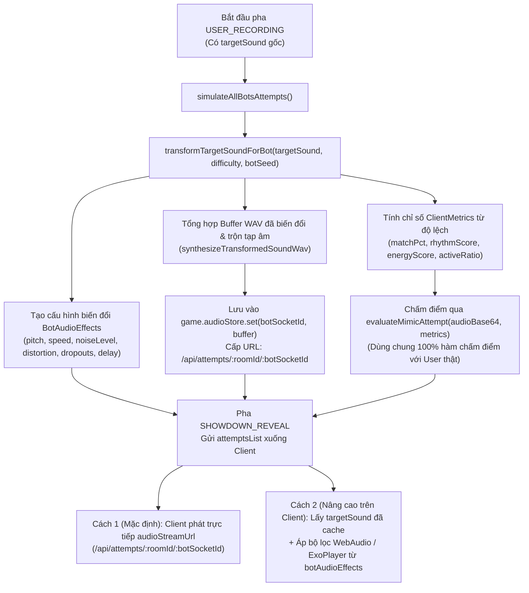

# 🤖 Kế Hoạch Thiết Kế & Đối Chiếu Cơ Chế Tạo Âm Thanh Cho AI Bot (`BOT_SOUND_GENERATION_PLAN.md`)

Tài liệu này phân tích, đánh giá mức độ khả quan và **cân đối giữa 2 phương án kỹ thuật** để AI Bot tạo ra bài thi nhại âm như một người chơi thông thường theo 3 cấp độ (**Yếu / `EASY`**, **Thông thường / `NORMAL`**, **Khó / `HARD`**):
1. **Phương án A (Đề xuất ban đầu — Procedural / Vocal Formant Generation)**: Tổng hợp (generate) ra một luồng sóng âm mới mô phỏng giọng nhại dựa trên đường bao năng lượng và tần số của sound mẫu.
2. **Phương án B (Ý tưởng tối ưu — Original Sound Transformation + Noise/Artifacts)**: Lấy trực tiếp **sound gốc (`targetSound`)** làm nền tảng, biến đổi ít hoặc nhiều tùy theo độ khó và trộn thêm tạp âm, tiếng ồn, tiếng thở, rè mic, trễ nhịp.
3. **Phương án Cân Đối Kết Hợp (Balanced Hybrid Architecture)**: Kết hợp ưu điểm của cả hai hướng để vừa giữ đúng nội dung âm thanh gốc, vừa có chất giọng thu qua micro và hoạt động mượt mà trên cả Server lẫn Client (Android / Web).

---

## 1. ⚖️ Bảng Đối Chiếu & Cân Đối 2 Ý Tưởng

| Tiêu chí đánh giá | Phương án A: Tự Generate Sound Mới<br>*(Procedural / Formant Synthesis)* | Phương án B: Biến Đổi Sound Gốc + Thêm Tạp Âm<br>*(Original Sound Transformation + Noise)* | Phương án Cân Đối Kết Hợp<br>*(Hybrid Transformation + DSP Stream)* |
| :--- | :--- | :--- | :--- |
| **Nguyên lý cốt lõi** | Phân tích tần số cơ bản ($F_0$) và đường bao biên độ (Envelope) để tổng hợp sóng âm mới từ đầu (Oscillator + Harmonics). | Lấy trực tiếp `targetSound` gốc, kéo giãn cao độ (`pitch`), tốc độ (`speed`), lọc dải tần micro (`bandpass`) và chèn tạp âm (`noise`, `crackle`, `dropouts`). | Vừa cung cấp **Buffer WAV đã biến đổi + pha tạp âm** trong `audioStore` (`/api/attempts/...`), vừa gửi kèm **`botAudioEffects` + `baseSoundUrl`** để Client có thể biến đổi trực tiếp trên file `.mp3` gốc. |
| **Độ giống với chủ đề câu hỏi** | **Trung bình (6.5/10)**: Với các câu nói phức tạp hoặc meme có lời (`emotional-damage`, `bing-chilling`), sóng tổng hợp thuần túy không phát âm rõ chữ. | **Rất cao (9.5/10)**: Giữ nguyên lời nói, giai điệu và tiết tấu đặc trưng của chính `targetSound` trong vòng đó. | **Tuyệt đối (10/10)**: Nghe rõ nội dung câu mẫu nhưng đã bị biến dạng/nhiễu theo đúng trình độ của từng Bot. |
| **Cảm giác "Người chơi thu qua Mic"** | **Khá (7.5/10)**: Tạo được độ rung thanh quản (vibrato/formant) nhưng dễ nghe hơi giống tiếng synth/robot nếu thiếu mẫu gốc. | **Rất tự nhiên (9/10)**: Khi kết hợp Bandpass Filter (`250Hz–3600Hz`) + tiếng thở/sôi mic + trễ nhịp đầu file, nghe giống hệt thu lại qua điện thoại. | **Rất tự nhiên (9.5/10)**: Kết hợp cả biến đổi sóng âm, tạp âm phòng/hơi thở và độ rung giọng. |
| **Tải CPU & RAM trên Server** | **Rất nhẹ**: Chỉ mất `< 5ms` để tính toán mảng PCM trong RAM, không cần tải file `.mp3` từ CDN về Server. | **Nhẹ – Trung bình**: Nếu biến đổi trực tiếp bằng DSP trên file `.mp3` tại Server cần giải mã MP3 (`ffmpeg`); nếu gửi kèm bộ lọc DSP hoặc tổng hợp nhẹ thì `< 5ms`. | **Tối ưu nhất**: Server tạo Buffer WAV nhẹ (`~20–50KB`) tức thì (`< 5ms`) lưu vào `audioStore` VÀ trả `botAudioEffects` để Client áp hiệu ứng thời gian thực lên `targetSound` đã cache sẵn. |
| **Tương thích luồng User thường** | Lưu vào `audioStore`, stream qua `/api/attempts/:roomId/:socketId` và chấm điểm qua `evaluateMimicAttempt`. | Lưu vào `audioStore`, stream qua `/api/attempts/:roomId/:socketId` và chấm điểm qua `evaluateMimicAttempt`. | Đồng nhất 100% với luồng nộp bài, chấm điểm và giải phóng RAM (`clearRoundAudioData`) của User thật. |

---

## 2. 🎛️ Thiết Kế Chi Tiết 3 Mode Của Bot (Yếu / Thông thường / Khó)

Hệ thống chuẩn hóa tham số độ khó qua hàm [`normalizeBotDifficulty`](file:///Users/lhd/Documents/WayProjects/Backend-MicMixFun/src/services/audio.service.ts) (hỗ trợ cả tên Tiếng Việt/Anh: `EASY` / `WEAK` / `YEU`, `NORMAL` / `MEDIUM` / `THONG_THUONG`, `HARD` / `DIFFICULT` / `KHO`).

Mỗi Bot trong phòng có một `botSeed` riêng (tính từ `botIndex`, `currentRound`, `socketId`) để đảm bảo **dù có 3 Bot cùng độ khó trong 1 phòng thì mỗi Bot vẫn tạo ra âm thanh và tạp âm khác nhau**.

### 2.1. Bảng thông số biến đổi Sound gốc & Tạp âm (`BotAudioEffects`)

| Thông số kỹ thuật | Mode YẾU (`EASY` / `WEAK`) | Mode THÔNG THƯỜNG (`NORMAL`) | Mode KHÓ (`HARD`) |
| :--- | :--- | :--- | :--- |
| **Mức độ biến đổi chung** | **Biến đổi mạnh** — Lệch tông, sai nhịp, nhiều tiếng ồn và hụt hơi. | **Biến đổi vừa phải** — Có độ lệch tự nhiên như người chơi trung bình. | **Biến đổi rất ít** — Bám sát sound gốc, chỉ khác âm sắc micro nhẹ. |
| **1. Cao độ (`pitch`)** | Lệch `±18% .. 32%`<br>(`0.68x – 0.82x` hoặc `1.18x – 1.32x`) | Lệch `±6% .. 12%`<br>(`0.88x – 0.94x` hoặc `1.06x – 1.12x`) | Lệch `±1% .. 3.5%`<br>(`0.965x – 0.99x` hoặc `1.01x – 1.035x`) |
| **2. Tốc độ / Nhịp (`speed`)** | Lệch `±15% .. 27%`<br>(`0.73x – 0.85x` hoặc `1.15x – 1.27x`) | Lệch `±5% .. 10%`<br>(`0.90x – 0.95x` hoặc `1.05x – 1.10x`) | Lệch `±1% .. 3%`<br>(`0.97x – 0.99x` hoặc `1.01x – 1.03x`) |
| **3. Tạp âm & Tiếng ồn (`noiseLevel`)** | **Cao (`0.20 – 0.32`)**<br>Loại: `mic_static_and_breath` (tiếng sôi mic, tiếng thở mạnh, gió thổi vào mic) | **Vừa phải (`0.07 – 0.12`)**<br>Loại: `room_ambience` (tạp âm nền phòng tự nhiên) | **Rất thấp (`0.01 – 0.035`)**<br>Loại: `clean_mic` (âm thanh trong, gần như phòng thu) |
| **4. Độ rè / Vỡ tiếng (`distortion`)** | **Cao (`0.20 – 0.34`)**<br>Mô phỏng dí sát miệng vào mic gây rè/clipping & tiếng nổ lách tách (`crackle`). | **Nhẹ (`0.06 – 0.12`)**<br>Hơi ấm nhẹ đặc trưng của micro điện thoại. | **Rất thấp (`0.01 – 0.04`)**<br>Giữ nguyên độ động (dynamic range) của sound mẫu. |
| **5. Rung giọng (`tremoloDepth`)** | **Mạnh (`0.18 – 0.28`)**<br>Âm lượng và cao độ chao đảo không ổn định. | **Vừa (`0.08 – 0.13`)**<br>Độ ngân giọng tự nhiên. | **Tinh tế (`0.02 – 0.05`)**<br>Ổn định, chắc nhịp. |
| **6. Hụt hơi / Ngắt quãng (`dropoutCount`)** | **`2 – 3` lần ngắt quãng**<br>Giả lập quên bài hoặc hụt hơi giữa chừng (âm lượng tụt xuống `12%`). | **`0 – 1` lần ngắt nhẹ** | **`0` lần** (liền mạch từ đầu đến cuối). |
| **7. Độ trễ vào nhịp (`startDelayMs`)** | **Trễ nhiều (`230ms – 450ms`)**<br>Đầu bản thu chỉ có tiếng thở/tiếng ồn nền rồi mới phát âm. | **Trễ phản xạ tự nhiên (`75ms – 150ms`)** | **Bắt nhịp tức thì (`12ms – 40ms`)** |
| **8. Lọc tần số Mic (`bandpassHz`)** | `[360 Hz, 2500 Hz]`<br>(Âm thanh bí, nghẹt như loa/mic rẻ tiền) | `[260 Hz, 3600 Hz]`<br>(Chuẩn dải tần micro smartphone) | `[150 Hz, 5800 Hz]`<br>(Dải tần rộng, giữ độ chi tiết cao) |
| **9. Điểm số & Hạng (`evaluateMimicAttempt`)** | **50 – 72 điểm** (Hạng **C / B**) | **68 – 86 điểm** (Hạng **B / A**) | **84 – 97 điểm** (Hạng **A / S**) |

---

## 3. 🔄 Kiến Trúc Luồng Dữ Liệu (Server & Client Phối Hợp)



---

## 4. 💻 Cấu Trúc Payload Tại Pha `SHOWDOWN_REVEAL`

Khi Server chuyển sang trạng thái `SHOWDOWN_REVEAL`, mỗi phần tử của Bot trong `payload.attempts` có đầy đủ dữ liệu như một User thông thường kèm theo `botAudioEffects`:

```json
{
  "socketId": "bot_x8k2p",
  "userName": "Bot Meow",
  "avatar": "🐱",
  "isBot": true,
  "botDifficulty": "EASY",
  "roundScore": 61,
  "totalScore": 134,
  "audioUrl": "/api/attempts/MIMIC99/bot_x8k2p?r=2&b=0&t=1791960669996",
  "audioStreamUrl": "/api/attempts/MIMIC99/bot_x8k2p?r=2",
  "botSoundId": "cat-meow",
  "botSoundFileName": "cat-two.mp3",
  "botPitch": 1.24,
  "botSpeed": 0.81,
  "botAudioEffects": {
    "difficulty": "EASY",
    "baseSoundUrl": "https://pub-2ec3726948d14e47babdc7ea12268a78.r2.dev/animals/cat-two.mp3",
    "pitch": 1.24,
    "speed": 0.81,
    "noiseLevel": 0.245,
    "noiseType": "mic_static_and_breath",
    "distortion": 0.252,
    "tremoloDepth": 0.215,
    "dropoutCount": 2,
    "startDelayMs": 310,
    "bandpassHz": [360, 2500]
  },
  "evaluation": {
    "totalScore": 61,
    "pitchScore": 62,
    "rhythmScore": 59,
    "energyScore": 63,
    "grade": "B",
    "remark": "AI_REMARK_FUNNY_2"
  }
}
```

---

## 5. 📱 Hướng Dẫn Tích Hợp Phía Client (2 Chế Độ Linh Hoạt)

Nhờ kiến trúc cân đối giữa **Plan A (Buffer WAV tổng hợp tại Server)** và **Plan B (Biến đổi trực tiếp từ Sound gốc `targetSound`)**, phía Client (Android / Web) có thể chọn 1 trong 2 cách phát âm thanh của Bot ở màn hình `SHOWDOWN_REVEAL`:

### Cách 1: Phát trực tiếp luồng Audio từ Server (Zero-Config)
* Client không cần phân biệt User hay Bot, chỉ cần đưa `attempt.audioStreamUrl` (`/api/attempts/:roomId/:socketId`) vào trình phát `<audio>` hoặc `MediaPlayer`.
* Server sẽ trả về luồng `audio/wav` đã được tổng hợp theo tần số gốc kèm tiếng ồn trắng/hồng, tiếng rè mic, ngắt quãng và độ trễ của Bot đó.

### Cách 2: Biến đổi trực tiếp file `targetSound` đã cache tại Client bằng `botAudioEffects` (Chất lượng cao nhất & Tiết kiệm băng thông 100%)
* Vì máy Client đã tải sẵn file `targetSound` ở pha `PLAYING_SAMPLE`, khi phát lại lượt của Bot (`attempt.isBot === true` và có `attempt.botAudioEffects`), Client có thể phát lại chính buffer của `targetSound` qua chuỗi hiệu ứng (`AudioContext` trên Web hoặc `ExoPlayer` / `SoundPool` + Noise Generator trên Android):
  1. Chờ `botAudioEffects.startDelayMs` (trong lúc đó phát tiếng ồn nền mức `botAudioEffects.noiseLevel`).
  2. Phát `targetSound` với tốc độ `playbackRate = botAudioEffects.speed` và dịch cao độ `detune = 1200 * Math.log2(botAudioEffects.pitch)`.
  3. Đưa qua bộ lọc `BiquadFilterNode('bandpass')` theo dải `botAudioEffects.bandpassHz` và `WaveShaperNode` theo `botAudioEffects.distortion`.
  4. Trộn thêm kênh tạp âm nền (`noiseLevel`) để tạo ra bản nhại sống động từ chính file âm thanh gốc mà không tốn thêm bất kỳ byte băng thông tải xuống nào.

---

## 6. 🗺️ Lộ Trình Mở Rộng Tiếp Theo (Future Enhancements)

Nếu muốn nâng cấp thêm ở các phiên bản sau, có thể cân nhắc:
1. **Server-side FFmpeg Transform Cache (Tùy chọn)**:
   - Cài đặt `ffmpeg` vào `Dockerfile` (`RUN apk add --no-cache ffmpeg`) để khi cần, Server tải file `.mp3` gốc từ Cloudflare R2, chạy filter chain `asetrate,atempo,aecho,afftdn,anoisesrc,bandpass` trực tiếp trên dữ liệu `.mp3` gốc và xuất ra `audio/webm;codecs=opus` (`~18KB`).
2. **Cá tính hóa giọng Bot (Bot Voice Personas)**:
   - Gắn từng preset Bot (`Bot Meow`, `Bot Cyber`, `Bot Dino`) với một màu giọng cố định (ví dụ `Bot Meow` luôn lệch tông cao `pitch > 1.0`, `Bot Dino` luôn lệch tông trầm `pitch < 1.0`, `Bot Cyber` có thêm hiệu ứng flanger/robotic nhẹ).
