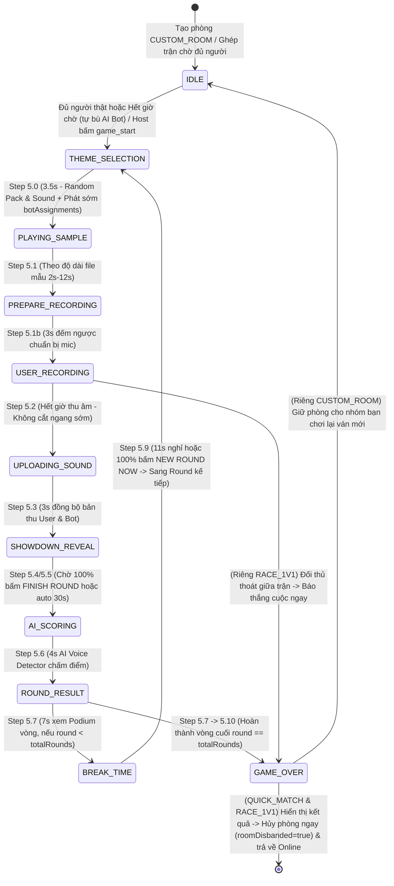

# 📘 Tài Liệu Tính Năng, REST API & Giao Thức Socket.IO (MicMixFun & Mimic Party)

Tài liệu chính thức dành cho đội phát triển **Client (Android / iOS / Web)** tích hợp vào hệ thống **MicMixFun & Mimic Party Backend** (TypeScript + Express 5 + Socket.IO + Cloudflare R2 CDN).

---

## 0. ✨ Tổng Quan Các Tính Năng Hiện Có

1. **Xác Thực & Bảo Mật Đa Lớp (`Auth & Anti-Relay Security`)**:
   - **Firebase Anonymous / ID Token (`RS256`)**: Xác thực chữ ký RSA-SHA256 trực tiếp với chứng chỉ X.509 của Google (`securetoken@system.gserviceaccount.com`).
   - **Guest Session Token (`HMAC-SHA256`)**: Tự động cấp và gia hạn token định danh có thời hạn 7 ngày mà không cần đăng ký mật khẩu.
   - **Client Fingerprint Binding (Hỗ trợ Reverse Proxy / Load Balancer)**: Gắn chặt token với dấu vân tay thiết bị (`Real Client IP qua x-forwarded-for / cf-connecting-ip / x-real-ip + DeviceId/User-Agent`), đồng bộ 100% giữa HTTP REST và WebSocket khi đi qua Railway/Cloudflare Load Balancer và chặn đánh cắp token đem qua môi trường/server trung gian khác.
   - **One-Time Challenge Nonce (`GET /api/auth/challenge`)**: Cơ chế Challenge-Response hiệu lực 30 giây, dùng 1 lần duy nhất để chống Replay Attack.
   - **Rate Limiting & Giới hạn IP thật**: Giới hạn tối đa **15 kết nối đồng thời trên mỗi IP public thật của người dùng**, chống spam Chat (6 tin / 3s), Soundboard (5 lần / 2s), Emoji (5 lần / 1s).

2. **Quản Lý Phòng & Quy Tắc "Đã Out Là Out Hẳn" (`Room Lifecycle & No Reconnect`)**:
   - Tạo phòng (`create_room`), tham gia phòng (`join_room` — chỉ dành cho `CUSTOM_ROOM`), rời phòng (`leave_room`), đóng phòng xóa sạch RAM (`close_room`), đổi trạng thái sẵn sàng (`player_ready_toggle`), mời ra khỏi phòng (`kick_player`).
   - **Tự động chuyển quyền Chủ phòng (`Host Migration`)**: Khi Host rời phòng hoặc mất kết nối, quyền Host tự động chuyển sang người chơi thật kế tiếp.
   - **Bỏ cơ chế tự động Reconnect ("Đã Out là Out hẳn")**: Rời phòng (`leave_room`, `cancel_match`, rớt mạng hoặc mở `create_room`) là xóa vĩnh viễn phiên chơi khỏi phòng cũ (`restoredSession: false, totalScore: 0`). Phòng `QUICK_MATCH` và `RACE_1V1` chặn tuyệt đối mọi lệnh `join_room` (`ROOM_NOT_FOUND`).

3. **Tìm Trận Nhanh, Đấu Tay Đôi 1v1 & Popup Find Match (`Smart Matchmaking Queue + Match Accept Popup`)**:
   - Sự kiện `find_match` / `quick_match` (4 người) và `race_1v1` / `find_1v1_match` (2 người):
     1. Ưu tiên ghép ngay với người chơi thật đang chờ trong phòng mở hoặc hàng đợi (`matchmakingQueue`), hỗ trợ cộng giờ mềm (`+5s`, trần `16s`) khi có thêm người thật vào phòng.
     2. Khi chưa đủ người, phát sự kiện `matchmaking_searching` và đếm ngược mỗi giây qua `matchmaking_tick`.
     3. Hỗ trợ hủy tìm trận bất kỳ lúc nào qua `cancel_match` / `cancel_quick_match` / `decline_match` (`matchmaking_cancelled`).
     4. Khi gom đủ người chơi (`4/4` hoặc `2/2`, gồm người thật hoặc tự bù AI Bot khi hết giờ tìm trận), Server phát `match_found`, `matchmaking_found` và `match_accept_updated` (`state: "MATCH_FOUND"`, `showMatchFoundPopup: true`, `acceptedCount`, `totalPlayers`, với AI Bot tự Accept sẵn `isAccepted: true`). Khi `100%` người chơi bấm `accept_match` (hoặc hết `5s` đếm ngược), Server phát `match_all_accepted` và bắt đầu ngay `5.0 THEME_SELECTION`.

4. **Đấu Trường Nhại Giọng `Mimic Party` (`State Machine`)**:
   - Hỗ trợ cấu hình số vòng (`3, 5, 7, 10` vòng) và thời lượng thu âm (`3 - 15s` hoặc tự động khớp theo độ dài file âm thanh mẫu).
   - Chu trình 9 trạng thái: `IDLE` ➔ `THEME_SELECTION` (3.5s) ➔ `PLAYING_SAMPLE` (theo độ dài file mẫu, hỗ trợ đồng bộ phát xong sớm qua `sample_playback_done`) ➔ `PREPARE_RECORDING` (3s lấy hơi) ➔ `USER_RECORDING` (thu âm & nộp bài) ➔ `UPLOADING_SOUND` (3s đồng bộ) ➔ `SHOWDOWN_REVEAL` (30s nghe lại + thả emoji + bấm `confirm_showdown_skip`) ➔ `AI_SCORING` (4s chấm điểm hồi hộp) ➔ `ROUND_RESULT` (7s Podium vòng) ➔ `BREAK_TIME` (11s nghỉ giải lao / `confirm_next_round_ready`) ➔ `GAME_OVER`.

5. **Hệ Thống AI Bot Thông Minh 3 Cấp Độ (`EASY` / `NORMAL` / `HARD`)**:
   - Quản lý Bot thủ công (`add_bot`, `remove_bot`) hoặc tự động điền đủ 4 người chơi khi bắt đầu (`game_start` với `autoFillBots: true`).
   - Hỗ trợ đồng thời **Quota 1:1 Client Upload (`game_submit_bot_audio` <= 350KB)** và **Live Playback DSP (`LIVE_PLAYBACK_DSP` 0% CPU/RAM Server)**.

6. **Media, Soundboard Đồng Bộ, Chat & Live Mic Stream**:
   - Chat văn bản trong phòng (`send_message`), kích hoạt Soundboard phát đồng loạt trên mọi thiết bị (`trigger_sound`, `stop_all_sounds`), chia sẻ đoạn thu âm (`share_audio_clip`) và truyền giọng nói trực tiếp thời gian thực (`mic_stream_start`, `mic_stream_chunk`, `mic_stream_stop`).

7. **Kho 251 Âm Thanh Cloudflare R2 CDN & Đa Ngôn Ngữ (`VI / EN`)**:
   - 9 chủ đề âm thanh (`animals`, `meme`, `voice1`, `anime`, `voices`, `robots`, `yankee`, `vehicles`, `funny`) lưu trữ trên Cloudflare R2 CDN.
   - Stream trực tiếp bản thu của người chơi/Bot qua HTTP (`GET /api/attempts/:roomId/:socketId`) giúp giảm tải băng thông Socket.IO.
   - Toàn bộ mã lỗi, thông báo hệ thống, lời nhắc game và nhận xét AI được chuẩn hóa dưới dạng Enum đa ngôn ngữ (`GET /api/enums`).

---

## 1. ⚙️ Danh Mục Hằng Số Kỹ Thuật (System Constants)

### 1.1. Thời Gian & Vòng Đấu (Timings & Durations)

| Hằng số (Constant) | Giá trị | Đơn vị | Mô tả |
| :--- | :--- | :--- | :--- |
| `THEME_SELECTION_DURATION` | **3.5** | Giây | Thời gian chạy hiệu ứng quay Roulette chọn chủ đề âm thanh |
| `PLAYING_SAMPLE_DURATION` | **2.0 - 12.0** | Giây | Tự động lấy theo thời lượng thực tế của file mẫu (hoặc kết thúc sớm khi nhận `sample_playback_done`) |
| `PREPARE_RECORDING_DURATION` | **3.0** | Giây | Thời gian đệm đếm ngược 3..2..1 để người chơi lấy hơi và bật micro |
| `USER_RECORDING_DURATION` | **Theo file mẫu (hoặc 3-15s)** | Giây | Thời gian mở micro nhại lại âm thanh |
| `UPLOADING_SOUND_DURATION` | **3.0** | Giây | Thời gian đệm để các máy hoàn tất upload bản thu của người chơi và AI Bot |
| `SHOWDOWN_REVEAL_DURATION`| **30.0**| Giây | Thời gian nghe lại bản thu của nhau, thả emoji & bấm `FINISH ROUND` (`confirm_showdown_skip`) |
| `AI_SCORING_DURATION` | **4.0** | Giây | Thời gian AI phân tích phổ âm thanh và tạo hiệu ứng khóa điểm vòng đấu |
| `ROUND_RESULT_DURATION` | **7.0** | Giây | Thời gian hiển thị Bục vinh danh Top 1-2-3 của vòng (`ROUND RESULTS PODIUM`) |
| `BREAK_TIME_DURATION` | **11.0** | Giây | Thời gian nghỉ giải lao giữa 2 vòng (chuyển sớm nếu 100% bấm `confirm_next_round_ready`) |
| `DEFAULT_TOTAL_ROUNDS` | **3** | Vòng | Số vòng đấu mặc định trong 1 trận (Host có thể cấu hình `3, 5, 7, 10`) |
| `DEFAULT_MATCHMAKING_WAIT_MS` | **10000** | Ms (10s) | Thời gian chờ tìm người chơi thật trước khi tự tạo phòng với AI Bot (`RACE_1V1` mặc định `8000ms`) |
| `DEFAULT_MATCH_ACCEPT_WAIT_MS` | **5000** | Ms (5s) | Thời gian hiển thị Popup Find Match chờ người chơi bấm `accept_match` trước khi tự động Accept & vào trận |
| `ROOM_CLEANUP_DELAY_MS` | **30000**| Ms (30s) | Thời gian giữ phòng riêng `CUSTOM_ROOM` trống trước khi xóa (`QUICK_MATCH` & `RACE_1V1` xóa ngay `0ms`) |

### 1.2. Giới Hạn Tệp Âm Thanh & Buffer (Audio Limits & Specs)

| Hằng số (Constant) | Giá trị | Đơn vị | Mô tả |
| :--- | :--- | :--- | :--- |
| `MAX_HTTP_BUFFER_SIZE` | **1** (`1e6`) | MB | Giới hạn dung lượng tối đa cho 1 gói tin qua Socket.IO để bảo vệ RAM |
| `MAX_USER_AUDIO_UPLOAD_BYTES` | **512 KB** (`524288`) | Bytes | Trần dung lượng tối đa cho 1 bản thu âm của người chơi thật (kiểm tra trước khi cấp phát Buffer) |
| `MAX_BOT_AUDIO_UPLOAD_BYTES` | **350 KB** (`358400`) | Bytes | Trần dung lượng tối đa cho 1 file audio AI Bot do Client upload (vượt trần tự hạ về `LIVE_PLAYBACK_DSP`) |
| `MAX_BOTS_PER_CLIENT_PER_ROUND` | **1** | Bot / Máy | **Quota 1:1**: Mỗi máy Client chỉ phải render & upload tối đa **1 AI Bot / vòng** |
| `MIN_AUDIO_PAYLOAD_SIZE`| **500** | Chars | Ngưỡng chuỗi Base64 tối thiểu để loại bỏ bản thu rỗng/mất tiếng |
| `SAMPLE_RATE` | **24000 - 48000**| Hz | Tần số lấy mẫu âm thanh khuyến nghị cho Android, iOS và Web |
| `AUDIO_CHANNELS` | **1 (Mono)** | Kênh | Định dạng 1 kênh để tối ưu băng thông đường truyền |
| `PREFERRED_MIME_TYPE` | `audio/webm` / `audio/mp4` / `audio/wav` | MIME | Định dạng nén ưu tiên độ trễ thấp |
| `STREAM_URL_THRESHOLD` | **4096** | Chars | Nếu chuỗi Base64 `> 4KB`, server tự thay `audioUrl` bằng đường dẫn HTTP stream `/api/attempts/:roomId/:socketId` để giảm kích thước JSON |

### 1.3. Cấu Hình Phòng, Bot & Bảo Mật (Room, Bot & Security Limits)

| Hằng số (Constant) | Giá trị | Mô tả |
| :--- | :--- | :--- |
| `MAX_MEMBERS_PER_ROOM` | **12** người | Số thành viên tối đa (cả người thật và AI Bot) trong 1 phòng |
| `MAX_BOTS_PER_ROOM` | **3** Bot | Số lượng AI Bot tối đa trong 1 phòng |
| `DEFAULT_MIN_PLAYERS_WITH_BOTS` | **4** người | Số người chơi mục tiêu của `QUICK_MATCH` (hoặc khi bật `autoFillBots` ở phòng 1 người) |
| `RACE_1V1_PLAYERS` | **2** người | Số người chơi cố định của chế độ Đấu Tay Đôi `RACE_1V1` (1 vs 1) |
| `MAX_CHAT_HISTORY_SIZE` | **50** tin nhắn | Số tin nhắn tối đa lưu trữ tạm thời trong RAM mỗi phòng (không lưu chuỗi Base64 audio vào lịch sử) |
| `MAX_USERNAME_LENGTH` | **20** ký tự | Độ dài tối đa của tên hiển thị |
| `MAX_CONNECTIONS_PER_IP` | **15** kết nối | Số kết nối Socket.IO tối đa đồng thời trên cùng 1 địa chỉ IP (tự động đối soát mỗi 60s) |
| `ROOM_CLEANUP_DELAY_MS` | **30000** ms (30s) | Thời gian ân hạn chờ reconnect cho phòng riêng `CUSTOM_ROOM` (`QUICK_MATCH` & `RACE_1V1` hủy ngay `0ms`) |
| `ROOM_IDLE_TIMEOUT_MS` | **30 phút** | Tự động thu hồi phòng `CUSTOM_ROOM` bị bỏ không ở trạng thái `IDLE` / `GAME_OVER` quá 30 phút |
| `CHALLENGE_TTL_MS` | **30000** ms (30s) | Thời hạn hiệu lực của mã One-Time Challenge Nonce (`MAX_CHALLENGE_NONCES = 10000`) |
| `AUTH_TOKEN_TTL_MS` | **7 ngày** | Thời hạn hiệu lực của Session Token (`HMAC-SHA256`) |

---

## 2. 🔄 Hệ Thống Máy Trạng Thái Gameplay (State Machine — 100% Server-Driven)

Server vận hành theo mô hình **State Machine tập trung (100% Server-Authoritative — Không có chủ động Next Round hay nhảy cóc Step từ Client)**. Mọi thứ tự chuyển pha và bộ đếm thời gian đều do Server quyết định tuyệt đối; Client chỉ cần lắng nghe `game_state_changed` và `game_state_tick`:



---

## 3. 🌐 Đặc Tả Chi Tiết REST APIs

Base URL:
* **Local Development**: `http://localhost:3000`
* **Production (Railway)**: `https://micmixfun.up.railway.app`
* **Audio CDN (Cloudflare R2)**: `https://pub-2ec3726948d14e47babdc7ea12268a78.r2.dev`

### 3.1. Bảng Tổng Hợp Các Endpoint

| Method | Endpoint | Mô tả |
| :--- | :--- | :--- |
| `GET` | `/` | Kiểm tra nhanh trạng thái hoạt động của dịch vụ |
| `GET` | `/api/health` | Health Check kèm thống kê số phòng và số kết nối Socket đang hoạt động |
| `GET` | `/api/auth/challenge` | Phát hành mã `nonce` dùng 1 lần (hiệu lực 30s) chống Replay Attack |
| `POST` | `/api/auth/firebase` | Xác thực Firebase ID Token (`RS256`) và đổi lấy `authToken` gắn Fingerprint |
| `POST` | `/api/auth/guest` | Cấp mới hoặc gia hạn Guest Session Token (`HMAC-SHA256`) |
| `GET` | `/api/auth/verify` | Kiểm tra tính hợp lệ và Fingerprint của `authToken` hoặc `firebaseIdToken` |
| `GET` | `/api/rooms` | Lấy danh sách các phòng đang mở trên Server |
| `GET` | `/api/mimic-packs` | Lấy danh sách 9 chủ đề âm thanh (`SOUND_PACKS`) dùng trong Mimic Party |
| `GET` | `/api/sounds` | Lấy danh sách toàn bộ 251 file âm thanh từ `sounds/catalog.json` (hỗ trợ lọc `?pack=`) |
| `GET` | `/api/game-states` | Lấy danh mục `GAME_STATES`, `STATE_LABELS` và toàn bộ từ điển `ENUM_DICTIONARY` |
| `GET` | `/api/enums` | Lấy toàn bộ bảng mã Localization Enum (`VI` / `EN`) cho Client |
| `GET` | `/api/attempts/:roomId/:socketId` | Stream trực tiếp binary audio bản thu của người chơi hoặc AI Bot trong vòng hiện tại |
| `GET` | `/sounds/*`, `/downloaded_sounds/*`, `/audio/*` | Tự động Redirect (`302`) các đường dẫn âm thanh cũ sang Cloudflare R2 CDN |

---

### 3.2. Chi Tiết Request & Response Từng REST API

#### 1) `GET /api/health` — Kiểm tra tình trạng máy chủ & Telemetry tài nguyên
* **Response (`200 OK`)**:
  ```json
  {
    "status": "online",
    "timestamp": 1760494800000,
    "totalActiveRooms": 3,
    "totalConnectedSockets": 11,
    "stateCounters": {
      "rooms": 3,
      "gameSessions": 3,
      "matchmakingQueue": 0,
      "challengeNonces": 2,
      "trackedIps": 8,
      "totalStoredAudioBuffers": 4
    },
    "memory": {
      "rssMB": 68.42,
      "heapUsedMB": 24.15,
      "externalMB": 2.31,
      "arrayBuffersMB": 0.48
    }
  }
  ```

#### 2) `GET /api/auth/challenge` — Lấy One-Time Challenge Nonce
* **Response (`200 OK`)**:
  ```json
  {
    "success": true,
    "nonce": "a4f891c2e7b03d561290ef84a1c3b5d7",
    "timestamp": 1760494800000,
    "expiresInMs": 30000
  }
  ```

#### 3) `POST /api/auth/firebase` — Xác thực Firebase ID Token
* **Headers**: `Content-Type: application/json` (hoặc truyền `Authorization: Bearer <firebaseIdToken>`)
* **Request Body**:
  ```json
  {
    "firebaseIdToken": "eyJhbGciOiJSUzI1NiIsImtpZCI6...",
    "userName": "Alex",
    "avatar": "🦊",
    "deviceId": "android-pixel-8-pro",
    "nonce": "a4f891c2e7b03d561290ef84a1c3b5d7",
    "timestamp": 1760494800000,
    "appSignature": "<HMAC_SHA256(nonce:timestamp:firebaseUid, APP_SIGNING_SECRET)>"
  }
  ```
  *(Lưu ý: `nonce`, `timestamp`, `appSignature` là tuỳ chọn nâng cao khi bật xác thực Challenge-Response).*
* **Response (`200 OK`)**:
  ```json
  {
    "success": true,
    "userId": "fb_9xYzAbCdEfGh123",
    "firebaseUid": "9xYzAbCdEfGh123",
    "provider": "firebase_anonymous",
    "authToken": "eyJ1aWQiOiJmYl85eFl6QWJDZEVmR2gxMjMi...<signature>",
    "expiresAt": 1761099600000,
    "user": {
      "userId": "fb_9xYzAbCdEfGh123",
      "firebaseUid": "9xYzAbCdEfGh123",
      "userName": "Alex",
      "avatar": "🦊"
    }
  }
  ```
* **Error Responses**:
  - `401 Unauthorized`: `{ "success": false, "code": "AUTH_FIREBASE_TOKEN_INVALID", "message": "AUTH_FIREBASE_TOKEN_INVALID" }`
  - `403 Forbidden`: `{ "success": false, "code": "AUTH_CHALLENGE_SIGNATURE_INVALID", "message": "AUTH_CHALLENGE_SIGNATURE_INVALID" }`

#### 4) `POST /api/auth/guest` — Cấp mới hoặc làm mới Guest Session Token
* **Request Body**:
  ```json
  {
    "userName": "Alex",
    "avatar": "🎧",
    "deviceId": "android-pixel-8-pro",
    "authToken": "<token_cũ_nếu_muốn_gia_hạn>",
    "firebaseIdToken": "<tuỳ_chọn_nếu_muốn_gắn_kèm_firebase>"
  }
  ```
* **Response (`200 OK`)**:
  ```json
  {
    "success": true,
    "userId": "u_8f9d2a1b4c3e5f60",
    "firebaseUid": null,
    "provider": "guest",
    "authToken": "eyJ1aWQiOiJ1XzhmOWQyYTFiNGMzZTVmNjAi...<signature>",
    "expiresAt": 1761099600000,
    "user": {
      "userId": "u_8f9d2a1b4c3e5f60",
      "firebaseUid": null,
      "userName": "Alex",
      "avatar": "🎧"
    }
  }
  ```

#### 5) `GET /api/auth/verify` — Kiểm tra Token hiện tại
* **Headers**:
  - `Authorization: Bearer <authToken_hoặc_firebaseIdToken>` (hoặc query `?token=...`)
  - `X-Device-Id: <deviceId>` (nếu lúc cấp token có truyền `deviceId`)
* **Response (`200 OK`)**:
  ```json
  {
    "success": true,
    "valid": true,
    "user": {
      "userId": "u_8f9d2a1b4c3e5f60",
      "firebaseUid": null,
      "provider": "guest",
      "userName": "Alex",
      "avatar": "🎧",
      "expiresAt": 1761099600000
    }
  }
  ```
* **Error Response (`401 Unauthorized`)**:
  ```json
  {
    "success": false,
    "valid": false,
    "code": "AUTH_TOKEN_INVALID_OR_EXPIRED",
    "message": "AUTH_TOKEN_INVALID_OR_EXPIRED"
  }
  ```

#### 6) `GET /api/rooms` — Danh sách phòng đang mở
* **Query Params**: `?limit=100&includeMatchmaking=false` *(Mặc định chỉ trả về các phòng riêng `CUSTOM_ROOM`, tối đa 100 phòng; truyền `includeMatchmaking=true` nếu muốn xem cả phòng `QUICK_MATCH` / `RACE_1V1`)*.
* **Response (`200 OK`)**:
  ```json
  {
    "rooms": [
      {
        "roomId": "MIMIC99",
        "roomName": "Phòng Đại Chiến",
        "mode": "CUSTOM_ROOM",
        "memberCount": 4,
        "maxMembers": 12,
        "gameState": "IDLE",
        "createdAt": 1760494700000
      }
    ]
  }
  ```

#### 7) `GET /api/mimic-packs` — Danh sách các gói chủ đề âm thanh
* **Response (`200 OK`)**:
  ```json
  {
    "packs": [
      {
        "id": "animals",
        "name": "PACK_NAME_ANIMALS",
        "emoji": "🐾",
        "description": "PACK_DESC_ANIMALS",
        "sounds": [
          {
            "id": "animals_cat-two",
            "name": "Cat Two",
            "emoji": "🐱",
            "fileName": "cat-two.mp3",
            "relativePath": "animals/cat-two.mp3",
            "hint": "Mimic the sound of Cat Two!"
          }
        ]
      }
    ]
  }
  ```

#### 8) `GET /api/sounds` — Danh mục 251 file âm thanh trên CDN
* **Query Params**: `?pack=animals` *(tuỳ chọn: lọc theo tên pack như `animals`, `meme`, `anime`, `voices`, `voice1`, `robots`, `yankee`, `vehicles`, `funny`, `everyday`, `melody`, `signals`, `space`, `common`)*
* **Response (`200 OK`)**:
  ```json
  {
    "count": 251,
    "packCounts": {
      "animals": 32,
      "meme": 28,
      "anime": 24
    },
    "sounds": [
      {
        "id": "cat-two",
        "pack": "animals",
        "fileName": "cat-two.mp3",
        "relativePath": "animals/cat-two.mp3",
        "name": "Cat Two",
        "url": "https://pub-2ec3726948d14e47babdc7ea12268a78.r2.dev/animals/cat-two.mp3"
      }
    ]
  }
  ```

#### 9) `GET /api/enums` & `GET /api/game-states` — Từ điển mã Enum Đa Ngôn Ngữ (`VI / EN`)
* **Response (`200 OK`)**:
  ```json
  {
    "states": {
      "IDLE": "IDLE",
      "THEME_SELECTION": "THEME_SELECTION",
      "PLAYING_SAMPLE": "PLAYING_SAMPLE",
      "PREPARE_RECORDING": "PREPARE_RECORDING",
      "USER_RECORDING": "USER_RECORDING",
      "AI_SCORING": "AI_SCORING",
      "SHOWDOWN_REVEAL": "SHOWDOWN_REVEAL",
      "ROUND_RESULT": "ROUND_RESULT",
      "GAME_OVER": "GAME_OVER"
    },
    "labels": {
      "IDLE": "STATE_LABEL_IDLE",
      "THEME_SELECTION": "STATE_LABEL_THEME_SELECTION"
    },
    "enums": {
      "errorCodes": { "ROOM_NOT_FOUND": "ROOM_NOT_FOUND" },
      "systemMessageCodes": { "SYS_HOST_JOINED_ROOM": "SYS_HOST_JOINED_ROOM" },
      "gameMessageCodes": { "GAME_MSG_USER_RECORDING": "GAME_MSG_USER_RECORDING" },
      "roomCloseReasonCodes": { "HOST_CLOSED": "HOST_CLOSED" },
      "stateLabelCodes": { "STATE_LABEL_IDLE": "STATE_LABEL_IDLE" },
      "aiRemarkCodes": { "AI_REMARK_LEGENDARY_1": "AI_REMARK_LEGENDARY_1" },
      "soundPackNameCodes": { "PACK_NAME_ANIMALS": "PACK_NAME_ANIMALS" },
      "soundPackDescCodes": { "PACK_DESC_ANIMALS": "PACK_DESC_ANIMALS" }
    },
    "descriptions": {
      "ROOM_NOT_FOUND": {
        "code": "ROOM_NOT_FOUND",
        "vi": "Phòng chơi không tồn tại hoặc đã giải tán!",
        "en": "Room does not exist or has been closed.",
        "context": "Khi vào phòng hoặc lấy dữ liệu phòng không còn tồn tại"
      }
    }
  }
  ```

#### 10) `GET /api/attempts/:roomId/:socketId` — Stream Audio bản thu của Người chơi / AI Bot
* **Mô tả**: Trả về trực tiếp binary buffer (`audio/webm`, `audio/mp4` hoặc `audio/wav` đối với AI Bot thuộc chế độ `CLIENT_UPLOAD`). Đối với AI Bot thuộc chế độ `LIVE_PLAYBACK_DSP` (không cần Client upload), endpoint này tự động Redirect (`302`) sang URL file âm thanh gốc trên CDN. Tự động xoá khỏi RAM sau mỗi vòng và khi kết thúc game.
* **Error Responses**:
  - `404 Not Found` (`ROOM_NOT_FOUND` hoặc `ATTEMPT_AUDIO_NOT_FOUND`).

---

## 4. ⚡ Đặc Tả Đầy Đủ Giao Thức Socket.IO (Socket Specifications)

### 4.0. Kết Nối Handshake (`io.connect`)
Khi khởi tạo kết nối Socket.IO, Client có thể truyền thông tin xác thực trong `auth`:
```javascript
const socket = io("https://micmixfun.up.railway.app", {
  transports: ["websocket"],
  auth: {
    token: "<authToken_HMAC>",           // Hoặc dùng trường authToken
    firebaseIdToken: "<firebase_jwt>",   // Tuỳ chọn nếu dùng Firebase Auth
    deviceId: "android-device-id-001",   // Dùng để đối chiếu Client Fingerprint
    nonce: "<challenge_nonce>",          // Tuỳ chọn Challenge-Response
    timestamp: 1760494800000,
    appSignature: "<hmac_signature>"
  }
});
```

---

### 4.1. Sự Kiện Client Gửi Lên Server (`Client ➔ Server`)

#### Nhóm A — Xác Thực & Quản Lý Phòng (`room.handler.ts`)

| Event Name | Payload Gửi Lên | Callback Response (`ack`) | Mô tả |
| :--- | :--- | :--- | :--- |
| `auth_guest` / `auth_firebase` | `{ userName, avatar, authToken?, firebaseIdToken? }` | `{ success: true, userId, firebaseUid, provider, authToken, expiresAt, user }` | Xác thực hoặc đổi tên/avatar trực tiếp trên kết nối Socket |
| `create_room` | `{ roomId?, roomName?, userName?, avatar? }` | `{ success: true, roomId, roomName, hostId, mode: "CUSTOM_ROOM", authToken, expiresAt, room, user, gameState }` | **Tạo phòng riêng (`CUSTOM_ROOM`)**: Tự động thoát sạch mọi phòng cũ (`QUICK_MATCH` / `RACE_1V1` / `CUSTOM_ROOM`), bỏ qua `roomId` cũ của phòng Matchmaking nếu Client gửi nhầm, đưa người tạo vào phòng mới làm `HOST` (`isReady: true`) và khởi tạo `MimicGameSession` ngay trong 1 bước |
| `join_room` | `{ roomId, userName, avatar, userId?, authToken?, firebaseIdToken?, createIfNotExists?: false }` | `{ success: true, authToken, expiresAt, restoredSession: false, room, user, gameState }` | **Vào phòng riêng (`CUSTOM_ROOM`) theo mã Code**: Chỉ cho phép vào phòng `CUSTOM_ROOM` khi nhập đúng mã phòng. **Bỏ hoàn toàn cơ chế tự động Reconnect**: Đã thoát phòng là thoát hẳn! Mọi lệnh `join_room` vào phòng `QUICK_MATCH` hoặc `RACE_1V1` đều bị chặn tuyệt đối (`ROOM_NOT_FOUND`) |
| `leave_room` | `{}` | `{ success: true }` | **Rời khỏi phòng hiện tại dứt điểm** (không lưu trạng thái chờ reconnect; nếu không còn người thật nào trong phòng thì hủy phòng ngay lập tức `0ms`) |
| `close_room` | `{ roomId? }` | `{ success: true, roomId, cleared: true }` | **(Chỉ Host)** Đóng phòng ngay lập tức và giải phóng toàn bộ RAM |
| `player_ready_toggle` | `{ roomId?, isReady?: boolean }` | `{ success: true, isReady }` | Bật / tắt trạng thái sẵn sàng tại sảnh chờ (hoặc xác nhận Accept nếu đang ở Popup Find Match) |
| `kick_player` | `{ roomId?, targetSocketId }` | `{ success: true }` | **(Chỉ Host)** Mời người chơi hoặc xóa AI Bot khỏi phòng |
| `add_bot` | `{ roomId?, difficulty?: "EASY"\|"NORMAL"\|"HARD", botName?, avatar? }` | `{ success: true, bot, members }` | **(Chỉ Host)** Thêm 1 AI Bot vào phòng khi ở trạng thái `IDLE` / `GAME_OVER` |
| `remove_bot` | `{ roomId?, botSocketId? }` | `{ success: true, removedBot, members }` | **(Chỉ Host)** Xóa 1 AI Bot khỏi phòng (nếu không truyền `botSocketId` sẽ xóa Bot cuối) |

#### Nhóm B — Tìm Trận Nhanh / Smart Matchmaking & Popup Find Match (`room.handler.ts`) — Hỗ Trợ `QUICK_MATCH` (4P) & `RACE_1V1` (2P)

| Event Name | Payload Gửi Lên | Callback Response (`ack`) | Mô tả |
| :--- | :--- | :--- | :--- |
| `find_match` (hoặc `quick_match`) | `{ userName?, avatar?, mode?: "QUICK_MATCH"\|"RACE_1V1", botCount?: 3, botDifficulty?, autoStart?: true, waitMs?: 10000, waitForPlayers?: true, acceptWaitMs?: 5000, requireAccept?: true }` | `{ success: true, searching, state: "FINDING_MATCH"\|"MATCH_FOUND", showMatchFoundPopup, acceptedCount, totalPlayers, targetPlayers, acceptedSocketIds, allAccepted, matchedWithHumans, timedOutToBots?, botsAdded, autoStarted, roomId, room, user, gameState }` | Tìm trận nhanh **4 Người (`QUICK_MATCH`)**: Ưu tiên Best-Fit (`3/4 ➔ 2/4 ➔ 1/4`) + FIFO. Chờ cơ bản `10s`; khi tìm được thêm người thật (`2/4` hoặc `3/4`) lúc đồng hồ `< 5s` thì tự **cộng giờ mềm `+5s`** (trần tối đa `16s`). Hết giờ tự bù `(4 - N)` AI Bot. Khi đủ `4/4` người (người thật hoặc người thật + Bot), Server bắn `match_found` & `match_accept_updated` để hiển thị **Popup Find Match + số người đã Accept (`acceptedCount / totalPlayers`)** |
| `race_1v1` (hoặc `find_1v1_match`) | `{ userName?, avatar?, botDifficulty?, autoStart?: true, waitMs?: 8000, waitForPlayers?: true, acceptWaitMs?: 5000, requireAccept?: true }` | `{ success: true, searching, state: "FINDING_MATCH"\|"MATCH_FOUND", showMatchFoundPopup, acceptedCount, totalPlayers: 2, targetPlayers: 2, acceptedSocketIds, allAccepted, mode: "RACE_1V1", matchedWithHumans, timedOutToBots?, botsAdded, autoStarted, roomId, room, user, gameState }` | Tìm trận **Đấu Tay Đôi `1vs1 Race` (`2 Người`)**: Khóa cứng `targetPlayers = 2`. Ghép đủ `2/2` người thật (hoặc hết `8s` chờ tự bù `1 AI Bot`) sẽ bắn `match_found` & `match_accept_updated` để hiển thị **Popup Find Match + số người đã Accept (`acceptedCount / 2`)** |
| `accept_match` (hoặc `confirm_match_accept`, `match_accept`) | `{ roomId? }` | `{ success: true, roomId, acceptedCount, totalPlayers, targetPlayers, acceptedSocketIds, allAccepted, autoStarted, members }` | **Xác nhận Accept trên Popup Find Match**: Khi người chơi bấm nút **"ACCEPT"**, Server tăng `acceptedCount`, broadcast `match_accept_updated` (`acceptedCount / totalPlayers`) cho toàn phòng. AI Bot luôn được đánh dấu `isAccepted = true` ngay từ đầu. Khi **100% người chơi đã Accept** (`acceptedCount === totalPlayers`) hoặc hết `5s` đếm ngược Accept, Server phát `match_all_accepted` và bắt đầu ngay Step `5.0 THEME_SELECTION` |
| `cancel_match` (hoặc `cancel_quick_match`, `decline_match`) | `{}` (hoặc không truyền data) | `{ success: true, cancelled: boolean, cancelledFromPreStartRoom: boolean, searching: false, state: "IDLE", showMatchFoundPopup: false, systemMessage: "SYS_MATCHMAKING_CANCELLED" }` | **Unified Cancel / Decline Match**: Hủy tìm trận khi đang đứng lẻ `1/4` trong Queue, khi đang ở phòng chờ `2/4`, `3/4`, hoặc khi từ chối ở Popup Find Match trước khi trận đấu bắt đầu |
| `get_matchmaking_state` | `{}` | `{ searching: boolean, state: "FINDING_MATCH"\|"MATCH_FOUND"\|"IDLE", showMatchFoundPopup: boolean, acceptedCount, totalPlayers, roomId?, mode, currentPlayers, targetPlayers, members, waitMs, remainingMs, timeRemaining, elapsedSeconds, totalDuration, progressPercent, startedAt, endsAt }` | Lấy trạng thái đồng hồ tìm trận / Popup Find Match (`acceptedCount / totalPlayers`) và danh sách ghế Avatar (`members`) hiện tại từ Server |

#### Nhóm C — Gameplay Đấu Trường Nhại Giọng (`game.handler.ts`) — Chuẩn UI Figma (`5.1` ➔ `5.10`)

| Event Name | Payload Gửi Lên | Callback Response (`ack`) | Mô tả |
| :--- | :--- | :--- | :--- |
| `game_start` (hoặc `fill_bots_and_start`, `matchmaking_timeout`) | `{ roomId?, requireAllReady?: false, autoFillBots?: boolean, minPlayers?: 4, botCount?, botDifficulty? }` | `{ success: true, botsAdded, totalPlayers }` | **(Chỉ Host)** Bắt đầu trận đấu. Với `CUSTOM_ROOM` đã có từ 2 thành viên trở lên (`>= 2`), Server **không tự động chèn AI Bot** (trừ khi Host truyền rõ `autoFillBots: true`, `botCount > 0` hoặc gọi `fill_bots_and_start`). Nếu chỉ có 1 mình Host thì tự bù thêm Bot cho đủ 4 người |
| `game_update_config` | `{ roomId?, totalRounds?: 3\|5\|7\|10, recordDuration?: 3..15, useCustomRecordDuration?: boolean }` | `{ success: true, totalRounds, recordDuration }` | **(Chỉ Host)** Cập nhật số vòng đấu và thời gian thu âm khi ở sảnh chờ |
| `sample_playback_done` | `{ roomId? }` | — | Ghi nhận thiết bị đã phát xong file âm thanh mẫu (Server vẫn giữ đúng bộ đếm `PLAYING_SAMPLE` trước khi sang `PREPARE_RECORDING`) |
| `game_submit_audio` | `{ roomId?, botSocketId?, audioData: "data:audio/webm;base64,...", mimeType?: "audio/webm", metrics?: { matchPct?, melodyScore?, pitchScore?, rhythmScore?, energyScore?, attackScore?, activeRatio? } }` | `{ success: true, evaluation: { totalScore, pitchScore, melodyScore, rhythmScore, energyScore, attackScore, grade, remark } }` | Nộp bản thu âm nhại giọng của User (tối đa `512KB`). Server giải mã 1 lần qua `decodeBoundedBase64Audio`, chấm điểm theo chuẩn Figma (`Melody 50% · Rhythm 30% · Attack 20%`) và lưu vào `audioStore` để phát qua `/api/attempts/:roomId/:socketId` |
| `game_submit_bot_audio` | `{ roomId?, botSocketId, audioData?: "data:audio/wav;base64,...", mimeType?: "audio/wav", metrics?: { matchPct?, melodyScore?, rhythmScore?, attackScore?, activeRatio? } }` | `{ success: true, botSocketId, uploadedBy, assignedGeneratorSocketId, generationMode, audioUrl, evaluation }` | Client được phân công (`assignedGeneratorSocketId`, tối đa **1 Bot/Client/vòng**) nộp file audio đã gen cho AI Bot (`<= 350KB`) hoặc chỉ gửi `metrics` nhẹ. Nếu Bot không được gán upload hoặc vượt trần `350KB`, tự động dùng chế độ `LIVE_PLAYBACK_DSP` |
| `game_emoji_reaction` | `{ roomId?, emoji: "😂" }` | — | Thả biểu tượng cảm xúc bay trên màn hình (tối đa 5 lần / giây) |
| `confirm_showdown_skip` (hoặc `finish_round`, `skip_to_round_result`) | `{ roomId? }` | `{ success: true, isVoted, skipCount, totalCount, allSkipConfirmed }` | **Màn `SHOWDOWN_REVEAL` (`5.4 + 5.5` — `"FINISH ROUND ▶"`)**: Người chơi click nghe tự do các bản thu âm trong danh sách `"Players' Recordings"`, nghe xong bấm **"FINISH ROUND ▶"**. AI Bot luôn được đánh dấu Done sẵn (`100%`). Ngay khi **100% người chơi đã bấm Done** (hoặc hết `30s` AFK safety timer), Server lập tức chuyển sang `AI_SCORING` (`5.6`) |
| `confirm_next_round_ready` (hoặc `new_round_now`) | `{ roomId? }` | `{ success: true, readyCount, totalCount, allReady }` | **Màn `BREAK_TIME` (`5.9` — `"NEW ROUND NOW"`) / `ROUND_RESULT` (`5.7`) / `GAME_OVER` (`5.10` ở `CUSTOM_ROOM`)**: Khi người chơi bấm **"NEW ROUND NOW"**, nếu **100% người thật trong phòng đã bấm**, Server chuyển thẳng sang Round tiếp theo ngay lập tức mà không cần đợi hết `11s` đếm ngược |
| `get_game_state` | `{ roomId? }` | `GameStateSnapshot \| null` | Lấy trạng thái hiện tại của bàn chơi (chỉ trả về dữ liệu nếu socket hiện đang là thành viên hợp lệ trong phòng đó) |

#### Nhóm D — Chat, Soundboard, Chia Sẻ Audio & Live Mic (`media.handler.ts`)

| Event Name | Payload Gửi Lên | Callback Response (`ack`) | Mô tả |
| :--- | :--- | :--- | :--- |
| `send_message` | `{ message: "Hello!", type?: "text", audioMeta?: null }` | `{ success: true, messageId }` | Gửi tin nhắn chat vào phòng (Rate limit: 6 tin / 3s, lưu tối đa 50 tin gần nhất) |
| `trigger_sound` | `{ soundId, soundName?, soundUrl, volume?: 1.0, pitch?: 1.0 }` | `{ success: true }` | Phát hiệu ứng âm thanh Soundboard đồng bộ cho toàn bộ thành viên trong phòng (Rate limit: 5 lần / 2s) |
| `stop_all_sounds` | `{}` | — | Dừng tất cả âm thanh Soundboard đang phát trong phòng |
| `share_audio_clip` | `{ audioData, audioName?, duration?, mimeType?: "audio/webm" }` | `{ success: true, audioId }` | Chia sẻ đoạn ghi âm ngắn realtime cho các thành viên đang online trong phòng (Rate limit: 5 clip / 10s; trong lịch sử `room.messages` tự động đặt `audioData: null, truncatedForMemory: true` để bảo vệ RAM) |
| `mic_stream_start` | `{ sampleRate?: 48000, channels?: 1 }` | — | Bắt đầu truyền giọng nói trực tiếp (Live Mic Stream) |
| `mic_stream_chunk` | `<ArrayBuffer \| Base64Chunk>` | — | Gửi từng mảnh dữ liệu âm thanh micro thời gian thực |
| `mic_stream_stop` | `{}` | — | Kết thúc truyền giọng nói trực tiếp |

---

### 4.2. Sự Kiện Server Bắn Xuống Client (`Server ➔ Client`)

#### 1) Sự kiện Phòng, Smart Matchmaking & Popup Find Match (`acceptedCount / totalPlayers`)
* **`joined_room_success`**: Gửi riêng cho socket vừa vào phòng thành công (cấu trúc giống hệt callback của `join_room`).
* **`user_joined`**: Broadcast khi có người chơi hoặc Bot mới vào phòng:
  ```json
  {
    "user": { "socketId": "...", "userId": "...", "userName": "Alex", "avatar": "🦊", "role": "PLAYER", "isReady": false },
    "members": [ ... ],
    "systemMessage": "SYS_PLAYER_JOINED_ROOM",
    "messageCode": "SYS_PLAYER_JOINED_ROOM",
    "messageParams": { "userName": "Alex", "role": "PLAYER" }
  }
  ```
* **`user_left`**: Broadcast khi có thành viên rời phòng (`{ socketId, userName, members, systemMessage: "SYS_USER_LEFT_ROOM", messageParams }`).
* **`host_changed`**: Broadcast khi Chủ phòng cũ rời đi và quyền Host được chuyển giao (`{ newHostId, newHostName, members, systemMessage: "SYS_HOST_CHANGED" }`).
* **`player_ready_changed`**: Broadcast khi người chơi bật/tắt sẵn sàng tại sảnh (`{ socketId, userName, isReady, members, systemMessage }`).
* **`kicked_from_room`**: Gửi riêng cho người bị Host kick (`{ code: "ROOM_KICKED_BY_HOST", message: "ROOM_KICKED_BY_HOST" }`).
* **`room_closed`**: Broadcast khi phòng bị đóng (`{ roomId, reason: "HOST_CLOSED", message: "SYS_HOST_CLOSED_ROOM", messageParams, timestamp }`).
* **`bot_added` / `bot_removed` / `bots_auto_filled`**: Broadcast khi thêm/xóa Bot thủ công hoặc tự động điền Bot lúc bắt đầu game.
* **`matchmaking_searching`**: Gửi ngay khi bắt đầu vào hàng đợi chờ tìm người chơi thật, hoặc khi gom vào phòng chờ `2/4`, `3/4` (Server quản lý 100% timer tìm trận và trả về danh sách `members` để UI vẽ 4 ô ghế Avatar sáng dần `1/4 ➔ 2/4 ➔ 3/4`):
  ```json
  {
    "searching": true,
    "state": "FINDING_MATCH",
    "showMatchFoundPopup": false,
    "roomId": "A1B2C3",
    "mode": "QUICK_MATCH",
    "currentPlayers": 2,
    "targetPlayers": 4,
    "acceptedCount": 0,
    "totalPlayers": 2,
    "members": [
      { "socketId": "...", "userName": "Player1", "avatar": "🎧", "role": "HOST", "isBot": false, "isAccepted": false },
      { "socketId": "...", "userName": "Player2", "avatar": "🦊", "role": "PLAYER", "isBot": false, "isAccepted": false }
    ],
    "waitMs": 10000,
    "remainingMs": 10000,
    "timeRemaining": 10,
    "elapsedSeconds": 0,
    "totalWaitSeconds": 10,
    "totalDuration": 10,
    "progressPercent": 0,
    "extended": false,
    "extendedBonusSeconds": 0,
    "startedAt": 1760494800000,
    "endsAt": 1760494810000,
    "timestamp": 1760494800000,
    "systemMessage": "SYS_MATCHMAKING_SEARCHING",
    "messageCode": "SYS_MATCHMAKING_SEARCHING",
    "messageParams": { "waitSeconds": 10, "waitMs": 10000 }
  }
  ```
* **`matchmaking_tick`**: Server bắn định kỳ mỗi `1 giây` (bắt đầu từ `t = 0s` đến khi hết giờ, kèm `currentPlayers`, `members`, `extended`, `extendedBonusSeconds`) để Client chỉ việc bind trực tiếp lên UI đồng hồ tìm trận và các ô Avatar mà **không cần tự chạy timer phía Client**:
  ```json
  {
    "searching": true,
    "state": "FINDING_MATCH",
    "showMatchFoundPopup": false,
    "roomId": "A1B2C3",
    "mode": "QUICK_MATCH",
    "currentPlayers": 3,
    "targetPlayers": 4,
    "acceptedCount": 0,
    "totalPlayers": 3,
    "members": [ ... ],
    "waitMs": 13000,
    "remainingMs": 6000,
    "timeRemaining": 6,
    "elapsedSeconds": 7,
    "totalWaitSeconds": 13,
    "totalDuration": 13,
    "progressPercent": 54,
    "extended": true,
    "extendedBonusSeconds": 5,
    "startedAt": 1760494800000,
    "endsAt": 1760494813000,
    "timestamp": 1760494807000
  }
  ```
* **`matchmaking_player_joined`**: Broadcast ngay khi có người chơi thật mới ghép vào phòng chờ (`2/4` hoặc `3/4`) làm kích hoạt cộng giờ mềm (`+5s` khi còn `< 5s`, trần `16s`) để Client hiển thị hiệu ứng sáng ô Avatar mới và cộng thêm giây chờ (`{ roomId, mode, currentPlayers, targetPlayers, members, extended: true, extendedBonusSeconds: 5, timeRemaining, remainingMs, totalWaitSeconds }`).
* **`match_found` / `matchmaking_found` / `match_accept_updated` (Show Popup Find Match + Số Người Đã Accept)**:
  - Broadcast ngay khi phòng đã gom đủ số người chơi mục tiêu (`4/4` ở `QUICK_MATCH` hoặc `2/2` ở `RACE_1V1`, bao gồm cả người thật lẫn AI Bot được bù khi hết giờ tìm trận), và mỗi khi có người chơi bấm nút Accept (`accept_match`).
  - **AI Bot luôn được đánh dấu `isAccepted: true` ngay từ đầu** (ví dụ: 1 người thật + 3 AI Bot sẽ hiển thị ngay `acceptedCount: 3, totalPlayers: 4`).
  - Client dùng sự kiện này để bật **Popup Find Match** và hiển thị bộ đếm **`acceptedCount / totalPlayers`** (ví dụ: `"3/4 Players Accepted"`) cùng trạng thái tích xanh của từng thành viên trong `members[i].isAccepted`:
  ```json
  {
    "success": true,
    "searching": false,
    "state": "MATCH_FOUND",
    "showMatchFoundPopup": true,
    "requireAccept": true,
    "roomId": "A1B2C3",
    "mode": "QUICK_MATCH",
    "currentPlayers": 4,
    "targetPlayers": 4,
    "totalPlayers": 4,
    "acceptedCount": 3,
    "acceptedSocketIds": ["bot_1", "bot_2", "bot_3"],
    "allAccepted": false,
    "matchedWithHumans": false,
    "timedOutToBots": true,
    "botsAdded": 3,
    "autoStarted": false,
    "waitMs": 5000,
    "remainingMs": 5000,
    "timeRemaining": 5,
    "members": [
      { "socketId": "sock_u1", "userName": "Alex", "avatar": "🎧", "role": "HOST", "isBot": false, "isAccepted": false, "isReady": false },
      { "socketId": "bot_1", "userName": "Bot Alpha", "avatar": "🤖", "role": "PLAYER", "isBot": true, "isAccepted": true, "isReady": true },
      { "socketId": "bot_2", "userName": "Bot Meow", "avatar": "🐱", "role": "PLAYER", "isBot": true, "isAccepted": true, "isReady": true },
      { "socketId": "bot_3", "userName": "Bot Shib", "avatar": "🐶", "role": "PLAYER", "isBot": true, "isAccepted": true, "isReady": true }
    ]
  }
  ```
* **`match_accept_tick`**: Bắn mỗi `1 giây` trong thời gian chờ người chơi bấm Accept trên Popup Find Match (`5s` mặc định).
* **`match_all_accepted`**: Broadcast ngay khi **100% người chơi đã Accept** (`acceptedCount === totalPlayers` hoặc hết `5s` tự động Accept), đồng thời Server tự động bắt đầu ván đấu và phát `game_state_changed` (`state: "THEME_SELECTION"` — Step `5.0`).
* **`get_matchmaking_state` (`Client ➔ Server` ack)**: Cho phép Client lấy lại trạng thái timer tìm trận (`FINDING_MATCH`) hoặc trạng thái Popup Find Match (`MATCH_FOUND` kèm `acceptedCount / totalPlayers`) bất cứ lúc nào.
* **`matchmaking_cancelled`**: Gửi khi người chơi hủy tìm trận (`{ success: true, cancelled: true, cancelledFromPreStartRoom: boolean, searching: false, state: "IDLE", showMatchFoundPopup: false, timeRemaining: 0, remainingMs: 0, systemMessage: "SYS_MATCHMAKING_CANCELLED" }`).

#### 2) Sự kiện Gameplay Mimic Party — Chuẩn Luồng Figma (`5.0` ➔ `5.10`)

> **Nguyên tắc thiết kế theo luồng UI Figma đã chốt:**
> 1. **Giai đoạn Thu âm & Đồng bộ (`5.0` ➔ `5.3` — 100% Server Auto)**:
>    - `THEME_SELECTION` (`3.5s`) ➔ `PLAYING_SAMPLE` (theo độ dài mẫu) ➔ `PREPARE_RECORDING` (`3s`) ➔ `USER_RECORDING` (đợi hết giờ thu âm) ➔ `UPLOADING_SOUND` (`3s`).
> 2. **Giai đoạn Nghe lại tương tác `SHOWDOWN_REVEAL` (`5.4 + 5.5` gộp chung — `"Players' Recordings"` & `"FINISH ROUND ▶"`)**:
>    - Ngay sau `UPLOADING_SOUND` (`3s`), Server chuyển thẳng vào `SHOWDOWN_REVEAL` (bộ đếm bảo hiểm AFK **`30s`**).
>    - Trên màn hình hiển thị danh sách `"Players' Recordings"` của cả phòng (User + AI Bot). Mỗi người chơi **tự do bấm Play nghe bất kỳ bản thu nào trên máy mình** (không bị Server ép tự nhảy người làm ngắt đoạn đang nghe).
>    - Tất cả AI Bot luôn được đánh dấu Done sẵn (`isReady = true`). Khi người chơi nghe xong và bấm nút **"FINISH ROUND ▶"** (`confirm_showdown_skip` / `finish_round` / `confirm_next_round_ready`), Server broadcast `showdown_skip_updated` + `round_ready_updated` (`skipCount / totalCount`).
>    - Ngay khi **100% người chơi trong phòng đã bấm `"FINISH ROUND ▶"`** (hoặc hết `30s` AFK timer), Server lập tức chuyển sang **`AI_SCORING` (`5.6`)**!
> 3. **Giai đoạn Chấm điểm AI (`5.6` — `4s`), Bảng điểm Hiệp (`5.7` — `7s`) & Nghỉ giữa hiệp (`5.9` — `11s` + `"NEW ROUND NOW"`)**:
>    - **`AI_SCORING` (`5.6` — `4s`)**: Màn hình khóa sổ & phân tích 3 tiêu chí (`Melody · Rhythm · Attack`), sau `4s` tự chuyển sang `ROUND_RESULT`.
>    - **`ROUND_RESULT` (`5.7` — `7s`)**: Hiển thị Podium xếp hạng của hiệp (audio trong `audioStore` vẫn giữ nguyên suốt pha này để nghe lại nếu cần). Hết `7s` (hoặc khi 100% người thật bấm Ready), chuyển sang `BREAK_TIME` (nếu chưa phải hiệp cuối) hoặc `GAME_OVER` (nếu là hiệp cuối).
>    - **`BREAK_TIME` (`5.9` — `11s`)**: Hiển thị đồng hồ nghỉ `"Round X starts in 11s"` kèm nút **"NEW ROUND NOW"** (`confirm_next_round_ready` / `new_round_now`). Nếu **100% người thật bấm `"NEW ROUND NOW"`**, Server mở Round tiếp theo ngay lập tức; ngược lại hết `11s` tự động bắt đầu Round mới.

##### Bảng Lịch Trình Các Step Trong 1 Round Theo Chuẩn UI Figma (`GAME_STEP_DURATIONS`)

| Thứ tự (`stepIndex`) | Mã Figma (`phaseStep`) | `state` (`GameStateType`) | Thời lượng Server (`duration`) | Điều kiện chuyển sang `nextState` | Mô tả hiển thị trên Client |
| :---: | :---: | :--- | :---: | :--- | :--- |
| `1` | `5.0` | `THEME_SELECTION` | **`3.5s`** (`4s` tick) | Tự động khi hết `3.5s` ➔ `PLAYING_SAMPLE` | Quay/chọn chủ đề Sound Pack của vòng đấu |
| `2` | `5.1` | `PLAYING_SAMPLE` | **Theo độ dài file mẫu** (`2s – 12s`) | Tự động khi hết giờ mẫu ➔ `PREPARE_RECORDING` | `"Listen & Remember"` — Phát âm thanh mẫu gốc (`targetSound.audioUrl`) |
| `3` | `5.1b` | `PREPARE_RECORDING` | **`3s`** | Tự động khi hết `3s` ➔ `USER_RECORDING` | Đếm ngược `3..2..1` chuẩn bị lấy hơi & bật mic |
| `4` | `5.2` | `USER_RECORDING` | **Theo độ dài file mẫu** (hoặc custom `3s – 15s`) | Tự động khi hết giờ thu âm ➔ `UPLOADING_SOUND` | `"Your Turn — Mimic it!"` — Người chơi thu âm nhại lại |
| `5` | `5.3` | `UPLOADING_SOUND` | **`3s`** | Tự động khi hết `3s` ➔ `SHOWDOWN_REVEAL` | `"Uploading your sound..."` — Đồng bộ bản thu âm của cả phòng |
| `6` | `5.4 + 5.5` | `SHOWDOWN_REVEAL` | **`30s`** (AFK Safety Timer) | **100% người chơi bấm `"FINISH ROUND ▶"`** (hoặc hết `30s`) ➔ `AI_SCORING` | `"Players' Recordings"` — Tự do click nghe lại các bản thu & bấm `"FINISH ROUND ▶"` |
| `7` | `5.6` | `AI_SCORING` | **`4s`** | Tự động khi hết `4s` ➔ `ROUND_RESULT` | `"Locking in this round..."` — AI phân tích Melody · Rhythm · Attack |
| `8` | `5.7` | `ROUND_RESULT` | **`7s`** | Tự động khi hết `7s` (hoặc 100% Ready) ➔ `BREAK_TIME` / `GAME_OVER` | `"ROUND RESULTS"` — Podium 1st / 2nd / 3rd + Cộng điểm hiệp |
| `9` | `5.9` | `BREAK_TIME` | **`11s`** | **100% người chơi bấm `"NEW ROUND NOW"`** (hoặc hết `11s`) ➔ `THEME_SELECTION` (vòng sau) | `"BREAK TIME"` — Nghỉ giải lao giữa 2 vòng + Nút `"NEW ROUND NOW"` |
| `—` | `5.10` | `GAME_OVER` | **`0s`** (`QUICK_MATCH`/`RACE_1V1`) hoặc **`8s`** (`CUSTOM_ROOM`) | Giải tán phòng ngay lập tức (`roomDisbanded: true`) đối với `QUICK_MATCH` / `RACE_1V1`; giữ sảnh ở `CUSTOM_ROOM` | `"FINAL RESULTS"` — Vinh danh nhà vô địch chung cuộc |

* **`game_state_changed`**: Sự kiện trung tâm điều khiển UI mỗi khi Server chuyển sang Step mới:
  ```json
  {
    "roomId": "MIMIC99",
    "state": "PLAYING_SAMPLE",
    "stateLabel": "STATE_LABEL_PLAYING_SAMPLE",
    "phaseStep": "5.1",
    "stepIndex": 2,
    "totalStepsInRound": 10,
    "nextState": "PREPARE_RECORDING",
    "round": 1,
    "totalRounds": 3,
    "isLastRound": false,
    "nextRound": 2,
    "duration": 4,
    "totalDuration": 4,
    "timeRemaining": 4,
    "elapsedSeconds": 0,
    "remainingMs": 4000,
    "progressPercent": 0,
    "stateStartedAt": 1760494800000,
    "stateEndsAt": 1760494804000,
    "stepDurations": {
      "themeSelection": 3.5,
      "playingSample": 4,
      "prepareRecording": 3,
      "userRecording": 4,
      "uploadingSound": 3,
      "listeningNowPlaying": 5,
      "showdownReveal": 30,
      "aiScoring": 4,
      "roundResult": 7,
      "breakTime": 11,
      "readyCountdown": 3
    },
    "timestamp": 1760494800000,
    "payload": {
      "phaseStep": "5.1",
      "pack": { "id": "animals", "name": "PACK_NAME_ANIMALS", "emoji": "🐾" },
      "targetSound": {
        "id": "animals_cat-two",
        "name": "Cat Two",
        "emoji": "🐱",
        "hint": "Mimic the sound of Cat Two!",
        "audioUrl": "https://pub-2ec3726948d14e47babdc7ea12268a78.r2.dev/animals/cat-two.mp3",
        "rawDuration": 3.2,
        "exactDuration": 3.2,
        "duration": 4
      }
    }
  }
  ```
  - **Cấu trúc `payload` trong pha `SHOWDOWN_REVEAL` (Step `5.4 + 5.5` — `"Players' Recordings"` & `"FINISH ROUND ▶"`)**:
    ```json
    {
      "phaseStep": "5.5",
      "duration": 30,
      "interactiveReplay": true,
      "pack": { ... },
      "targetSound": { ... },
      "roundWinner": { "socketId": "...", "userName": "Alex", "roundScore": 92, ... },
      "skipCount": 2,
      "totalCount": 4,
      "votedSockets": ["bot_1", "bot_2"],
      "attempts": [
        {
          "socketId": "sock_human_1",
          "userName": "Alex",
          "avatar": "🦊",
          "isBot": false,
          "botDifficulty": null,
          "roundScore": 92,
          "totalScore": 180,
          "audioUrl": "/api/attempts/MIMIC99/sock_human_1?r=2&t=1760494850000",
          "audioStreamUrl": "/api/attempts/MIMIC99/sock_human_1?r=2",
          "evaluation": {
            "totalScore": 92,
            "pitchScore": 94,
            "rhythmScore": 90,
            "energyScore": 91,
            "grade": "S",
            "remark": "AI_REMARK_LEGENDARY_1"
          }
        },
        {
          "socketId": "bot_abc123",
          "userName": "Bot Mecha",
          "avatar": "🤖",
          "isBot": true,
          "botDifficulty": "NORMAL",
          "roundScore": 78,
          "totalScore": 154,
          "audioUrl": "https://pub-2ec3726948d14e47babdc7ea12268a78.r2.dev/animals/cat-two.mp3?bot=1&d=NORMAL&p=1.06&s=1.05&delay=95&seed=284",
          "audioStreamUrl": "https://pub-2ec3726948d14e47babdc7ea12268a78.r2.dev/animals/cat-two.mp3",
          "botSoundId": "cat-two",
          "botSoundFileName": "cat-two.mp3",
          "botPitch": 1.06,
          "botSpeed": 1.05,
          "botAudioEffects": {
            "difficulty": "NORMAL",
            "baseSoundUrl": "https://pub-2ec3726948d14e47babdc7ea12268a78.r2.dev/animals/cat-two.mp3",
            "pitch": 1.06,
            "pitchSemitones": 1.01,
            "speed": 1.05,
            "pitchScoopCents": -24,
            "vibratoRateHz": 1.82,
            "noiseLevel": 0.041,
            "noiseType": "room_ambience",
            "inhaleBreathMs": 56,
            "inhaleBreathGain": 0.018,
            "distortion": 0.054,
            "tremoloDepth": 0.046,
            "dropoutCount": 0,
            "startDelayMs": 95,
            "bandpassHz": [220, 4200],
            "vocalPresenceHz": 1400,
            "vocalPresenceGainDb": 2.8
          },
          "evaluation": {
            "totalScore": 78,
            "pitchScore": 79,
            "rhythmScore": 76,
            "energyScore": 80,
            "grade": "A",
            "remark": "AI_REMARK_GOOD_2"
          }
        }
      ]
    }
    ```
* **`game_state_tick`**: Server bắn định kỳ mỗi `1 giây` trong suốt mọi Step (kể cả `SHOWDOWN_REVEAL` và `BREAK_TIME`) để Client hiển thị đếm ngược, thanh tiến trình và người chơi gợi ý (`spotlightPlayer`):
  ```json
  {
    "roomId": "MIMIC99",
    "state": "BREAK_TIME",
    "stateLabel": "STATE_LABEL_BREAK_TIME",
    "phaseStep": "5.9",
    "stepIndex": 9,
    "totalStepsInRound": 9,
    "nextState": "THEME_SELECTION",
    "round": 1,
    "totalRounds": 3,
    "isLastRound": false,
    "nextRound": 2,
    "timeRemaining": 9,
    "elapsedSeconds": 2,
    "totalDuration": 11,
    "remainingMs": 9000,
    "progressPercent": 18,
    "stateStartedAt": 1760494900000,
    "stateEndsAt": 1760494911000,
    "timestamp": 1760494902000
  }
  ```
* **`game_config_changed`**: Broadcast khi Host đổi cấu hình vòng/thời gian thu âm.
* **`showdown_skip_updated`**: Broadcast khi có người bấm nút **"FINISH ROUND ▶"** tại màn `SHOWDOWN_REVEAL` (`{ socketId, userName, isVoted, skipCount, totalCount, allSkipConfirmed, votedSockets }`). Khi `allSkipConfirmed === true`, Server chuyển ngay sang `AI_SCORING` (`5.6`).
* **`round_ready_updated`**: Broadcast tiến độ bấm sẵn sàng tại `SHOWDOWN_REVEAL`, `ROUND_RESULT`, `BREAK_TIME` (**"NEW ROUND NOW"**) hoặc `GAME_OVER` (`{ socketId, userName, readyCount, totalCount, allReady, players }`).
* **`all_players_ready`**: Broadcast khi 100% người chơi trong phòng đã bấm **"FINISH ROUND ▶"** (tại `SHOWDOWN_REVEAL` ➔ chuyển ngay sang `AI_SCORING`) hoặc **"NEW ROUND NOW"** (tại `BREAK_TIME` ➔ vào ngay Round kế tiếp).
* **`attempts_updated`**: Broadcast nếu bản thu âm của User tới Server trễ vài trăm ms đúng lúc vừa bước vào `SHOWDOWN_REVEAL` (`{ roomId, socketId, userName, audioUrl, audioStreamUrl, evaluation, attempts }`) để mọi máy cập nhật danh sách `"Players' Recordings"` tức thì.
* **`bot_audio_synced`**: Broadcast khi máy Client được phân công (`assignedGeneratorSocketId`) upload xong bản sound của AI Bot lên Server (`{ roomId, botSocketId, botName, uploadedBy, audioUrl, audioStreamUrl, evaluation, attempts }`) kèm kết quả chấm điểm thực tế trên Server.
* **`game_reaction_broadcast`**: Truyền chuỗi emoji bay trên màn hình (`"😂"`).
* **`game_error`**: Báo lỗi thao tác game (`{ code: "GAME_HOST_ONLY_START", message: "GAME_HOST_ONLY_START" }`).

#### 3) Sự kiện Media, Chat & Live Mic
* **`new_message`**: Tin nhắn mới trong phòng (`{ id, senderId, senderName, avatar, message, type: "text"|"sound_trigger"|"audio_share", audioMeta, timestamp }`).
* **`sync_play_sound`**: Yêu cầu các máy trong phòng phát đồng bộ 1 hiệu ứng Soundboard (`{ soundId, soundName, soundUrl, volume, pitch, senderId, senderName, avatar, timestamp }`).
* **`sync_stop_sounds`**: Dừng toàn bộ âm thanh Soundboard đang phát (`{ senderId, senderName }`).
* **`new_audio_shared`**: Khi có thành viên chia sẻ voice clip vào phòng (`{ id, audioData, audioName, mimeType, duration, senderId, senderName, avatar, timestamp }`).
* **`user_mic_stream_started` / `user_mic_stream_chunk` / `user_mic_stream_stopped`**: Sự kiện nhận luồng giọng nói trực tiếp từ thành viên khác trong phòng.

## 5. 🤖 Thuật Toán Chấm Điểm AI Voice Scoring (Cho Cả User & AI Bot)

AI Voice Detector trên Server (`evaluateMimicAttempt`) chấm điểm bản thu của cả **User** (`game_submit_audio`) lẫn **AI Bot** (`game_submit_bot_audio`) dựa trên trọng số 3 thành phần theo đúng chuẩn UI Figma (`5.6 AI_SCORING`: **Melody 50% · Rhythm 30% · Attack 20%**):

$$\text{Total Score} = \text{round}\big((\text{Melody/Pitch} \times 0.50) + (\text{Rhythm} \times 0.30) + (\text{Attack/Energy} \times 0.20)\big)$$

1. **Giai điệu & Cao độ (`pitchScore` / `melodyScore` — 50%)**: So sánh tần số cơ bản (F0) và độ khớp cao độ (`matchPct` / `melodyScore` / `pitchScore`).
2. **Nhịp điệu (`rhythmScore` — 30%)**: So sánh độ khớp trường độ và nhịp độ phát âm (`rhythmScore`).
3. **Độ nảy & Năng lượng (`energyScore` / `attackScore` — 20%)**: Cường độ âm thanh (RMS amplitude) và độ bén khi vào nhịp (`energyScore` / `attackScore`).
4. **Hỗ trợ phân tích đa chế độ trên Server**:
   - **Khi Client gửi kèm `metrics`**: Server kiểm tra ngưỡng im lặng (`activeRatio < 0.05` ➔ phạt `15 điểm - Hạng F`), sau đó chuẩn hóa 3 chỉ số (`35..100`) và tính tổng điểm theo trọng số `50% / 30% / 20%`.
   - **Khi Client gửi file `RIFF WAV (16-bit PCM)` mà không kèm `metrics`**: Server tự động đọc trực tiếp mẫu sóng âm PCM 16-bit từ Buffer để tính `RMS Energy`, `Active Voice Ratio`, `Zero-Crossing Rate` và `Attack Transients` (nếu file WAV im lặng `activeRatio < 0.04` hoặc `rms < 0.008` ➔ phạt `15 điểm - Hạng F`).
   - **Khi Client upload sound của AI Bot (`game_submit_bot_audio`)**: Server giải mã file audio của Bot lưu vào `audioStore`, chạy `evaluateMimicAttempt()` chấm điểm thực tế trên Server, trừ điểm giả lập tạm và cập nhật điểm chính thức (`roundScore`, `totalScore`, `evaluation`) cho Bot đó!

### Tiêu chuẩn xếp hạng:
* **Hạng S (>= 90 điểm)**: Thánh nhại âm! Giống y bản gốc.
* **Hạng A (75 - 89 điểm)**: Rất mượt mà, bám sát giai điệu.
* **Hạng B (55 - 74 điểm)**: Khá giải trí, nghe có nét riêng.
* **Hạng C (35 - 54 điểm)**: Lệch tông đáng kể.
* **Hạng F (< 35 điểm hoặc rỗng)**: Quên bật mic hoặc âm thanh không xác định.

---

## 6. 📱 Kiến Trúc Tích Hợp Client (Android Kotlin MVI Pattern — Chuẩn UI Figma `5.0` ➔ `5.10` & Popup Find Match)

Client Android sử dụng mô hình MVI (Model-View-Intent) với `StateFlow` bám sát từng màn hình Figma:

```kotlin
// 1. Enum GameState (Đầy đủ các bước 5.0 -> 5.10)
enum class MimicGameState {
    IDLE,
    THEME_SELECTION,       // 5.0 (3.5s) - Chọn chủ đề Sound Pack
    PLAYING_SAMPLE,        // 5.1 (2-12s) - "Listen & Remember"
    PREPARE_RECORDING,     // 5.1b (3s)   - Đếm ngược 3..2..1 lấy hơi
    USER_RECORDING,        // 5.2 (2-12s) - "Your Turn — Mimic it!"
    UPLOADING_SOUND,       // 5.3 (3s)    - "Uploading your sound..."
    LISTENING_NOW_PLAYING, // (Legacy / Optional)
    SHOWDOWN_REVEAL,       // 5.4 + 5.5 (30s AFK / 100% Done) - "Players' Recordings" + Nút "FINISH ROUND ▶"
    AI_SCORING,            // 5.6 (4s)    - "Locking in this round... Melody · Rhythm · Attack"
    ROUND_RESULT,          // 5.7 (7s)    - "ROUND RESULTS PODIUM"
    BREAK_TIME,            // 5.9 (11s / 100% Ready) - "BREAK TIME" + Nút "NEW ROUND NOW"
    GAME_OVER              // 5.10 (0s ở QuickMatch/1v1, 8s ở CustomRoom) - "FINAL RESULTS"
}

// 2. Data Class UiState (Bao gồm trạng thái Popup Find Match + Số người đã Accept)
data class MimicGameUiState(
    val state: MimicGameState = MimicGameState.IDLE,
    val phaseStep: String = "5.0",
    val round: Int = 1,
    val totalRounds: Int = 3,
    val timeRemaining: Int = 0,
    val progressPercent: Int = 0,
    // Trạng thái Tìm trận & Popup Find Match + Accept
    val isSearchingMatch: Boolean = false,
    val showMatchFoundPopup: Boolean = false,
    val isMyMatchAccepted: Boolean = false,
    val acceptedCount: Int = 0,
    val totalMatchPlayers: Int = 4,
    val acceptTimeRemaining: Int = 5,
    // Trạng thái Gameplay
    val targetSound: TargetSound? = null,
    val attempts: List<PlayerAttempt> = emptyList(),
    val leaderboard: List<LeaderboardItem> = emptyList(),
    val isMyFinishRoundClicked: Boolean = false,
    val finishRoundCount: Int = 0,
    val totalPlayerCount: Int = 0,
    val isMyNewRoundClicked: Boolean = false,
    val readyCount: Int = 0
)

// 3. Socket Listeners cho Popup Find Match + Accept (match_found, match_accept_updated, match_accept_tick, match_all_accepted)
val handleMatchFoundOrAcceptUpdate: (Array<Any>) -> Unit = { args ->
    val data = args.firstOrNull() as? JSONObject
    if (data != null && data.optBoolean("showMatchFoundPopup", false)) {
        val acceptedIds = data.optJSONArray("acceptedSocketIds")
        val myId = socket.id()
        var iAccepted = false
        if (acceptedIds != null && myId != null) {
            for (i in 0 until acceptedIds.length()) {
                if (acceptedIds.optString(i) == myId) iAccepted = true
            }
        }
        _uiState.update { current ->
            current.copy(
                isSearchingMatch = false,
                showMatchFoundPopup = !data.optBoolean("allAccepted", false),
                isMyMatchAccepted = iAccepted,
                acceptedCount = data.optInt("acceptedCount", current.acceptedCount),
                totalMatchPlayers = data.optInt("totalPlayers", current.totalMatchPlayers),
                acceptTimeRemaining = data.optInt("timeRemaining", current.acceptTimeRemaining)
            )
        }
    }
}
socket.on("match_found", handleMatchFoundOrAcceptUpdate)
socket.on("matchmaking_found", handleMatchFoundOrAcceptUpdate)
socket.on("match_accept_updated", handleMatchFoundOrAcceptUpdate)
socket.on("match_accept_tick", handleMatchFoundOrAcceptUpdate)

socket.on("match_all_accepted") {
    _uiState.update { it.copy(showMatchFoundPopup = false, isSearchingMatch = false) }
}

// Hành động khi User bấm nút "ACCEPT" trên Popup Find Match
fun onAcceptMatchClicked() {
    socket.emit("accept_match", JSONObject().put("roomId", currentRoomId), Ack { ackArgs ->
        val res = ackArgs.firstOrNull() as? JSONObject ?: return@Ack
        if (res.optBoolean("success")) {
            _uiState.update { current ->
                current.copy(
                    isMyMatchAccepted = true,
                    acceptedCount = res.optInt("acceptedCount", current.acceptedCount),
                    totalMatchPlayers = res.optInt("totalPlayers", current.totalMatchPlayers),
                    showMatchFoundPopup = !res.optBoolean("allAccepted", false)
                )
            }
        }
    })
}

// Hành động khi User thoát giữa trận hoặc rời phòng -> Xóa sạch currentRoomId dưới Client (Đã out là out hẳn, không reconnect)
fun onLeaveRoomAndGoHome() {
    socket.emit("leave_room", JSONObject(), Ack {
        currentRoomId = null
        _uiState.value = MimicGameUiState()
    })
}

// 4. Socket Listeners cho Gameplay trong ViewModel
socket.on("game_state_changed") { args ->
    val data = args.firstOrNull() as? JSONObject ?: return@on
    val nextState = runCatching { MimicGameState.valueOf(data.getString("state")) }
        .getOrDefault(MimicGameState.IDLE)
    val payload = data.optJSONObject("payload")

    _uiState.update { current ->
        current.copy(
            state = nextState,
            showMatchFoundPopup = false,
            isSearchingMatch = false,
            phaseStep = data.optString("phaseStep", current.phaseStep),
            round = data.optInt("round", current.round),
            totalRounds = data.optInt("totalRounds", current.totalRounds),
            timeRemaining = data.optInt("timeRemaining", 0),
            progressPercent = 0,
            // Reset trạng thái nút bấm khi sang Step mới
            isMyFinishRoundClicked = if (nextState == MimicGameState.SHOWDOWN_REVEAL) false else current.isMyFinishRoundClicked,
            finishRoundCount = payload?.optInt("skipCount", current.finishRoundCount) ?: current.finishRoundCount,
            totalPlayerCount = payload?.optInt("totalCount", current.totalPlayerCount) ?: current.totalPlayerCount,
            isMyNewRoundClicked = if (nextState == MimicGameState.BREAK_TIME) false else current.isMyNewRoundClicked
        )
    }

    // Nếu trận đấu QUICK_MATCH / RACE_1V1 kết thúc (roomDisbanded == true), xóa ngay currentRoomId dưới Client
    if (nextState == MimicGameState.GAME_OVER && payload?.optBoolean("roomDisbanded", false) == true) {
        currentRoomId = null
    }

    // Trigger Side-effects theo từng màn hình Figma
    when (nextState) {
        MimicGameState.PLAYING_SAMPLE -> { // 5.1: Phát âm thanh mẫu
            val url = payload?.optJSONObject("targetSound")?.optString("audioUrl")
            if (!url.isNullOrEmpty()) audioPlayer.play(url)
        }
        MimicGameState.PREPARE_RECORDING -> { // 5.1b: Dừng âm thanh mẫu, chuẩn bị mic
            audioPlayer.stop()
        }
        MimicGameState.USER_RECORDING -> { // 5.2: Bắt đầu thu âm của User & Render ngầm sound cho Bot được phân công
            audioRecorder.startRecording()
            val botAssignments = payload?.optJSONArray("botAssignments")
            botAudioGenerator.prepareAssignedBotsAsync(socket.id(), botAssignments)
        }
        MimicGameState.UPLOADING_SOUND -> { // 5.3: Dừng thu âm & Upload cả bài của User lẫn bài của Bot được phân công lên Server để chấm điểm
            val result = audioRecorder.stopAndBuildPayload()
            socket.emit("game_submit_audio", JSONObject().apply {
                put("roomId", currentRoomId)
                put("audioData", result.base64Audio)
                put("mimeType", "audio/webm")
                put("metrics", result.metricsJson) // { melodyScore, rhythmScore, attackScore, activeRatio }
            })

            // Upload sound của các AI Bot mà máy này được giao gen (assignedGeneratorSocketId == socket.id) để Server lưu & chấm điểm!
            botAudioGenerator.getRenderedBotsForUpload().forEach { renderedBot ->
                socket.emit("game_submit_bot_audio", JSONObject().apply {
                    put("roomId", currentRoomId)
                    put("botSocketId", renderedBot.botSocketId)
                    put("audioData", renderedBot.base64Wav)
                    put("mimeType", "audio/wav")
                    put("metrics", renderedBot.metricsJson)
                })
            }
        }
        MimicGameState.SHOWDOWN_REVEAL -> { // 5.4 + 5.5: Hiển thị list "Players' Recordings" để user tự click nghe
            val attemptsJson = payload?.optJSONArray("attempts")
            _uiState.update { it.copy(attempts = parseAttempts(attemptsJson)) }
        }
        else -> {}
    }
}

// 5. Lắng nghe nhịp đếm ngược 1s từ Server
socket.on("game_state_tick") { args ->
    val data = args.firstOrNull() as? JSONObject ?: return@on
    _uiState.update { current ->
        current.copy(
            timeRemaining = data.optInt("timeRemaining", current.timeRemaining),
            progressPercent = data.optInt("progressPercent", current.progressPercent)
        )
    }
}

// 6. Lắng nghe cập nhật số người bấm "FINISH ROUND ▶" (5.5) & "NEW ROUND NOW" (5.9)
socket.on("showdown_skip_updated") { args ->
    val data = args.firstOrNull() as? JSONObject ?: return@on
    _uiState.update { current ->
        current.copy(
            finishRoundCount = data.optInt("skipCount", current.finishRoundCount),
            totalPlayerCount = data.optInt("totalCount", current.totalPlayerCount)
        )
    }
}

socket.on("round_ready_updated") { args ->
    val data = args.firstOrNull() as? JSONObject ?: return@on
    _uiState.update { current ->
        current.copy(
            readyCount = data.optInt("readyCount", current.readyCount),
            totalPlayerCount = data.optInt("totalCount", current.totalPlayerCount)
        )
    }
}

// 7. Hành động khi User bấm nút "FINISH ROUND ▶" tại màn 5.5 (SHOWDOWN_REVEAL)
fun onFinishRoundClicked() {
    socket.emit("finish_round", JSONObject().put("roomId", currentRoomId), Ack { ackArgs ->
        val res = ackArgs.firstOrNull() as? JSONObject ?: return@Ack
        if (res.optBoolean("success")) {
            _uiState.update { it.copy(isMyFinishRoundClicked = res.optBoolean("isVoted", true)) }
        }
    })
}

// 8. Hành động khi User bấm nút "NEW ROUND NOW" tại màn 5.9 (BREAK_TIME)
fun onNewRoundNowClicked() {
    socket.emit("new_round_now", JSONObject().put("roomId", currentRoomId), Ack { ackArgs ->
        val res = ackArgs.firstOrNull() as? JSONObject ?: return@Ack
        if (res.optBoolean("success")) {
            _uiState.update { it.copy(isMyNewRoundClicked = true) }
        }
    })
}
```

---

## 7. 👑 Phân Quyền Chủ Phòng (Host) & Người Chơi (Player)

Hệ thống phân chia rõ ràng 2 vai trò người dùng trong phòng để đảm bảo tính kỷ luật và trải nghiệm mượt mà:

### 7.1. Bảng so sánh quyền hạn:

| Tính năng | Chủ phòng (Host) 👑 | Người chơi (Player) 🎧 | Ghi chú |
| :--- | :---: | :---: | :--- |
| **Quyền tạo phòng / vào đầu tiên** | Có (tự động thành Host) | Không (người vào sau) | `hostId` được gán vào socket đầu tiên |
| **Cấu hình trận đấu (`game_update_config`)** | ✅ Toàn quyền (Số vòng: 3/5/7, Thời gian nhại) | ❌ Bị chặn | Server báo lỗi nếu Player cố gọi |
| **Khởi động game (`game_start`)** | ✅ Có quyền bắt đầu | ❌ Bị chặn | Emit `game_error` nếu không phải Host |
| **Bật/Tắt Sẵn sàng (`player_ready_toggle`)** | Luôn mặc định `isReady = true` | ✅ Tự do bật / tắt | Thông báo cho cả phòng |
| **Mời ra khỏi phòng (`kick_player`)** | ✅ Có quyền Kick bất kỳ ai | ❌ Không có quyền | Target nhận `kicked_from_room` |
| **Chuyển giao quyền (Host Migration)** | Tự động chuyển khi Host rời phòng | Được thăng cấp lên Host | Socket kế tiếp trong `members` |

---

### 7.2. Các Socket Events phục vụ phân quyền:

#### A. Host khởi động game (`game_start`)
* **Client emit**:
  ```json
  { "roomId": "ROOM_PIN" }
  ```
* **Phản hồi khi vi phạm**:
  Nếu người gửi không phải là Chủ phòng, server sẽ emit sự kiện lỗi về riêng socket đó:
  ```json
  // Event: "game_error"
  { "message": "Chỉ có Chủ phòng (Host) mới có quyền bắt đầu trận đấu!" }
  ```

#### B. Host cập nhật cấu hình phòng (`game_update_config`)
* **Host emit**:
  ```javascript
  socket.emit('game_update_config', {
    roomId: 'MIMIC99',
    totalRounds: 5,        // 3, 5, 7 hoặc 10
    recordDuration: 7      // 3 đến 15 giây
  });
  ```
* **Server Broadcast cho cả phòng**:
  ```json
  // Event: "game_config_changed"
  {
    "totalRounds": 5,
    "recordDuration": 7,
    "updatedBy": "socket_id_host",
    "systemMessage": "⚙️ Chủ phòng đã cập nhật: 5 vòng, thời gian nhại 7s!"
  }
  ```

#### C. Player chuyển trạng thái Sẵn sàng (`player_ready_toggle`)
* **Player emit**:
  ```javascript
  socket.emit('player_ready_toggle', {
    roomId: 'MIMIC99',
    isReady: true // hoặc false
  });
  ```
* **Server Broadcast cho cả phòng**:
  ```json
  // Event: "player_ready_changed"
  {
    "socketId": "sock_123",
    "userName": "Alex",
    "isReady": true,
    "members": [ ... ],
    "systemMessage": "Alex đã SẴN SÀNG ✅"
  }
  ```

#### D. Host Kick người chơi (`kick_player`)
* **Host emit**:
  ```javascript
  socket.emit('kick_player', {
    roomId: 'MIMIC99',
    targetSocketId: "sock_troll_456"
  });
  ```
* **Gửi riêng cho người bị kick**:
  ```json
  // Event: "kicked_from_room"
  {
    "message": "Bạn đã bị Chủ phòng mời ra khỏi phòng!"
  }
  ```

#### E. Cơ chế Chuyển Giao Quyền Chủ Phòng (Host Migration)
Khi Chủ phòng bấm rời phòng (`leave_room`) hoặc bị rớt mạng / mất kết nối (`disconnect`):
1. Server tự động tìm thành viên kế tiếp trong danh sách `room.members`.
2. Gán `room.hostId = nextHost.socketId`, chuyển `role: 'HOST'`, và `isReady: true`.
3. Cập nhật `gameSession.setHost(newHostId)`.
4. Broadcast sự kiện `host_changed` tới toàn bộ phòng:
  ```json
  // Event: "host_changed"
  {
    "newHostId": "sock_new_host_789",
    "newHostName": "Hoàng Long",
    "members": [ ... ],
    "systemMessage": "👑 Hoàng Long đã trở thành Chủ phòng mới!"
  }
  ```
Client tự động mở khóa giao diện Host (hiển thị nút Bắt đầu, bảng cấu hình và quyền Kick) mà không cần phải reload lại trang.

---

### 7.3. ⏳ Cơ Chế Chuyển Step & Sẵn Sàng Qua Vòng Theo Chuẩn UI Figma (`5.0` ➔ `5.10`) & Xử Lý Rời Trận Giữa Chừng

Để đảm bảo người chơi vừa được **tự do click nghe lại các bản thu âm theo ý muốn**, vừa **không bị treo phòng nếu có người AFK**:

1. **Luồng Chuyển Step & Đồng Thuận 100% Player (`5.0` ➔ `5.10`)**:
   - **Giai đoạn Thu âm & Upload (`5.0` ➔ `5.3` — 100% Server Auto)**:
     - `THEME_SELECTION` (**3.5s**) ➔ `PLAYING_SAMPLE` (theo độ dài mẫu) ➔ `PREPARE_RECORDING` (**3s**) ➔ `USER_RECORDING` (đợi hết giờ thu âm) ➔ `UPLOADING_SOUND` (**3s**).
   - **Màn `SHOWDOWN_REVEAL` (`5.4 + 5.5` gộp chung — `"Players' Recordings"` & Nút `"FINISH ROUND ▶"`)**:
     - Ngay sau `UPLOADING_SOUND` (**3s**), Server vào thẳng `SHOWDOWN_REVEAL` với bộ đếm bảo hiểm AFK **30s**.
     - Người chơi tự do click vào từng dòng trong `"Players' Recordings"` để nghe lại trên máy mình.
     - Tất cả AI Bot luôn được đánh dấu Done sẵn (`isReady = true`). Khi người chơi nghe xong và bấm **"FINISH ROUND ▶"** (`confirm_showdown_skip` / `finish_round` / `confirm_next_round_ready`), ngay khi **100% người chơi trong phòng đã bấm Done** (hoặc khi hết **30s** AFK timer), Server lập tức chuyển sang **`AI_SCORING` (`5.6`)**!
   - **Màn `AI_SCORING` (`5.6` — 4s) ➔ `ROUND_RESULT` (`5.7` — 7s) ➔ `BREAK_TIME` (`5.9` — 11s)**:
     - `AI_SCORING` chạy **4s** (*"Locking in this round... Melody · Rhythm · Attack"*) rồi sang `ROUND_RESULT` (**7s** Podium).
     - Tại `BREAK_TIME` (**11s**), nếu **100% người thật bấm nút `"NEW ROUND NOW"`** (`confirm_next_round_ready` / `new_round_now`), Server bắt đầu ngay Round tiếp theo mà không cần đợi hết 11s; nếu có người chưa bấm thì hết 11s Server tự động qua vòng mới.

2. **Quy tắc khi có người rời trận giữa chừng (`Mid-Game Leave`) & Giải tán phòng ngay sau trận (`QUICK_MATCH` & `RACE_1V1`)**:
   - **Mode `QUICK_MATCH` (`4 Người`)**:
     - Khi 1 người thoát giữa trận, ván đấu **vẫn tiếp tục chạy bình thường tới hết tất cả các Round (`3/3`)** cho những người chơi còn lại. Nếu phòng đang ở `SHOWDOWN_REVEAL` hoặc `BREAK_TIME` và những người còn lại đều đã bấm Done/Ready, Server lập tức chuyển bước ngay mà không bị kẹt bởi người vừa thoát.
     - Ngay khi phát sự kiện `5.10 GAME_OVER` (hoặc khi người thật cuối cùng rời phòng), Server **giải tán và xóa sổ phòng ngay lập tức (`roomDisbanded: true`, `autoRestart: false`, `duration: 0`, `currentRoomId = null`)**, giải phóng 100% RAM/Timer và đưa người chơi về trạng thái **Online** (ngoài phòng). Nếu muốn chơi tiếp, Client bấm `quick_match` để tìm trận mới.
   - **Mode `RACE_1V1` (`2 Người`)**:
     - Khi đối thủ thoát giữa trận, Server **kết thúc ván đấu ngay lập tức** và chuyển thẳng sang `GAME_OVER` kèm `reason: "OPPONENT_LEFT_FORFEIT"`, `forfeitedBySocketId`, `forfeitedByUserName` để trao chiến thắng ngay cho người ở lại.
     - Ngay khi phát sự kiện `5.10 GAME_OVER`, Server **giải tán và xóa sổ phòng ngay lập tức (`roomDisbanded: true`, `autoRestart: false`, `duration: 0`, `currentRoomId = null`)** và đưa người chơi về trạng thái **Online**.
   - **Mode `CUSTOM_ROOM` (`Phòng Riêng Tạo Mã`)**:
     - Sau `GAME_OVER` (**8s**), phòng riêng vẫn giữ nguyên các thành viên để Chủ phòng có thể bấm `game_start` chơi lại ván mới hoặc đóng phòng (`close_room`).

---

### 7.4. ⏱️ Thời Gian Nhại Giọng Bằng Âm Thanh Mẫu & Khoảng Đệm Chuẩn Bị (PREPARE_RECORDING)

1. **Thời gian thu âm nhại lại bằng đúng âm thanh mẫu**:
   * Trước đây, thời gian thu âm bị fix cứng 5 giây khiến những file mẫu ngắn (1-2s) bị dư thừa quá nhiều thời gian chết, còn các file dài hơn lại bị cắt vội vã.
   * Server hiện tại sử dụng công cụ đọc metadata file âm thanh thực tế (`getSoundDuration(fileName)`):
     * `PLAYING_SAMPLE`: Phát đúng thời lượng thực tế của file âm thanh (`Math.max(2, Math.ceil(rawDuration))`).
     * `USER_RECORDING`: Thời gian nhại lại được đồng bộ **CHÍNH XÁC BẰNG THỜI GIAN ÂM THANH MẪU** (`customDuration = playDuration`).
     * Client nhận `duration` qua sự kiện `game_state_changed` và đếm ngược nhịp 1s qua `game_state_tick`.

2. **Khoảng đệm chuẩn bị lấy hơi (3s delay: `PREPARE_RECORDING`)**:
   * Để người chơi không bị bất ngờ và giật mình khi âm thanh mẫu vừa dứt thì micro đã bật ngay, server chèn trạng thái đệm **`PREPARE_RECORDING`** kéo dài **3 giây**:
     * Trạng thái chuyển: `PLAYING_SAMPLE` ➔ `PREPARE_RECORDING` (3s) ➔ `USER_RECORDING` (bằng duration mẫu).
     * Dừng và reset hoàn toàn audio mẫu nếu đang phát dở.
     * Client hiển thị màn hình đếm ngược 3..2..1, thông báo tên âm thanh và thời gian thu âm chuẩn bị diễn ra.
     * Payload sự kiện `PREPARE_RECORDING`:
       ```json
       {
         "state": "PREPARE_RECORDING",
         "duration": 3,
         "timeRemaining": 3,
         "payload": {
           "targetSound": { "id": "anime-wow", "name": "Anime Kawaii Wow", "emoji": "🌸" },
           "recordingDuration": 5,
           "message": "Lấy hơi! Chuẩn bị micro để nhại lại trong 3 giây..."
         }
       }
       ```


---

### 7.5. 📊 Biểu Đồ Sóng Âm Động, Sóng Kép Đè Lên Nhau (Dual Waveform) & Chấm Điểm Hồi Hộp (5s Suspense)

1. **Khắc phục triệt để lỗi âm thanh thừa phát lấn State (`sample_playback_done`)**:
   * Khi client phát trọn vẹn tệp âm thanh mẫu (`audio.onended`), client emit sự kiện `sample_playback_done`.
   * Server ngay lập tức kết thúc `PLAYING_SAMPLE` và chuyển sang `PREPARE_RECORDING` (đếm 3..2..1) mà không phụ thuộc vào timer fix cứng.
   * Client đồng thời gọi `stopSampleAudio()` để reset audio về vị trí 0, đảm bảo **không còn một mili-giây âm thanh thừa nào bị phát lấn** sang lượt nhại của người chơi.

2. **Biểu đồ sóng âm động trong lúc nghe mẫu (`PLAYING_SAMPLE`)**:
   * Sử dụng Web Audio API (`AudioContext.decodeAudioData`) giải mã chính xác 70 điểm biên độ sóng âm thực tế của tệp âm thanh.
   * Hiển thị canvas sóng âm màu **Electric Cyan (#00e5ff)** chuyển động nhịp nhàng theo năng lượng tần số âm thanh từ `AnalyserNode` và vạch kim playhead quét theo tiến trình phát.

3. **Biểu đồ sóng âm kép đè lên nhau trong lúc nhại lại (`USER_RECORDING`)**:
   * Canvas hiển thị đồng thời 2 lớp sóng âm đè lên nhau với màu sắc và opacity phân biệt rõ rệt:
     * **Lớp 1 (Sóng âm mẫu gốc)**: Màu **Cyan (#00e5ff)** với độ trong suốt **`Opacity = 40%`**, hiển thị toàn bộ biên độ chuẩn của tệp âm thanh.
     * **Lớp 2 (Giọng nhại của user)**: Màu **Hot Neon Pink (#f43f5e)** với độ đậm nét **`Opacity = 95%`** (kèm hiệu ứng phát sáng neon glow), vẽ trực tiếp theo thời gian thực đè lên sóng âm mẫu khi người chơi phát âm vào micro.
   * Hiển thị chỉ số trùng khớp thời gian thực: `Độ trùng khớp nhịp & cao độ: 85% 🔥`.

4. **Vòng chấm điểm hồi hộp kịch tính (5s Suspense: `AI_SCORING`)**:
   * Thời gian chấm điểm được nâng lên **5 giây** để tạo bầu không khí hồi hộp, gay cấn như gameshow truyền hình trước khi công bố bảng vàng.
   * Giao diện hiển thị radar quét sóng âm đa chiều, thanh tiến độ 0% ➔ 100%, đồng hồ đếm ngược 5s và các thông báo trạng thái kịch tính:
     * `0s - 1.2s`: 🔍 Đang bóc tách cao độ & tần số giọng hát...
     * `1.2s - 2.5s`: ⚡ Đang đối chiếu phổ tần số của từng người chơi...
     * `2.5s - 3.8s`: 🤖 Tính toán điểm số năng lượng & độ tương đồng...
     * `3.8s - 5.0s`: 🥁 HỒI HỘP! Chuẩn bị lật mở bảng điểm vàng...
   * Âm thanh nhịp tim đập hồi hộp (*heartbeat thump*) được tổng hợp trực tiếp bằng Web Audio API Oscillator.


---

## 8. 🚀 Lưu Ý Tối Ưu Hóa Cho Client Để Giảm Tải Server

Chi tiết đầy đủ xem tại **[CLIENT_OPTIMIZATION_GUIDE.md](./CLIENT_OPTIMIZATION_GUIDE.md)**. Tóm tắt các yêu cầu bắt buộc đối với đội phát triển Client (Android & Web):

1. **Nén Audio trước khi gửi (`game_submit_audio`)**:
   * Thu âm ở chế độ **Mono (1 kênh)**, Sample Rate **`24,000 Hz`**, Bitrate **`24 kbps`** (`audio/webm;codecs=opus` hoặc `AAC/MP4`).
   * Nếu người chơi im lặng (`activeRatio < 0.05`), gửi `audioData: null` thay vì upload file âm thanh trắng.
   * Mỗi vòng chỉ gọi `game_submit_audio` **đúng 1 lần**.
2. **Đính kèm chỉ số DSP tính sẵn tại Client (`metrics`)**:
   * Gửi kèm `metrics: { matchPct, activeRatio, energyScore, rhythmScore }` tính từ sóng âm thời gian thực để giảm tải CPU chấm điểm trên Server.
3. **Bỏ cơ chế tự động Reconnect (Đã Out là Out hẳn)**:
   * Khi người chơi thoát giữa trận (`leave_room`, `cancel_match`, ngắt kết nối hoặc chuyển sang mở `create_room`), người chơi bị xóa dứt điểm khỏi phòng trước đó. Client phải xóa `currentRoomId = null` ngay khi thoát phòng và tuyệt đối không tự gọi `join_room` vào lại mã phòng `QUICK_MATCH` / `RACE_1V1` cũ. Chỉ phòng `CUSTOM_ROOM` mới cho phép tham gia qua mã code phòng.
4. **Sử dụng HTTP Stream cho các bản thu lớn (`/api/attempts/:roomId/:socketId`)**:
   * Ở `SHOWDOWN_REVEAL`, ưu tiên phát âm thanh qua `audioStreamUrl` (lazy load khi người dùng bấm nghe) và cache các file mẫu `/downloaded_sounds/*` tại bộ nhớ đệm của thiết bị.
5. **Throttle các sự kiện tần suất cao**:
   * Giới hạn `game_emoji_reaction` tối đa 1 lần / `300ms` mỗi client; không dùng polling `get_game_state`.


---

## 9. 🔐 Phương Thức Xác Thực Người Dùng (Guest Session Token / HMAC-SHA256)

Server sử dụng cơ chế **Stateless Signed Session Token (`HMAC-SHA256`)** để định danh người chơi mà không bắt buộc đăng ký tài khoản mật khẩu phức tạp, đồng thời **chống giả mạo `userId`**.

### 9.1. Cấu trúc Token
* Định dạng: `<base64url(payloadJSON)>.<base64url(hmacSha256Signature)>`
* Payload bên trong:
  ```json
  {
    "uid": "u_8f9d2a1b4c3e5f60",
    "name": "Alex",
    "avatar": "🦊",
    "iat": 1728873600000,
    "exp": 1729478400000
  }
  ```
* Thời hạn mặc định (`AUTH_TOKEN_TTL_MS`): **7 ngày**.
* Kiểm tra chữ ký bằng `crypto.timingSafeEqual` chống tấn công Timing Attack.

### 9.2. Các cách lấy & sử dụng `authToken`

#### Cách 1: Tự động cấp phát ngay khi gọi `join_room` (Khuyên dùng)
* Lần đầu vào phòng, Client gửi `join_room` (chưa cần có `authToken`).
* Server tự sinh `userId` bảo mật, ký `authToken` và trả về trong callback / sự kiện `joined_room_success`:
  ```json
  {
    "success": true,
    "authToken": "eyJ1aWQiOiJ1XzhmOWQyYTFiNGMzZTVmNjAiLC...",
    "expiresAt": 1729478400000,
    "restoredSession": false,
    "user": {
      "socketId": "...",
      "userId": "u_8f9d2a1b4c3e5f60",
      "userName": "Alex",
      "isAuthenticated": true
    }
  }
  ```
* Client lưu `authToken` vào `localStorage` (Web) hoặc `SharedPreferences` (Android). Ở các lần kết nối sau, gửi kèm `authToken` trong `io({ auth: { token } })` hoặc trong `join_room({ roomId, userName, avatar, authToken })`.

#### Cách 2: Gọi REST API `POST /api/auth/guest` hoặc Socket Event `auth_guest`
* **REST API**:
  * `POST /api/auth/guest` với body `{ "userName": "Alex", "avatar": "🦊", "authToken": "<token_cũ_nếu_có>" }`
  * `GET /api/auth/verify` với header `Authorization: Bearer <authToken>` để kiểm tra token còn hạn hay không.
* **Socket Event**:
  * `socket.emit('auth_guest', { userName: 'Alex', avatar: '🦊', authToken }, (res) => { ... })`


---

## 10. 🔥 Tích Hợp Firebase Anonymous Authentication & Cơ Chế Clear Data Khi Đóng Phòng (`close_room`)

### 10.1. Luồng Xác Thực Kép: Firebase Anonymous Auth + HMAC Session Token

Khi ứng dụng Android / iOS / Web sử dụng **Firebase Anonymous Authentication**:

1. **Tại App (Android Kotlin)**:
   ```kotlin
   // Bước 1: Đăng nhập ẩn danh trên Firebase và lấy ID Token (JWT)
   FirebaseAuth.getInstance().signInAnonymously().addOnSuccessListener { result ->
       result.user?.getIdToken(false)?.addOnSuccessListener { tokenResult ->
           val firebaseIdToken = tokenResult.token

           // Bước 2: Truyền firebaseIdToken vào Socket Handshake hoặc join_room
           val opts = IO.Options().apply {
               auth = mapOf("firebaseIdToken" to firebaseIdToken)
           }
           val socket = IO.socket("http://localhost:3000", opts)
           socket.connect()

           // Bước 3: Hoặc gửi kèm trực tiếp trong sự kiện join_room
           socket.emit("join_room", JSONObject().apply {
               put("roomId", "MIMIC99")
               put("userName", "Alex")
               put("avatar", "🦊")
               put("firebaseIdToken", firebaseIdToken)
           })
       }
   }
   ```

2. **Xử lý tại Server (`verifyFirebaseIdToken`)**:
   * Server kiểm tra cấu trúc JWT 3 phần của Firebase ID Token (`header.payload.signature`), kiểm tra hạn dùng (`exp`), `iss` (`https://securetoken.google.com/<projectId>`), `sub`/`user_id` (`firebaseUid`) và xác thực chữ ký `RSA-SHA256` với chứng chỉ công khai X.509 của Google (`securetoken@system.gserviceaccount.com` được cache tự động theo `max-age`).
   * Sau khi xác thực thành công, Server ánh xạ định danh cố định `uid = "fb_" + firebaseUid`, đồng thời cấp kèm `authToken` (HMAC-SHA256) tốc độ cao cho các phiên kết nối lại.
   * Hỗ trợ đầy đủ qua:
     * **REST API**: `POST /api/auth/firebase` (Body: `{ "firebaseIdToken": "...", "userName": "Alex", "avatar": "🦊" }`)
     * **Socket Handshake**: `io({ auth: { firebaseIdToken } })`
     * **Socket Event**: `auth_firebase` hoặc `join_room({ roomId, userName, avatar, firebaseIdToken })`

---

### 10.2. 🧹 Cơ Chế Xóa Sạch Dữ Liệu Khi Đóng Phòng (`close_room` & `destroyRoomData`)

Để đảm bảo Server không bị rò rỉ RAM (Memory Leak) bởi các mảng tin nhắn chat, dữ liệu phiên chơi và các `Buffer` âm thanh sau khi kết thúc:

1. **Chủ phòng chủ động đóng phòng (`close_room`)**:
   * **Host emit**:
     ```json
     // Event: "close_room"
     { "roomId": "MIMIC99" }
     ```
   * **Server xử lý tức thời (`destroyRoomData`)**:
     1. Broadcast sự kiện **`room_closed`** tới toàn bộ thành viên trong phòng:
        ```json
        // Event: "room_closed"
        {
          "roomId": "MIMIC99",
          "reason": "HOST_CLOSED",
          "message": "👑 Chủ phòng Alex đã đóng phòng đấu!",
          "timestamp": 1728873900000
        }
        ```
     2. Tách toàn bộ socket ra khỏi kênh phòng (`sock.leave(roomId)`), xóa sạch `room.members` và `room.messages`.
     3. Gọi `gameSession.destroy()`: Hủy mọi bộ đếm `timer` / `nextStageTimer`, xóa sạch `audioStore` (giải phóng toàn bộ `Buffer` âm thanh trong RAM), xóa `players`, `disconnectedPlayers`, `usedSoundIds`, `showdownSkipVotes`.
     4. Xóa `rooms.delete(roomId)` và `gameSessions.delete(roomId)`.

2. **Tự động giải phóng Audio Buffer sau mỗi vòng (`clearRoundAudioData`)**:
   * Ngay khi kết thúc pha nghe lại (`SHOWDOWN_REVEAL` ➔ `ROUND_RESULT` hoặc `GAME_OVER`), Server tự động gọi `clearRoundAudioData()` để xóa toàn bộ `audioStore` và chuỗi Base64 của vòng vừa qua khỏi RAM, chỉ giữ lại điểm số trên bảng xếp hạng.

3. **Tự động dọn dẹp ngay lập tức khi không còn người thật trong phòng (`leave_room` / `disconnect`)**:
   * Bỏ hoàn toàn cơ chế giữ phòng chờ Reconnect: Ngay khi người thật cuối cùng rời phòng (`remainingHumans.length === 0`), Server gọi `destroyRoomData(roomId, 'ALL_MEMBERS_LEFT')` xóa sổ phòng và toàn bộ dữ liệu RAM **ngay lập tức (0ms)**.

---

## 11. 🌐 Bảng Mapping Localization Enum Codes (`src/config/messages.ts`)

Toàn bộ thông báo lỗi, thông báo hệ thống phòng, lời nhắc trạng thái Gameplay và lời bình AI trên Server đều trả về **mã Enum cố định** (`code` / `message` / `systemMessage` / `remark`) kèm đối tượng `messageParams` (nếu có biến động) để ứng dụng Client (Android / iOS / Web) chủ động hiển thị đa ngôn ngữ (Localization).

Client cũng có thể gọi trực tiếp **`GET /api/enums`** (hoặc **`GET /api/game-states`**) để lấy toàn bộ từ điển ánh xạ JSON thời gian thực.

### 11.1. Bảng Mã Lỗi (`ErrorCode`)

| Mã Enum (`code` / `message`) | Mô tả Tiếng Việt (VI) | Mô tả Tiếng Anh (EN) | `messageParams` | Ngữ cảnh xuất hiện |
| :--- | :--- | :--- | :--- | :--- |
| `INTERNAL_SERVER_ERROR` | Đã xảy ra lỗi hệ thống ngoài ý muốn. Vui lòng thử lại! | An unexpected internal server error occurred. | — | Lỗi ngoại lệ không xác định tại REST API hoặc Socket handler (HTTP 500). |
| `SOUNDS_DIRECTORY_READ_ERROR` | Không thể đọc danh mục âm thanh trên máy chủ. | Failed to read sound catalog on server. | — | Lỗi đọc file `sounds/catalog.json` tại `GET /api/sounds` (HTTP 500). |
| `AUTH_FIREBASE_TOKEN_INVALID` | Firebase ID Token không hợp lệ hoặc đã hết hạn! | Firebase ID Token is invalid or expired. | — | `POST /api/auth/firebase` khi JWT sai định dạng, hết hạn hoặc sai chữ ký RS256 (HTTP 401). |
| `AUTH_CHALLENGE_SIGNATURE_INVALID` | Chữ ký xác thực thiết bị (Challenge-Response) không hợp lệ hoặc bị giả mạo qua trung gian! | Device challenge-response signature is invalid or replayed. | — | `POST /api/auth/firebase` khi `nonce` hết hạn, bị dùng lại (replay) hoặc sai HMAC signature (HTTP 403). |
| `AUTH_TOKEN_INVALID_OR_EXPIRED` | Phiên đăng nhập không hợp lệ hoặc đã hết hạn! | Session token is invalid, expired, or fingerprint mismatched. | — | `GET /api/auth/verify` khi thiếu token, token hết hạn hoặc lệch Client Fingerprint (HTTP 401). |
| `AUTH_IP_CONNECTION_LIMIT_EXCEEDED` | Vượt quá số kết nối tối đa cho phép trên cùng 1 địa chỉ IP! | Maximum simultaneous connections per IP address exceeded. | — | Socket.IO Handshake Middleware khi 1 IP mở quá `MAX_CONNECTIONS_PER_IP` (15) kết nối. |
| `ROOM_ID_REQUIRED` | Vui lòng cung cấp mã phòng! | Room ID is required. | — | Socket event `join_room` khi `roomId` rỗng. |
| `ROOM_ID_ALREADY_EXISTS` | Mã phòng đã tồn tại. Hãy thử mã khác! | Room ID already exists. Please try another code. | — | Socket event `create_room` khi mã phòng bị trùng. |
| `ROOM_NOT_FOUND` | Phòng chơi không tồn tại hoặc đã giải tán! | Room does not exist or has been closed. | — | `GET /api/attempts/:roomId/:socketId` (404), `close_room` hoặc `game_start` khi không tìm thấy phòng. |
| `ROOM_NOT_JOINED` | Bạn chưa tham gia phòng nào! | You have not joined any room. | — | Gửi chat, phát soundboard, chia sẻ audio hoặc nộp bài khi socket chưa vào phòng. |
| `ROOM_FULL` | Phòng đã đầy (`{maxMembers}/{maxMembers}` người)! | Room is full (`{maxMembers}/{maxMembers}` members). | `maxMembers` | Socket event `join_room` khi số thành viên đạt ngưỡng `MAX_MEMBERS_PER_ROOM` (12). |
| `ROOM_HOST_ONLY_CLOSE` | Chỉ có Chủ phòng (Host) mới có quyền đóng phòng! | Only the room Host can close the room. | — | Socket event `close_room` được gọi bởi thành viên không phải Host. |
| `ROOM_HOST_ONLY_KICK` | Chỉ có Chủ phòng mới có quyền mời thành viên ra khỏi phòng! | Only the room Host can kick a member. | — | Socket event `kick_player` được gọi bởi thành viên không phải Host. |
| `ROOM_CANNOT_KICK_SELF` | Bạn không thể tự mời chính mình ra khỏi phòng! | You cannot kick yourself from the room. | — | Socket event `kick_player` khi `targetSocketId` trùng với `socket.id` của Host. |
| `ROOM_KICKED_BY_HOST` | Bạn đã bị Chủ phòng mời ra khỏi phòng! | You have been removed from the room by the Host. | — | Sự kiện `kicked_from_room` gửi tới người chơi bị Host kick. |
| `PLAYER_NOT_IN_ROOM` | Người chơi không còn trong phòng! | Player is no longer in the room. | — | Khi `kick_player`, `submitMimicAudio`, `confirmShowdownSkip` hoặc `confirmRoundReady` mà không tìm thấy người chơi. |
| `RATE_LIMIT_CHAT_EXCEEDED` | Bạn nhắn quá nhanh! Vui lòng đợi giây lát. | You are sending messages too fast. Please wait a moment. | — | Socket event `send_message` vượt quá 6 tin nhắn / 3 giây. |
| `RATE_LIMIT_SOUND_EXCEEDED` | Thao tác phát âm thanh quá nhanh! Vui lòng đợi giây lát. | You are triggering sounds too fast. Please slow down. | — | Socket event `trigger_sound` vượt quá 5 lần / 2 giây. |
| `ATTEMPT_AUDIO_NOT_FOUND` | Không tìm thấy bản thu âm hoặc bản thu đã được giải phóng sau vòng đấu. | Attempt audio recording not found or already cleared. | — | `GET /api/attempts/:roomId/:socketId` khi không có bản thu trong `audioStore` (HTTP 404). |
| `GAME_NOT_FOUND` | Trận đấu không tồn tại! | Game session does not exist. | — | Khi gọi `game_submit_audio`, `confirm_next_round_ready` hoặc `confirm_showdown_skip` cho phòng chưa có phiên game. |
| `GAME_HOST_ONLY_START` | Chỉ có Chủ phòng (Host) mới có quyền bắt đầu trận đấu! | Only the room Host can start the game. | — | Socket event `game_start` được gọi bởi người chơi không phải Host. |
| `GAME_PLAYERS_NOT_READY` | Chưa thể bắt đầu! Còn thành viên chưa sẵn sàng: `{unreadyPlayers}` | Cannot start! Some players are not ready: `{unreadyPlayers}` | `unreadyPlayers` | Socket event `game_start` với `requireAllReady=true` khi còn thành viên chưa bấm Sẵn sàng. |
| `GAME_HOST_ONLY_CONFIG` | Chỉ có Chủ phòng mới có quyền cấu hình trận đấu! | Only the room Host can update game configuration. | — | Socket event `game_update_config` được gọi bởi người chơi không phải Host. |
| `GAME_CONFIG_LOCKED_IN_PROGRESS` | Không thể đổi cấu hình khi trận đấu đang diễn ra! | Cannot change game configuration while a match is in progress. | — | Socket event `game_update_config` khi trạng thái game khác `IDLE` và `GAME_OVER`. |
| `GAME_NOT_IN_RECORDING_PHASE` | Hiện không trong thời gian thu âm! | Not currently in the voice recording phase. | — | Nộp bài thu âm (`submitMimicAudio`) khi game không ở trạng thái `USER_RECORDING` hoặc `AI_SCORING`. |
| `GAME_ALREADY_SUBMITTED_THIS_ROUND` | Bạn đã nộp bài trong vòng này rồi! | You have already submitted your recording for this round. | — | Chặn nộp bài trùng lặp nhiều lần trong cùng 1 vòng đấu. |
| `GAME_NOT_IN_SHOWDOWN_PHASE` | Chưa tới giai đoạn Showdown Reveal! | Not currently in the Showdown Reveal phase. | — | Gọi `confirmShowdownSkip` khi game không ở trạng thái `SHOWDOWN_REVEAL`. |
| `GAME_NOT_IN_READY_PHASE` | Chưa tới giai đoạn xác nhận sẵn sàng qua vòng! | Not currently in the Round Result or Game Over ready phase. | — | Gọi `confirmRoundReady` khi game không ở trạng thái `ROUND_RESULT` hoặc `GAME_OVER`. |
| `BOT_HOST_ONLY_MANAGE` | Chỉ có Chủ phòng mới có quyền thêm hoặc xóa Bot AI! | Only the room Host can add or remove AI Bots. | — | Gọi `add_bot` hoặc `remove_bot` bởi người chơi không phải Host. |
| `BOT_CANNOT_MANAGE_IN_PROGRESS` | Không thể thêm hoặc xóa Bot khi trận đấu đang diễn ra! | Cannot add or remove AI Bots while a match is in progress. | — | Gọi `add_bot` hoặc `remove_bot` khi trạng thái game khác `IDLE` và `GAME_OVER`. |
| `BOT_NOT_FOUND` | Không tìm thấy Bot AI trong phòng! | AI Bot not found in the room. | — | Gọi `remove_bot` khi phòng không có Bot nào hoặc `botSocketId` không tồn tại. |

### 11.2. Bảng Mã Thông Báo Hệ Thống Phòng (`SystemMessageCode`)

| Mã Enum (`systemMessage` / `messageCode`) | Mô tả Tiếng Việt (VI) | Mô tả Tiếng Anh (EN) | `messageParams` | Sự kiện Socket |
| :--- | :--- | :--- | :--- | :--- |
| `SYS_HOST_JOINED_ROOM` | 👑 Chủ phòng `{userName}` đã tham gia phòng! | 👑 Host `{userName}` joined the room! | `userName`, `role` | `user_joined` |
| `SYS_PLAYER_JOINED_ROOM` | 🎧 `{userName}` đã tham gia phòng! | 🎧 `{userName}` joined the room! | `userName`, `role` | `user_joined` |
| `SYS_USER_LEFT_ROOM` | `{userName}` đã rời phòng. | `{userName}` left the room. | `userName` | `user_left` |
| `SYS_HOST_CHANGED` | 👑 `{newHostName}` đã trở thành Chủ phòng mới! | 👑 `{newHostName}` is now the new room Host! | `newHostName` | `host_changed` |
| `SYS_HOST_CLOSED_ROOM` | 👑 Chủ phòng `{hostName}` đã đóng phòng đấu! | 👑 Host `{hostName}` closed the room! | `hostName` | `room_closed` |
| `SYS_PLAYER_READY` | `{userName}` đã SẴN SÀNG ✅ | `{userName}` is READY ✅ | `userName`, `isReady` | `player_ready_changed` |
| `SYS_PLAYER_UNREADY` | `{userName}` đã hủy sẵn sàng ⏳ | `{userName}` is no longer ready ⏳ | `userName`, `isReady` | `player_ready_changed` |
| `SYS_SOUND_TRIGGERED` | đã phát âm thanh `"{soundName}"` | played sound `"{soundName}"` | `soundId`, `soundName` | `new_message` (`type: "sound_trigger"`) |
| `SYS_AUDIO_CLIP_SHARED` | đã chia sẻ một đoạn ghi âm giọng nói 🎙️ | shared a voice recording clip 🎙️ | — | `new_message` (`type: "audio_share"`) |
| `SYS_GAME_CONFIG_UPDATED` | ⚙️ Chủ phòng đã cập nhật: `{totalRounds}` vòng, thời gian nhại `{recordDuration}`s! | ⚙️ Host updated config: `{totalRounds}` rounds, `{recordDuration}`s recording time! | `totalRounds`, `recordDuration` | `game_config_changed` |
| `SYS_BOT_JOINED_ROOM` | 🤖 Bot `{botName}` đã tham gia phòng đấu! | 🤖 Bot `{botName}` joined the room! | `botName`, `difficulty` | `bot_added` & `user_joined` |
| `SYS_BOT_REMOVED_FROM_ROOM` | 🤖 Bot `{botName}` đã rời khỏi phòng. | 🤖 Bot `{botName}` was removed from the room. | `botName` | `bot_removed` & `user_left` |
| `SYS_MATCHMAKING_BOTS_FILLED` | 🤖 Không tìm thấy người chơi khác — Hệ thống đã tự động thêm `{botsAdded}` Bot AI vào phòng để bắt đầu trận đấu! | 🤖 No other players found — Automatically added `{botsAdded}` AI Bots to start the match! | `botsAdded`, `totalPlayers` | `bots_auto_filled` |
| `SYS_MATCHMAKING_SEARCHING` | 🔍 Đang tìm người chơi khác đang rảnh (`{waitSeconds}`s)... | 🔍 Searching for other available players (`{waitSeconds}`s)... | `waitSeconds`, `waitMs` | `matchmaking_searching` |
| `SYS_MATCHMAKING_CANCELLED` | ❌ Đã hủy tìm trận. | ❌ Matchmaking cancelled. | — | `matchmaking_cancelled` |

### 11.3. Bảng Mã Thông Báo Gameplay (`GameMessageCode`)

| Mã Enum (`payload.message` / `messageCode`) | Mô tả Tiếng Việt (VI) | Mô tả Tiếng Anh (EN) | `messageParams` | Trạng thái / Sự kiện |
| :--- | :--- | :--- | :--- | :--- |
| `GAME_MSG_PREPARE_RECORDING` | Lấy hơi! Chuẩn bị micro để nhại lại trong `{countdown}` giây... | Take a breath! Get your mic ready in `{countdown}` seconds... | `countdown` | `PREPARE_RECORDING` |
| `GAME_MSG_USER_RECORDING` | 🎙️ TỚI LƯỢT BẠN! HÃY NHẠI LẠI NGAY VÀO MICRO! | 🎙️ YOUR TURN! MIMIC THE SOUND INTO YOUR MIC NOW! | `duration` | `USER_RECORDING` |
| `GAME_MSG_AI_SCORING` | 🤖 AI Voice Detector đang phân tích & đối chiếu phổ âm thanh... | 🤖 AI Voice Detector is analyzing audio spectrum... | — | `AI_SCORING` |
| `GAME_MSG_ALL_SKIP_CONFIRMED` | 🚀 Tất cả đã đồng ý! Đang mở Bảng Điểm Vòng... | 🚀 All players agreed to skip! Opening Round Leaderboard... | — | `all_players_ready` (Showdown Skip) |
| `GAME_MSG_ALL_PLAYERS_READY_COUNTDOWN` | 🎉 Tất cả người chơi đã SẴN SÀNG! Bắt đầu trong `{countdown}` giây... | 🎉 All players READY! Starting in `{countdown}` seconds... | `countdown` | `all_players_ready` (Qua vòng mới) |
| `GAME_MSG_GAME_OVER_CHAMPION` | 🏆 Chúc mừng `{championName}` đã trở thành Vua Nhại Giọng! | 🏆 Congratulations to `{championName}` for becoming the Mimic Champion! | `championName`, `totalScore` | `GAME_OVER` |
| `GAME_MSG_GAME_OVER_FINISHED` | Trận đấu kết thúc! | Match finished! | — | `GAME_OVER` |

### 11.4. Bảng Mã Nhận Xét AI (`AiRemarkCode`) & Nhãn State (`StateLabelCode`)

| Mã Enum (`evaluation.remark`) | Hạng Điểm | Mô tả Tiếng Việt (VI) | Mô tả Tiếng Anh (EN) |
| :--- | :--- | :--- | :--- |
| `AI_REMARK_LEGENDARY_1` | **S (>= 90)** | 🔥 THÁNH NHẠI ÂM! Giống đến mức bản gốc phải xin chữ ký! | 🔥 MIMIC GOD! Even the original would ask for your autograph! |
| `AI_REMARK_LEGENDARY_2` | **S (>= 90)** | 🌟 10 điểm không có nhưng! Quá xuất thần! | 🌟 10 out of 10! Absolutely phenomenal! |
| `AI_REMARK_LEGENDARY_3` | **S (>= 90)** | 👑 Đỉnh cao thanh nhạc đường phố! Giống y đúc! | 👑 Peak vocal mastery! Identical to the sample! |
| `AI_REMARK_GOOD_1` | **A (75 - 89)** | 👏 Rất mượt mà! Khá giống bản gốc đấy! | 👏 Very smooth! Pretty close to the original! |
| `AI_REMARK_GOOD_2` | **A (75 - 89)** | ✨ Ấn tượng đấy, chỉ lệch một xíu cao độ thôi! | ✨ Impressive, just a tiny pitch difference! |
| `AI_REMARK_GOOD_3` | **A (75 - 89)** | 🎉 Khá lắm, nghe có nét rất riêng! | 🎉 Nice job, it has your own unique flair! |
| `AI_REMARK_FUNNY_1` | **B / C (35 - 74)** | 😂 Âm thanh này nghe giống tiếng bị nghẹt mũi hơn! | 😂 That sounded more like a stuffy nose! |
| `AI_REMARK_FUNNY_2` | **B / C (35 - 74)** | 🤔 Có gì đó sai sai... nhưng rất giải trí! | 🤔 Something went wrong... but very entertaining! |
| `AI_REMARK_FUNNY_3` | **B / C (35 - 74)** | 🤣 Nghe như phiên bản remix bị lỗi vậy! | 🤣 Sounds like a glitched remix version! |
| `AI_REMARK_FUNNY_4` | **B / C (35 - 74)** | 🚑 Cần gọi cấp cứu cho thanh quản của bạn không? | 🚑 Should we call an ambulance for your vocal cords? |
| `AI_REMARK_TERRIBLE_1` | **F (< 35)** | 💀 Tiếng gì đây trời?! AI xin phép từ chối nhận dạng! | 💀 What was that sound?! AI refuses to recognize it! |
| `AI_REMARK_TERRIBLE_2` | **F (< 35)** | 👻 Đang giả tiếng sinh vật ngoài hành tinh à? | 👻 Are you mimicking an alien creature? |
| `AI_REMARK_TERRIBLE_3` | **F (< 35)** | 🤐 Quên bật tiếng hay đang nhai micro vậy? | 🤐 Did you forget to unmute or are you chewing the mic? |
| `AI_REMARK_MISSED_RECORDING` | **F (0 - Missed)** | 😴 Không kịp thu âm nhại lại! | 😴 Missed the recording window! |

---

## 12. 🤖 Hệ Thống AI Bot, 4 Chế Độ Chơi & Smart Matchmaking Engine

> **Tài liệu liên quan:**
> - Bản thiết kế trực quan 4 Chế Độ Chơi & Luồng Matchmaking: [`GAME_FLOW_DIAGRAMS.html`](./GAME_FLOW_DIAGRAMS.html) & [`GAME_DESIGN_MODES.html`](./GAME_DESIGN_MODES.html)
> - Bảng tra cứu Enum đầy đủ: [`ENUM_LOCALIZATION_GUIDE.md`](./ENUM_LOCALIZATION_GUIDE.md)
> - Thiết kế tổng hợp âm thanh AI Bot: [`BOT_SOUND_GENERATION_PLAN.md`](./BOT_SOUND_GENERATION_PLAN.md)
> - Quy tắc kiến trúc & hiệu năng (Guardrails): [`AGENTS.md`](../AGENTS.md)

### 12.1. Tổng quan 4 Chế Độ Chơi & Smart Matchmaking Engine (`quick_match` vs `race_1v1` vs `CUSTOM_ROOM`)

| Mode | Socket Event khởi tạo | `room.mode` | Số người (`targetPlayers`) | Thời gian chờ cơ bản | Quy tắc Cộng giờ, Bù AI Bot, Popup Accept & Giải Tán Phòng |
| :--- | :--- | :---: | :---: | :---: | :--- |
| **1. Quick Match (4P)** | `quick_match` / `find_match` | `QUICK_MATCH` | **4 Người** | `10s` (`waitMs: 10000`) | Khi có người thật mới vào phòng (`2/4` hoặc `3/4`) mà đồng hồ `< 5s` ➔ **Cộng giờ mềm `+5s`** (trần tối đa `16s`). Hết giờ tự bù `(4 - N)` Bot. Đủ `4/4` ➔ Bắn `match_found` & `match_accept_updated` show **Popup Find Match + `acceptedCount / 4`** (AI Bot tự Accept sẵn). Đủ `4/4` Accept ➔ Vào `5.0 THEME_SELECTION`. Kết thúc `GAME_OVER` **giải tán phòng ngay (`roomDisbanded: true`)** |
| **2. 1vs1 Race (2P)** | `race_1v1` / `find_1v1_match` | `RACE_1V1` | **2 Người** | `8s` (`waitMs: 8000`) | Đủ `2/2` người thật (hoặc hết `8s` tự bù `1 AI Bot`) ➔ Bắn `match_found` & `match_accept_updated` show **Popup Find Match + `acceptedCount / 2`**. Đủ `2/2` Accept ➔ Vào `5.0 THEME_SELECTION`. Kết thúc `GAME_OVER` **giải tán phòng ngay (`roomDisbanded: true`)** |
| **3. Create Room** | `create_room` | `CUSTOM_ROOM` | Tối đa **8 Người** | Không tự đếm ngược | Tự động thoát sạch mọi phòng cũ (`QUICK_MATCH`/`RACE_1V1`), bỏ qua `roomId` cũ của phòng Matchmaking nếu gửi nhầm, tạo phòng riêng & **tự động cho Host vào phòng ngay** (`role: 'HOST'`). Tách biệt 100% khỏi Matchmaking |
| **4. Join Room** | `join_room` (`roomId`) | `CUSTOM_ROOM` | Tối đa **8 Người** | Không tự đếm ngược | Chỉ vào phòng `CUSTOM_ROOM` đang tồn tại theo mã Code. **Bỏ hoàn toàn cơ chế tự động Reconnect**: Đã out là out hẳn! Mọi lệnh `join_room` vào phòng `QUICK_MATCH` / `RACE_1V1` đều bị chặn tuyệt đối (`ROOM_NOT_FOUND`) |

#### 6 Cơ Chế Tối Ưu Smart Matchmaking Engine Trên Server:
1. **Best-Fit + FIFO Priority (`3/4 ➔ 2/4 ➔ 1/4`)**: Khi có người bấm tìm trận, Server luôn ưu tiên nhét vào phòng chờ đang có đông người thật nhất (`3/4` trước rồi tới `2/4`, phòng đợi lâu hơn ưu tiên trước) để đủ `4/4` vào trận ngay, thay vì tạo thêm phòng lẻ `2/4`.
2. **Popup Find Match + Accept Counter (`match_found` / `match_accept_updated` / `accept_match`)**: Ngay khi gom đủ `4/4` (ở `QUICK_MATCH`) hoặc `2/2` (ở `RACE_1V1`), Server phát `match_found` và `match_accept_updated` (`state: "MATCH_FOUND"`, `showMatchFoundPopup: true`, `acceptedCount`, `totalPlayers`, `members`). Tất cả AI Bot được đánh dấu `isAccepted = true` ngay lập tức; người chơi thật bấm `accept_match` (hoặc hết 5s đếm ngược tự Accept) sẽ chuyển ngay vào `5.0 THEME_SELECTION`.
3. **No Session Reconnect ("Đã Out là Out hẳn")**: Khi người chơi thoát giữa trận (`leave_room`, `cancel_match`, ngắt kết nối hoặc mở `create_room`), người chơi bị xóa vĩnh viễn khỏi phòng đó. Phòng `QUICK_MATCH` và `RACE_1V1` không bao giờ cho phép `join_room` lại dưới mọi hình thức (`ROOM_NOT_FOUND`).
4. **Immediate Post-Game Disband (`0ms` Zero-Residual Leak)**: Ngay khi một phòng `QUICK_MATCH` hoặc `RACE_1V1` kết thúc trận (`5.10 GAME_OVER`) hoặc khi người thật cuối cùng thoát phòng, Server lập tức giải tán phòng (`destroyRoomData`), gỡ toàn bộ socket (`currentRoomId = null`) và trả người chơi về trạng thái **Online** (không giữ phòng trống, không tự động loop mở lại phòng cũ).
5. **Live Avatar Slots (`currentPlayers`, `members`, `extendedBonusSeconds`)**: Mọi sự kiện `matchmaking_searching`, `matchmaking_tick`, `matchmaking_player_joined` và `get_matchmaking_state` đều trả về mảng `members` thực tế để UI vẽ 4 ô ghế Avatar sáng dần (`1/4 ➔ 2/4 ➔ 3/4 ➔ 4/4`).
6. **Unified Cancel / Decline Match (`cancel_match` / `cancel_quick_match` / `decline_match`)**: Hỗ trợ hủy tìm trận ở cả khi đang đứng lẻ `1/4` trong `matchmakingQueue`, khi đã được gom tạm vào phòng `2/4`, `3/4` đang đếm ngược, hoặc khi từ chối ở Popup Find Match trước khi ván đấu bắt đầu.

```javascript
// 1. Tìm trận nhanh 4 Người (QUICK_MATCH)
socket.emit("quick_match", {
  userName: "CaoThuNhaiGiong",
  avatar: "🎧",
  waitMs: 10000 // Cơ bản 10s (Server tự +5s nếu tìm được người lúc < 5s, trần 16s)
}, (res) => {
  console.log(res.mode);              // "QUICK_MATCH"
  console.log(res.state);             // "FINDING_MATCH" (nếu đang 2/4, 3/4) hoặc "MATCH_FOUND" (nếu đã đủ 4/4)
  console.log(res.room?.members);     // Danh sách thành viên hiện tại
});

// 2. Khi đủ 4/4 (hoặc 2/2 ở RACE_1V1) -> Server bắn match_found & match_accept_updated để Show Popup Find Match + Số người đã Accept
socket.on("match_found", ({ roomId, showMatchFoundPopup, acceptedCount, totalPlayers, members, timeRemaining }) => {
  if (showMatchFoundPopup) {
    console.log(`🎉 Đã tìm thấy trận (${roomId})! Đã Accept: ${acceptedCount}/${totalPlayers} (Còn ${timeRemaining}s)`, members);
  }
});

socket.on("match_accept_updated", ({ roomId, acceptedCount, totalPlayers, allAccepted, members }) => {
  console.log(`✅ Tiến độ Accept: ${acceptedCount}/${totalPlayers} (allAccepted=${allAccepted})`, members);
});

// 3. Người chơi bấm nút "ACCEPT" trên Popup Find Match
function onClickAcceptMatch(roomId) {
  socket.emit("accept_match", { roomId }, (res) => {
    console.log("Đã bấm Accept:", res.acceptedCount, "/", res.totalPlayers, "autoStarted=", res.autoStarted);
  });
}

// 4. Lắng nghe đồng hồ tìm trận & ghế Avatar trực tiếp từ Server
socket.on("matchmaking_tick", ({ state, currentPlayers, targetPlayers, acceptedCount, totalPlayers, members, timeRemaining }) => {
  if (state === "MATCH_FOUND") {
    console.log(`Popup Accept [${acceptedCount}/${totalPlayers}]... còn ${timeRemaining}s`);
  } else {
    console.log(`Đang tìm trận [${currentPlayers}/${targetPlayers}]... còn ${timeRemaining}s`, members);
  }
});

// 5. Hủy tìm trận hoặc thoát phòng dứt điểm (Đã out là out hẳn, không reconnect)
socket.emit("cancel_match", {}, (res) => {
  console.log(res.cancelled, res.cancelledFromPreStartRoom);
});
```

### 12.2. Bắt đầu trận tại phòng Custom (`game_start` / `fill_bots_and_start`)
Khi Chủ phòng ở phòng Custom (`CUSTOM_ROOM`) muốn bắt đầu trận đấu, gọi `game_start`:
- **Khi phòng đã có từ `>= 2` thành viên trở lên** (ví dụ 2–8 người bạn hoặc đã chủ động `add_bot` tại sảnh): Mặc định Server **KHÔNG tự động nhồi thêm Bot ngoài ý muốn** (`shouldAutoFill = false`), giữ nguyên số người hiện có để bạn bè đấu với nhau.
- **Khi chỉ có `1` mình Chủ phòng trong phòng** (hoặc khi truyền rõ `autoFillBots: true` / `botCount > 0`): Server mới tự động bù thêm AI Bot theo `botCount` hoặc cho đủ `minPlayers` (mặc định `4`), phát sự kiện `bots_auto_filled` (`SYS_MATCHMAKING_BOTS_FILLED`) rồi bắt đầu vòng 1 ngay!

```javascript
socket.emit("game_start", {
  roomId: "K9P2",
  requireAllReady: false,
  autoFillBots: false, // Mặc định false khi phòng CUSTOM_ROOM đã có >= 2 người; đặt true hoặc truyền botCount > 0 nếu muốn bù thêm Bot
  botCount: 0
}, (res) => {
  console.log(res); // { success: true, botsAdded: 0, totalPlayers: 2 }
});
```

### 12.3. Thêm / Xóa Bot thủ công tại sảnh (`add_bot` / `remove_bot`)
- **Thêm 1 Bot (`add_bot`):**
  ```javascript
  socket.emit("add_bot", {
    roomId: "K9P2",
    difficulty: "HARD", // "EASY" | "NORMAL" | "HARD"
    botName: "Bot Cyber",
    avatar: "👾"
  }, (res) => {
    console.log(res.bot); // { socketId: "bot_...", isBot: true, botDifficulty: "HARD", isReady: true }
  });
  ```
- **Xóa 1 Bot (`remove_bot` hoặc `kick_player`):**
  ```javascript
  socket.emit("remove_bot", {
    roomId: "K9P2",
    botSocketId: "bot_x8k2p" // Nếu bỏ trống sẽ xóa Bot vừa thêm gần nhất
  });
  ```

### 12.4. Cơ chế Quota 1:1 Gen Sound của AI Bot dưới Client & Upload Lên Server Để Chấm Điểm (`game_submit_bot_audio`)
1. **Phân công Quota 1:1 (`MAX_BOTS_PER_CLIENT_PER_ROUND = 1`) ngay từ đầu vòng (`5.0 THEME_SELECTION` ➔ `5.3 UPLOADING_SOUND`)**:
   - Ngay từ `5.0 THEME_SELECTION`, Server tính sẵn công thức biến đổi giọng người thật `botAudioEffects` theo 3 độ khó (`EASY` / `NORMAL` / `HARD`) và trả về mảng `botAssignments` xuyên suốt `5.0`, `5.1`, `5.15`, `5.2` và `5.3` để Client có dư thời gian render ngầm bằng `OfflineAudioContext`:
     - **Mỗi máy người thật chỉ nhận tối đa `1 Bot` mỗi vòng (`botGenerationMode: "CLIENT_UPLOAD"`, `assignedGeneratorSocketId: "<socketId>"`)**.
     - **Các Bot dư ra** (ví dụ phòng 1 Người thật + 3 Bot thì Bot #2 và Bot #3 dư ra): Được gắn `botGenerationMode: "LIVE_PLAYBACK_DSP"`, `assignedGeneratorSocketId: null`. Không máy Client nào phải render/upload file cho các Bot này; ở màn `SHOWDOWN_REVEAL`, khi người chơi bấm nghe, Client phát trực tiếp `targetSound.url` qua Web Audio API / Android AudioTrack kèm bộ lọc `botAudioEffects` thời gian thực!
   - Ba cấp độ công thức `botAudioEffects`:
     - **`EASY` (Yếu — Điểm khoảng 50–70đ)**: Lệch cao độ (`pitch` ±11%..18%) và tốc độ (`speed` ±10%..17%) trong ngưỡng giọng người thật, vào nhịp trễ (`startDelayMs` 180..340ms), có tiếng lấy hơi đầu câu, luyến giọng nhẹ và 1–2 nhịp ngập ngừng êm (`dropoutCount`).
     - **`NORMAL` (Thông thường — Điểm khoảng 68–86đ)**: Lệch nhẹ cao độ (`pitch` ±4.5%..9%) và tốc độ (`speed` ±4%..8.5%), âm sắc micro smartphone tiêu chuẩn (`[220Hz, 4200Hz]`), trễ phản xạ tự nhiên 70..140ms.
     - **`HARD` (Khó — Điểm khoảng 84–97đ)**: Bám rất sát âm thanh gốc (`pitch` ±1%..3.2%, `speed` ±1%..3%), thu âm micro trong trẻo (`[150Hz, 6000Hz]`), bắt nhịp nhanh (`startDelayMs` 15..40ms).
2. **Upload & Chấm Điểm Thực Tế Trên Server (`game_submit_bot_audio`, giới hạn `<= 350KB`)**:
   - Khi máy Client có `socket.id === assignedGeneratorSocketId` (`botGenerationMode === "CLIENT_UPLOAD"`) gen xong file âm thanh của Bot và gửi lên qua `game_submit_bot_audio` (`{ roomId, botSocketId, audioData, mimeType, metrics }`):
     - Server giải mã an toàn qua `decodeBoundedBase64Audio(audioData, 350 * 1024)` (chặn đứng payload `> 350KB` trước khi cấp phát C++ `Buffer`) và lưu vào `audioStore` để toàn bộ người chơi trong phòng bấm nghe đồng bộ qua `GET /api/attempts/:roomId/:botSocketId`.
     - Server **gọi trực tiếp `evaluateMimicAttempt(audioData, metrics, preDecodedBuffer)` (single-pass decode) để chấm điểm bản sound vừa upload của Bot trên Server**, trừ điểm fallback tạm và cập nhật lại `bot.roundScore`, `bot.totalScore` cùng `bot.currentAttempt.evaluation` (`botAudioUploaded = true`), đồng thời trả về `evaluation` trong callback và broadcast `bot_audio_synced` nếu đang ở màn `SHOWDOWN_REVEAL`.
     - Nếu vì lý do mạng mà Client không upload kịp `game_submit_bot_audio` (hoặc với các Bot `LIVE_PLAYBACK_DSP`), Server tự động dùng công thức DSP fallback để ván đấu không bao giờ bị kẹt.


### 12.5. Cơ Chế Xử Lý, 4 Kiểu Chấm Điểm Âm Thanh (`evaluateMimicAttempt`) & Thông Số Chịu Tải Production

#### A. Công thức trọng số & Bảng xếp hạng điểm (`Grade`)
Mọi lượt nộp âm thanh (`game_submit_audio` của người chơi hoặc `game_submit_bot_audio` của AI Bot) đều được giải mã Base64 một lần duy nhất qua `decodeBoundedBase64Audio` (kiểm tra kích thước ước tính trước khi cấp phát C++ `Buffer`) và tính điểm theo trọng số chuẩn UI Figma `5.6 AI_SCORING`:
- **Công thức tổng điểm:**
  $$\text{totalScore} = \text{round}(\text{pitchScore} \times 0.50 + \text{rhythmScore} \times 0.30 + \text{energyScore} \times 0.20)$$
- **Thang xếp hạng (`grade`):**
  - **`S`**: `totalScore >= 90` (`AI_REMARK_LEGENDARY_1..3`)
  - **`A`**: `75 <= totalScore <= 89` (`AI_REMARK_GOOD_1..3`)
  - **`B`**: `55 <= totalScore <= 74` (`AI_REMARK_FUNNY_1..4`)
  - **`C`**: `35 <= totalScore <= 54` (`AI_REMARK_FUNNY_1..4`)
  - **`F`**: `totalScore < 35` (`AI_REMARK_TERRIBLE_1..3` hoặc `AI_REMARK_MISSED_RECORDING`)

#### B. 4 Kiểu gửi & chấm điểm âm thanh trên Server
| Kiểu chấm điểm | Điều kiện kích hoạt | Cách Server xử lý & Chấm điểm | Bảo vệ chống gian lận / Im lặng / Tràn RAM |
| :--- | :--- | :--- | :--- |
| **1. Hybrid (`ClientMetrics` + Audio)** | Client gửi kèm `metrics: { matchPct, rhythmScore, energyScore, activeRatio }` và `audioData` | Chuẩn hóa `pitchScore` (`[35..99]`), `rhythmScore` (`[35..98]`), `energyScore` (`[35..100]`) từ `metrics`, đồng thời lưu Buffer (`<= 512KB`) vào `audioStore` để phát qua `/api/attempts/:roomId/:socketId` | Nếu `activeRatio < 0.05` (không phát ra tiếng) ➔ Phạt ngay **`15đ` (`Grade F`)**. Nếu file `> 512KB` ➔ Vẫn chấm điểm qua `metrics` nhưng từ chối lưu RAM |
| **2. Raw 16-bit PCM WAV (`RIFF WAVE`)** | Client gửi file `audio/wav` (`RIFF...WAVE...data`) và **không** truyền `metrics` | Server tự quét chunk `data`, lấy mẫu tối đa `1,024` điểm sóng 16-bit signed PCM (`readInt16LE`) để đo trực tiếp: **Năng lượng `RMS`**, **Tỷ lệ có tiếng `activeRatio`**, **Tần số cắt điểm 0 (`ZCR`)** và **Đỉnh bật âm (`Attack Peaks`)** | Nếu `activeRatio < 0.04` hoặc `rms < 0.008` (file WAV im lặng) ➔ Phạt ngay **`15đ` (`Grade F`)** |
| **3. Định dạng nén (`audio/webm`, `audio/mp4`, `audio/aac`, `audio/mpeg`)** | Client gửi file âm thanh nén và **không** truyền `metrics` | Server lấy mẫu `256` bước dọc theo Buffer đã giải mã để đo độ đa dạng phổ byte (`uniqueBytes / 256`) và độ biến thiên biên độ trung bình (`avgDelta`) | Nếu `uniqueBytes < 4` (buffer rỗng/đồng nhất) ➔ Phạt ngay **`10đ` (`Grade F`)**. Chuỗi Base64 `< 500` ký tự ➔ **`0đ` (`Grade F`)** |
| **4. AI Bot (`LIVE_PLAYBACK_DSP` / `CLIENT_UPLOAD`)** | Tự động cho AI Bot trong phòng | Mặc định sinh công thức DSP tất định (`EASY`: `52–70đ`, `NORMAL`: `70–85đ`, `HARD`: `85–96đ`) với 0% RAM Server, hoặc chấm điểm trực tiếp từ file WAV/WebM (`<= 350KB`) do Client được phân công upload qua `game_submit_bot_audio` | Vượt trần `350KB` tự động hạ về `LIVE_PLAYBACK_DSP` để bảo vệ RAM Server |

#### C. Thông số chịu tải thực tế trên Server Production (`https://micmixfun.up.railway.app`)
1. **Kết nối Socket & Định danh IP thật qua Reverse Proxy (`extractClientIp`)**:
   - Server trích xuất IP thật của thiết bị qua header `x-forwarded-for`, `cf-connecting-ip`, `x-real-ip` (trước khi fallback về `req.ip` / `handshake.address`), đảm bảo đồng bộ Fingerprint `100%` giữa lúc gọi HTTP REST (`/api/auth/guest`, `/api/auth/firebase`) và lúc bắt tay WebSocket (`wss://...`).
   - Giới hạn **`MAX_CONNECTIONS_PER_IP = 15` kết nối đồng thời trên mỗi IP public thật của người dùng**.
   - Chi phí bộ nhớ thực tế trên Production: **~18 KB Heap RAM / 1 kết nối Socket** (1 container Railway 512MB–1GB RAM đáp ứng **3,000 – 5,000 kết nối Socket đồng thời**, tương đương **750 – 1,250 phòng 4 người** hoạt động cùng lúc).
2. **Thông lượng xử lý & chấm điểm âm thanh (Benchmark thực tế)**:
   - Ghép trận `quick_match` (Smart Matchmaking 4P): **~27,500 – 28,200 req/s** (`p95 < 0.1ms`).
   - Giải mã Base64 + Chấm điểm `64KB WAV` (`ClientMetrics` hoặc `Server Waveform DSP`): **~72,500 – 77,400 sound/giây** (`~0.014ms / sound` CPU time; độ trễ mạng trọn vòng Upload + Chấm điểm trên Prod Railway đạt **`188ms – 238ms`**).
   - Giải mã Base64 + Chấm điểm `288KB WAV` lớn: **~26,100 sound/giây** (độ trễ trọn vòng mạng trên Prod đạt **`277ms`**).
   - Giải mã Base64 + Chấm điểm `128KB WebM/Opus`: **~55,800 sound/giây** (độ trễ trọn vòng mạng trên Prod đạt **`238ms`**).
   - Toàn bộ Buffer âm thanh trong `audioStore` được giải phóng sạch 100% (`clearRoundAudioData()`) ngay khi kết thúc mỗi vòng hoặc khi giải tán phòng (`0` residual memory leak).
